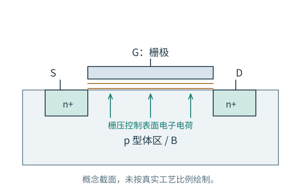
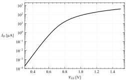

# 第 2 章：从电场、电荷走到一只 MOS 管

[系列首页](README.md) · [2.2 非理想效应](02-MOS器件/02-非理想效应.md) · [2.3 小信号与电容](02-MOS器件/03-小信号与电容.md)

把 MOS 看成一个开关，可以开始理解数字逻辑；把它看成“电压控制电流”的元件，可以开始分析放大器。但模拟设计还需要知道：这个电流是怎样形成的，哪些端口会干扰它，以及改变偏置以后，原来的解释还是否成立。

本章从器件结构出发，依次讨论电流关系、非理想效应和小信号电荷模型。gm/ID、ro 和工艺曲线在这条线上有各自的位置，不代替器件物理本身。

| 阅读段落 | 要解决的问题 |
|---|---|
| 本篇：结构与电流 | 为什么栅压能控制电流？线性区和饱和区从哪里来？ |
| [2.2 非理想效应与设计取舍](02-MOS器件/02-非理想效应.md) | 为什么阈值、输出斜率与跨导都不是固定常数？ |
| [2.3 小信号模型与电容](02-MOS器件/03-小信号与电容.md) | 怎样把电荷和电流关系变成可用于电路分析的模型？ |

## 四个端口，各自在控制什么

先考虑 p 型体区中的增强型 NMOS。两个 n+ 区提供源、漏接触，栅极与半导体之间隔着绝缘氧化层，体端 B 则决定衬底或阱的电势。

图 2-1：栅压改变表面电荷，漏源电压驱动载流子沿表面输运。图只说明物理关系，不是 GF180MCU 的制造截面或真实几何比例。

栅极不需要向沟道持续注入传导电流，就能通过电场改变沟道里的电子数量。漏源之间有电势差时，这些电子可以沿表面运动，形成电流。输入端控制电荷，电源维持输出端的电流与能量，后来放大器的工作就依赖这两种作用的分工。

源体与漏体之间还有 PN 结。对于普通 NMOS，体端通常置于较低电势，使这些结保持反偏。四端符号中的体端不是沟道的一段导线；改变源、体连接方式，会改变结偏置和阈值。独立体连接是否允许，取决于工艺的井隔离结构。

物理上近似对称的低压 MOS 在一定条件下可以交换源、漏角色，但这不意味着所有工艺器件都对称，也不意味着可以忽略体二极管或网表的端口次序。高压扩展漏结构等可能本来就不对称。电路分析先按明确定义的 D、G、S、B 建模。

## 栅压升高时，表面并非立刻“导通”

栅极相对 p 型体区施加正电压，先排斥表面的空穴，形成耗尽区；继续增加电压，表面电子浓度增加，形成反型层。强反型后，栅压的大部分新增作用表现为增加反型电荷。

这需要一定的电压来补偿平带电压、表面势变化与耗尽层电荷。对均匀掺杂、零源体偏置的长沟道近似，可写

$$
V_{TH0}=V_{FB}+2\phi_F+\gamma\sqrt{2\phi_F},
\qquad
\gamma=\frac{\sqrt{2q\varepsilon_{si}N_A}}{C_{ox}}.
$$

$C_{ox}=\varepsilon_{ox}/t_{ox}$ 是单位面积氧化层电容；$\phi_F$ 取 p 型体区费米势的正幅值，$V_{FB}$ 包括材料功函数与氧化层电荷的影响。这个式子用于理解阈值由哪些物理量决定，不用于代替真实工艺模型的阈值提取。

“达到阈值”也不是电流从零突然跳起。弱反型区已经有扩散电流；强反型只是电荷控制关系进入另一种有用的近似。先建立这点，后面才不会把阈值以下的模拟偏置误判为没有工作。

## 沿沟道看：漏端的电荷为什么更少

取源端电势为零，沟道位置 x 的电势为 V(x)。在强反型、渐变沟道近似下，反型层的单位面积电荷为

$$
Q_i(x)\simeq-C_{ox}\,[V_{GS}-V_{TH}-V(x)].
$$

沿源端走向电势更高的漏端，局部沟道相对于栅极的电压差减小，反型电荷的幅值也减小。这已经预告：漏源电压不仅驱动电流，还会改变沿途可用的电荷，所以电流不能一直与 VDS 成正比。

设迁移率近似常数，忽略扩散项，漂移电流可写成

$$
I_D=-WQ_i(x)\mu_n\frac{dV(x)}{dx}.
$$

把两边沿长度积分：

$$
I_DL=\mu_nWC_{ox}
\int_0^{V_{DS}}(V_{GS}-V_{TH}-V)\,dV.
$$

令 $V_{OV}=V_{GS}-V_{TH}$、$\beta=\mu_nC_{ox}W/L$，便得到

$$
I_D=\beta\left(V_{OV}V_{DS}-\frac{V_{DS}^2}{2}\right).
$$

这就是长沟道强反型的线性区表达式，要求大致满足 $0\le V_{DS}<V_{OV}$。当 VDS≪VOV，二次项可以略去，器件近似是一个受栅压控制的电阻：

$$
R_{\mathrm{on}}\simeq\frac1{\beta V_{OV}}.
$$

随着 VDS 增大，漏端电荷减少，增量电导下降。因此所谓“线性区”也只有在较小漏压范围内近似线性；它的另一个常见名称是三极管区。

## 夹断没有把电流截断

令漏端反型电荷趋近零，即 $V_{DS}\simeq V_{OV}$，可得到近似边界和饱和电流：

$$
I_{D,\mathrm{sat}}\simeq\frac12\beta V_{OV}^2.
$$

夹断发生在靠近漏端的一小段区域，电子仍会被高场区收集。长沟道理想模型的意思是：继续增加漏压，对源端所控制的反型电荷与电流影响较弱，新增压差主要落在漏端区域。它没有说载流子被堵住。

在这个理想模型中，饱和电流不随 VDS 变化，输出电阻为无穷大。真实器件不会如此，下一篇会解释输出斜率的来源。速度饱和还可能让电流在低于上述长沟道边界的条件下显著偏离平方律，因此“饱和”的具体物理机制需要看器件尺寸与电场条件。

这些关系足以开始做一个放大器的余量估算：NMOS 想在合适的饱和区工作，漏端必须比源端高出一定电压。但“满足工作区边界”和“满足增益、线性度指标”是两个不同要求。

## 弱反型：电流为何近似指数变化

在弱反型、其他偏置与温度固定时，电流可近似写成

$$
I_D\propto
\exp\left(\frac{V_{GS}-V_{TH}}{nU_T}\right)
\left[1-\exp\left(-\frac{V_{DS}}{U_T}\right)\right],
\qquad U_T=\frac{kT}{q}.
$$

n 是亚阈值因子。漏压达到数个 UT 以后，括号内的项接近一；栅压仍通过指数项控制电流。这里 VTH 的定义与比例常数有关，应把该式作为局部近似，不把不同阈值提取方法混为同一个开关点。

图 2-2：电流在强反型以前已经连续增长。曲线来自现有 GF180MCU 仿真：typical、27 °C、W/L=10/1 µm、VDS=1.65 V；完整条件与数据见 [实验资源](实验/README.md)。这张图检验“阈值不是电流开关”的判断，不用来定义一般器件的全部特性。

对指数关系求导，有 $g_m/I_D\simeq1/(nU_T)$；对强反型平方律求导，有 $g_m/I_D\simeq2/V_{OV}$。把强反型结果一直外推到 VOV→0，会得到不存在的无穷大跨导效率。模型必须在进入新区域时更换，而不是让一个公式承担所有偏置。

弱反型较高的跨导效率有助于降低达到指定 gm 所需的电流，但在小电流密度下取得足够跨导，往往需要更大尺寸。面积、电容、速度、失配和大信号充放电能力仍要分别考虑；低功耗不是单独把电流旋钮调小。

## PMOS：先改清方向，再复用机制

PMOS 的载流子与掺杂类型相反。通常用源端较高电势作为参考，定义 $V_{SG}=V_S-V_G$、$V_{SD}=V_S-V_D$，并把 $I_{SD}$ 的幅值取为从 S 到 D 的正值。强反型长沟道饱和近似为

$$
I_{SD}\simeq\frac12\mu_pC_{ox}\frac WL
(V_{SG}-|V_{THp}|)^2.
$$

机制仍是栅电场控制电荷、漏源场驱动输运；迁移率、阈值和体区连接不同。使用 PMOS 负载时，先判断栅压上升会让它多供还是少供电流，再给增益写符号，比机械地给 NMOS 公式加负号更可靠。

接下来进入 [非理想效应](02-MOS器件/02-非理想效应.md)。那些效应不会推翻上述物理过程，而是告诉我们：哪一个假设已经不能继续忽略，以及电路因此多出哪一条敏感路径。

本章知识主线对应 Razavi 第二版 Chapter 2。首版的全部工作点表、gm/ID 和长度扫描分析已保留在 [实验档案](实验/首版器件笔记.md)，供需要数值对照时使用。
