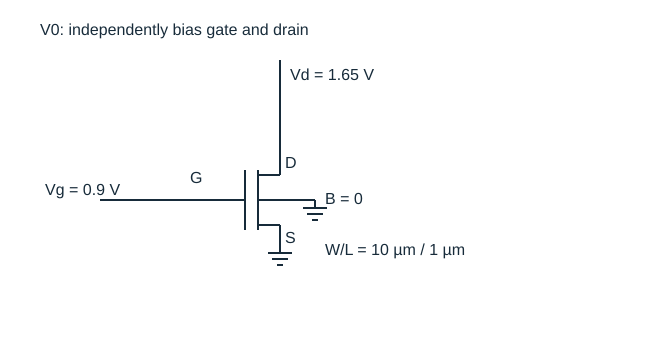
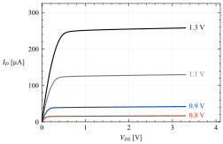
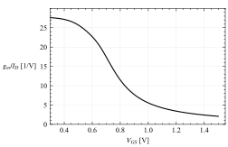
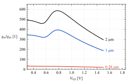

# 第 2 话：这只管子现在到底在做什么？

[系列首页](README.md) · [符号约定](约定.md) · [下一篇：共源级](03-共源级.md)

同一只 NMOS，栅压低一些时很省电，栅压高一些时电流增长更快。把它的沟道拉长，电流又小了。面对这些变化，只说“它进入了某某区”还不足以设计电路。我更想先知道三个数：此刻流过多少电流，栅压多动 1 mV 能多拉走多少电流，以及漏压自己动 1 mV 又会把电流扰动多少。

这三个问题分别对应 $I_D$、$g_m$、$g_{ds}$。后面遇到共源级、差分对、电流镜和补偿节点时，我们还会反复回来找它们。

## 从栅下的电荷开始

先考虑 p 型衬底上的增强型 NMOS。栅压升高，栅下表面先出现耗尽，随后电子浓度增加并形成反型层。栅氧化层把栅极与沟道隔开，栅压通过电场改变沟道电荷；漏源电压为载流子的输运提供横向电场。

在渐变沟道、强反型、迁移率近似不变的条件下，取源端为电势零点，沟道位置 $x$ 的反型层面电荷近似为

$$
Q_i(x)\simeq-C_{ox}[V_{GS}-V_{TH}-V(x)].
$$

$C_{ox}$ 是单位面积栅氧化层电容，单位 F/m²。沿沟道走向漏端，$V(x)$ 升高，栅极相对于局部沟道的有效电压减小，反型电荷随之减少。这个不均匀性正是电流不再与 VDS 简单成正比的原因。

把电荷乘以漂移速度，再对沟道积分，得到

$$
I_D\simeq\mu_n C_{ox}\frac WL
\left[(V_{GS}-V_{TH})V_{DS}-\frac{V_{DS}^2}{2}\right].
$$

它适用于长沟道、强反型、低到中等横向场下的线性区。令漏端局部电荷趋近零，得到近似边界 $V_{DS}=V_{OV}=V_{GS}-V_{TH}$，以及饱和电流

$$
I_D\simeq\frac12\mu_nC_{ox}\frac WL V_{OV}^2.
$$

夹断没有切断电流。载流子仍可经过漏端高场区被收集。上述公式表达的是：在这组近似下，进一步提高漏压主要改变漏端附近的高场区，电流对漏压的依赖变弱。

真实器件会出现沟道长度调制、迁移率退化、速度饱和、漏致势垒降低等效应。常见的 $(1+\lambda V_{DS})$ 修正只能粗略表示一部分输出斜率。不能期待一个固定 λ 在所有偏置和尺寸下都成立。GF180MCU 这里使用的是带尺寸分档的 BSIM4 模型；模型种类与实例参数见 [上游文档](https://gf180mcu-pdk.readthedocs.io/en/latest/analog/model_parameters/LV/LV_1.html)，更一般的紧凑模型背景可查 [Berkeley BSIM4](https://bsim.berkeley.edu/models/bsim4/)。

## 把偏置钉住，再谈这只管子的能力

图 2-1：栅、漏独立偏置，源与体接地。改变栅压时漏压不跟着跑，才能把栅控能力单独测出来。尺寸与结几何见 [约定](约定.md)，完整源文件见 [V0 网表](实验/v0-device.cir)。

这里使用 GF180MCU 的 3.3 V NMOS。虽然工艺名称含“180 nm”，本次模型的该器件最短沟道长度为 0.28 µm；不能据工艺名称写成 L=0.18 µm。我们选 L=1 µm 作为主线，再与 0.28 µm、2 µm 比较。[模型清单](../models/manifest.json) 固定了上游提交与文件哈希。

图 2-2：电流并未在某个栅压处突然从零跳出来。typical、27 °C、W/L=10/1 µm、VDS=1.65 V 的真实模型转移曲线；纵轴取对数。数据来自 [CSV](实验/data/transfer-L1.csv)，未经平滑处理。

弱反型下，载流子扩散贡献显著，电流随栅压近似指数变化：

$$
I_D\propto\exp\left(\frac{V_{GS}}{nU_T}\right),\qquad U_T=\frac{kT}{q}.
$$

这只在相应弱反型偏置、漏压足以抑制反向扩散等条件下成立，$n$ 是亚阈值因子。27 °C 时 $U_T$ 约 25.9 mV。阈值电压因此是一种描述器件和偏置的参数，不能当成精确的开关门槛。阈值以下的电流对于某些数字电路是漏电，对于弱反型模拟电路却可能就是工作电流。

## gm 是斜率，ro 也是斜率

在一个确定的直流工作点附近，把漏极电流作一阶展开：

$$
i_d\simeq g_m v_{gs}+g_{ds}v_{ds}+g_{mb}v_{bs}.
$$

这里三个系数都在同一个工作点求偏导。它们描述的是局部线性化。若输出摆幅大到跨越多个偏置区域，应该回到非线性电流关系，而不是继续套用这个工作点的系数。

本次 V0 主工作点 VGS=0.9 V、VDS=1.65 V 的结果为：

| 量 | GF180MCU 仿真值 | 可以怎样使用 |
|---|---:|---|
| ID | 40.64 µA | 功耗与电流预算的起点 |
| gm | 313.18 µS | 栅压增加 1 mV，局部漏流增加约 0.313 µA |
| gds | 0.84994 µS | 漏压增加 10 mV，局部漏流增加约 8.50 nA |
| ro | 1.177 MΩ | 漏端小信号输出电阻，不是 VDS/ID |
| gm/ID | 7.706 V⁻¹ | 每单位偏置电流获得的跨导 |
| gm/gds | 368.5 | 单管本征增益的幅值，实际负载会降低它 |

仿真器给出了 gm，仍值得独立检查。用 VGS=0.895 V 和 0.905 V 的电流作中心差分，得到 313.17 µS；用相邻漏压点检查 gds，得到 0.84994 µS。读出的参数确实与这张 I–V 曲线的斜率一致。这一步还能发现实例名读错、只保存了最后一个扫描点等脚本问题。

相比之下，此处的 VDS/ID 约为 40.6 kΩ，与 ro 相差近 29 倍。前者是从原点连到工作点的割线，后者是工作点的局部斜率倒数。把两者混用，会把本征增益估错一个数量级。

图 2-3：漏压足够高以后，曲线仍然存在斜率。四条曲线标注的是 VGS，W/L=10/1 µm、typical、27 °C。完整漏压范围为 0～3.3 V，右侧空白用于标注；见 [输出扫描网表](实验/v0-output.cir)。

实际设计中，VDS 是否“足够高”不宜只用 VGS−VTH 一刀切。BSIM 工作点提供了 `vdsat`；本次主工作点约为 0.221 V，可以作为该模型下的检查线索。它仍不能直接给出满足某个失真、增益或电流误差指标的最小余量，后者需要扫输出电压来确定。

## 跨导效率为何不会无限增加

平方律饱和电流求导后有

$$
g_m\simeq\mu_nC_{ox}\frac WL V_{OV}
=\frac{2I_D}{V_{OV}},\qquad
\frac{g_m}{I_D}\simeq\frac{2}{V_{OV}}.
$$

看起来只要让 VOV 趋近零，跨导效率就能任意高。但此时强反型平方律本身已失效。对弱反型指数式求导，则得到

$$
\frac{g_m}{I_D}\simeq\frac{1}{nU_T}.
$$

图 2-4：降低栅压时，gm/ID 逐渐接近弱反型平台。相同 V0 条件，所有点来自真实模型。低栅压下电流也迅速减小，不能只看这条曲线就宣布设计更好。

若目标 gm 已确定，提高 gm/ID 可以降低所需电流。例如 gm=0.3 mS，跨导效率为 10 V⁻¹ 时需要约 30 µA，为 20 V⁻¹ 时约需 15 µA。这个算式只是电流预算。为了在较低电流密度下仍取得目标 gm，往往需要更大器件，输入电容和面积可能随之上升。带宽、失配、寄生与压摆率仍要分别检查。

本次主工作点的模型 `vth` 约 0.6884 V，若直接用 2ID/(VGS−VTH)，会估出约 384 µS，而模型 gm 约 313 µS，前者高了约 23%。这不是重新拟合一个阈值就能解决的普适误差；平方律忽略的机制在这里已经影响定量结果。工程上可用真实工作点的 $2I_D/g_m\approx0.260$ V 表示“跨导等效过驱动”，但不能把它再称为物理阈值差。

## 加长沟道，换到了什么

图 2-5：在固定 W=10 µm、VDS=1.65 V、相同 VGS 扫描下，较长沟道的本征增益明显更高。三条曲线分别标注 L，typical、27 °C。它们没有保持相同电流。

在 VGS=0.9 V 处，把结果放到同一张表里：

| L | ID | gm | ro | gm/gds |
|---:|---:|---:|---:|---:|
| 0.28 µm | 233.36 µA | 1.232 mS | 22.74 kΩ | 28.0 |
| 1 µm | 40.64 µA | 313.18 µS | 1.177 MΩ | 368.5 |
| 2 µm | 21.45 µA | 158.36 µS | 3.481 MΩ | 551.3 |

这组比较支持“在这些固定电压和宽度条件下，长沟道提高本征增益”。它没有证明长沟道在同功耗、同带宽或同面积约束下更优，因为电流与跨导也变了。下一步如果需要公平比较，应先选择约束，例如固定 ID，再对各个长度重新求所需 VGS，必要时也调整宽度。把扫描条件写明，比多画一条曲线更能避免误读。

长沟道通常减弱漏端对沟道的控制，使 gds 更小；代价包括器件几何面积和电荷增加，以及在固定宽度、电压下的电流下降。实际极点由接到器件上的节点阻抗和总电容共同决定，因此“ro 更大”和“速度更快”没有必然联系。

## 源极一动，体端也参与进来了

体效应的长沟道近似为

$$
V_{TH}(V_{SB})\simeq V_{TH0}+
\gamma\left[\sqrt{2\phi_F+V_{SB}}-\sqrt{2\phi_F}\right].
$$

对于反偏的源体结，VSB 上升会增大耗尽区电荷，栅极需要更高电压才能形成相同程度的反型。上式中 $\gamma$ 的单位为 V¹ᐟ²，根号内是电压。求导后，在该模型下有

$$
g_{mb}\simeq g_m\frac{\gamma}{2\sqrt{2\phi_F+V_{SB}}}.
$$

注意本篇用 VSB 写阈值，用 VBS 写电流小信号式，因此 gmb 以正系数出现。把体固定在地、源极抬高，会同时减小 VGS、VBS；漏流通常比只考虑 gm 时下降得更多。

[体效应实验](实验/v0-body.cir) 特意把栅、漏电压源接在源端参考上，扫描源极相对体端的电压，同时保持 VGS=0.9 V、VDS=1.65 V。这样才能把体效应与 VGS 下降区分开来。[CSV](实验/data/body.csv) 保存了阈值、电流、gm 和 gmb；运行器检查阈值随反偏增加的方向。

## 把这一页带到下一只电路

如果现在给漏端接一个电阻，栅端的 1 mV 变化会引起约 0.313 µA 的电流变化。电阻可以把这个电流变化变成较大的电压变化，但漏端电压变化又会通过 gds 影响电流。放大器的增益就从这两个方向的作用中出现。

先自己估算：在理想交流接地的电源与漏端之间接 39 kΩ，增益会接近 −0.313 mS×39 kΩ，还是接近 −368？[下一篇](03-共源级.md) 从漏端 KCL 解答，并检查放大器有没有先把直流工作点推到错误的位置。

参考主线：Razavi, *Design of Analog CMOS Integrated Circuits*, 2nd ed., Chapter 2。本篇为独立推导与原始仿真实验，未复制教材文字或插图。工具与模型的精确版本见 [来源记录](../docs/SOURCES.md)。
