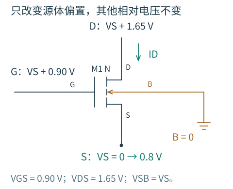
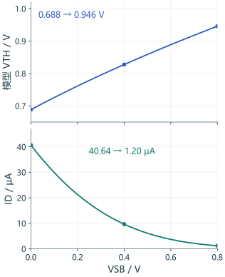
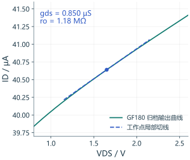

# 2.2 哪些端口在干扰理想电流源

[第 2 章](../02-MOS器件.md) · [下一篇：小信号与电容](03-小信号与电容.md)

理想饱和平方律把 ID 写成 VGS 的函数，容易让人形成一个方便的印象：栅端决定电流，其他端口只需满足工作区要求。真实器件却会让源体电压、漏压、纵向电场和横向电场都参与进来。设计中需要辨认它们分别改变了什么，不能把所有偏差统称为“沟道长度调制”。

## 源极上升，阈值为什么也跟着上升

先把两个容易混在一起的变化分开：源极升高时，如果栅极对地电压不动，VGS 自然降低；即使同时抬高栅极、让 VGS 保持不变，电流仍可能减小。第二个变化才是下面要单独观察的体效应。

图 2.2-1：沿用 V0 的真实测试连接。B 接地，VS 从 0 扫到 0.8 V；栅端和漏端随源端一起抬高，使 VGS=0.90 V、VDS=1.65 V 始终不变。图中标签是各端口对地电压，不是把 G、D 与 S 短接。原网表见 [v0-body.cir](../实验/v0-body.cir)。

先预测：已经把 VGS 的下降补回来了，漏流还会下降吗？对 NMOS，源体结反偏增大，形成反型所需平衡的耗尽区电荷随之改变。栅极需要更高的相对源端电压，才能维持同样的表面反型程度。

图 2.2-2：同一组 81 个归档偏置点，上图读 BSIM4 工作点输出的 VTH，下图读 ID；W/L=10/1 µm、typical、27 °C。模型与来源沿用 [V0 实验](../实验/README.md)，图中不叠加平方律拟合。

VSB 从 0 增至 0.8 V，模型 VTH 从约 0.688 V 升到 0.946 V，ID 从 40.64 µA 降到 1.20 µA。栅源电压虽然没变，形成反型的余量却在减少。末端 VGS 已低于这里报告的 VTH，电流仍未突然归零，这也连接了上一节的弱反型图像。模型报告的阈值是其工作点量，不是另外用恒流法提取的开关电压。

长沟道近似把这一趋势写成

$$
V_{TH}(V_{SB})=V_{TH0}
+\gamma\left(\sqrt{2\phi_F+V_{SB}}-\sqrt{2\phi_F}\right).
$$

式中 VSB=VS−VB，以反偏增大为正；γ 的单位为 V¹ᐟ²，根号内为电压。源极移动时，不能只在原来的 VGS 里减掉源电压，还要记得阈值本身在变。

若局部电流主要取决于 VGS−VTH，则

$$
\frac{g_{mb}}{g_m}\simeq
\frac{\partial V_{TH}}{\partial V_{SB}}
=\frac{\gamma}{2\sqrt{2\phi_F+V_{SB}}}.
$$

这里 gm 是对 VGS 的电流偏导，gmb 是对 VBS=VB−VS 的偏导。VBS 与 VSB 的符号相反，因此在标准电流小信号式中 gmb 作为正系数乘 vbs。固定栅、体后让源极升高，vgs 与 vbs 都减小，两项都会减小漏流。

体效应对不同电路有不同后果：共源级源端固定时，体效应没有受到输入激励；源跟随器的源端正是输出，体效应会降低跟随增益；共源共栅上管的体端若固定，gmb 则会参与局部恢复作用。

若工艺提供合适的独立井，B 跟随 S 可以消除相应的 vbs 激励。实现这种连接还要满足井隔离和体二极管的结偏置要求；普通共衬底 NMOS 的体端不能随意接到移动的源节点。

## 漏压升高，为什么饱和电流仍在变化

在长沟道图像里，漏压增加会扩展靠近漏端的高场区域，使有效受栅控制的沟道长度缩短。粗略地可用

$$
I_D\simeq I_{D0}(V_{GS})(1+\lambda V_{DS})
$$

表示输出斜率。固定 VGS 与体偏置求导，得到

$$
g_{ds}\simeq\lambda I_{D0},\qquad
r_o=\frac1{g_{ds}}\simeq\frac1{\lambda I_D}.
$$

最后一个近似还用了 λVDS 不大的条件。这给出一个有用直觉：在简单 λ 模型和其他条件相近时，更大的电流对应更大的输出电导，而有限 ro 会削弱放大器增益、电流镜复制精度与高阻节点的独立性。

图 2.2-3：复用归档 `output-Vg0.9.csv`，VGS=0.90 V、VSB=0、W/L=10/1 µm、typical、27 °C。这里只放大 0.8～2.6 V 的漏压窗口；[完整输出曲线](../图/device-output.svg)仍保留。蓝虚线使用 VDS=1.65 V 处保存的 gds 画局部切线，不是对整段扫描拟合 λ。

在这个点，ID≈40.64 µA、gds≈0.850 µS，因此 ro≈1.18 MΩ。VDS/ID 却只有约 40.6 kΩ：它连的是原点与工作点，不能替代这里的局部斜率倒数。若漏压只多动 10 mV，局部电流增量约为 8.50 nA；把这个小变化带入高阻输出节点，才会看出它对增益和电流镜误差的作用。

但同样的输出斜率也可能有其他来源。短沟道时，漏端电场可以降低源端注入势垒，表现为阈值随漏压降低，即 DIBL。用局部模型 $V_{TH}\simeq V_{TH0}-\eta_DV_{DS}$ 理解，在其他条件相同时，它会给 gds 增加约 $\eta_Dg_m$ 的贡献。这个项与简单沟道长度缩短的机制不同，不能指望一个固定 λ 对所有栅压、漏压和长度都有效。

因此，仿真中直接读取指定工作点的 gm、gds，通常比把整条输出曲线拟合为一个 λ 更适合局部电路分析。解释设计方向时仍需分辨输出斜率由什么主导。

可以用一个独立于 GF180 数据的解析反例区分机制：在弱反型、$V_{DS}\gg U_T$ 而漏端指数项可忽略的局部模型中，若 $nU_T=40\ \mathrm{mV}$、$\eta_D=0.02\ \mathrm{V/V}$，漏压增加 0.5 V 会让势垒对应的阈值降低 10 mV，电流约乘以 $e^{10/40}\approx1.28$。这是阈值进入指数关系的结果，不能仅按“电流乘上一个接近一的 λ 因子”判断。上面的真实输出曲线记录的是所有机制合成的斜率；现有扫描没有单独提取 DIBL，不能据它声称已经分离出 CLM 和 DIBL 各自的份额。

## 栅压加得更多，为何电流没有按平方增长

长沟道推导假设迁移率不随偏置变化。实际反型层被更强的纵向电场压向界面，表面散射等机制会降低有效迁移率。常见的教学近似为

$$
\mu_{\mathrm{eff}}\simeq\frac{\mu_0}{1+\theta V_{OV}}.
$$

如果把它代入平方律，gm 对 VGS 的增长会弱于常迁移率预测。θ 是用于该近似的参数，不应把它当作对所有工艺与反型程度都不变的材料常数。

横向场很强时，载流子速度也不能一直按 μE 线性增加。速度饱和主导时，电流可能更接近反型电荷乘以饱和速度的量级，因而对过驱动电压的依赖趋近一次关系，而非平方。迁移率退化与速度饱和涉及不同的电场方向，不宜混为一个原因。

这会影响一个常见设计选择：提高偏置电流或 VGS 以增加 gm，所得跨导收益可能低于平方律估计，还要付出功耗和电压余量。若增加宽度来降低电流密度，栅电荷与寄生也会增加。

## 小电压之外，还有电阻和漏电

源漏扩散、接触和互连的串联电阻会消耗电压，并形成局部退化。内部沟道感受到的 VGS、VDS 不再恰好等于外部端口电压。因此，把紧凑模型内部 gm、gds 拿出来组成最简单的外部模型时，可能留下小的定量差异。

源体、漏体结在正常工作时通常反偏，却有漏电与结电容。若结明显正偏，小信号的“栅体都不取电流”模型就不再适用。栅氧化层也不是所有条件下都无漏电；本系列低频入门分析先采用栅漏电可忽略的工作区。

温度则同时影响热电压、迁移率、阈值和漏电。固定栅压时，电流随温度的方向取决于这些机制的竞争，不能一概认为高温电流一定增大或一定减小。

## 用哪个模型回答哪个问题

| 模型层次 | 适合回答 | 不宜直接承担 |
|---|---|---|
| 长沟道强反型平方律 | 推导 gm 与电流、过驱动和尺寸的基本关系 | 弱反型、短沟道或强场下的精确数值 |
| 含体效应和简单 λ 的模型 | 看清源端和漏端新增的敏感路径 | 所有尺寸、偏置与温度的一致拟合 |
| 指定工作点的小信号模型 | 求局部增益、阻抗与线性频响 | 大摆幅、压摆过程和整个输入范围 |
| GF180MCU BSIM4 | 检查明确尺寸、偏置、工艺角下的器件和电路行为 | 在未计算的尺寸、偏置之外保证数值，或替代硅片与版图验证 |

例如，增加沟道长度可能减弱漏端控制、提高 ro，但在固定 W 与电压下也会改变电流、gm、面积和电荷。只有先规定同电流、同功耗、同面积或同速度中的哪些约束，才能讨论“更好”。首版 [长度扫描](../实验/首版器件笔记.md) 保留了固定宽度与电压的条件，不能被解释为同功耗设计优劣。

下一篇将把这些敏感路径组成 [小信号模型](03-小信号与电容.md)，再加入器件电容。那时的每个受控源和每条电流路径，都能回到这里的物理原因。
