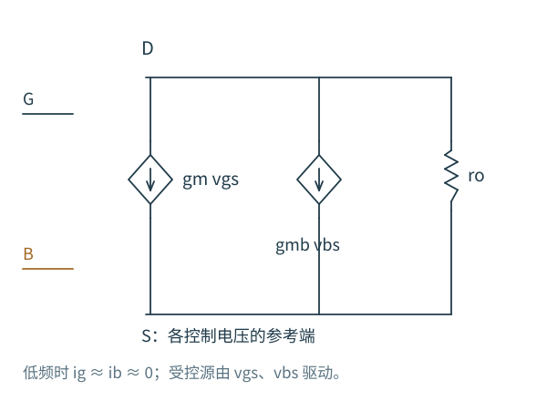
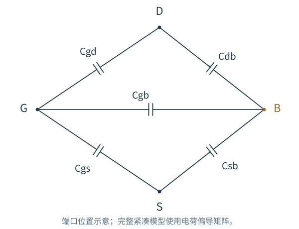

# 2.3 小信号模型：电流的斜率与电荷的去向

[第 2 章](../02-MOS器件.md) · [前一篇：非理想效应](02-非理想效应.md) · [下一章：单级放大器](../03-单级放大器/README.md)

只研究一个静态工作点时，电流由端口电压决定；信号变化起来以后，端口还要为变化的电荷供电流。因此，一个能够同时服务低频放大和频率响应的 MOS 模型，需要保留两类关系：电压怎样改变传导电流，电压怎样改变端口电荷。

## 把一条弯曲的特性，在工作点附近展开

把栅压抬高一点，会多出多少漏流？如果漏端也随之移动，这部分电流又该怎样计入？先把各端口的作用分开，就能把同一只 MOS 用于不同的放大电路。

以 NMOS 漏流从 D 到 S 为正，并固定温度。电流取决于三个端口相对电压：

$$
I_D=F(V_{GS},V_{DS},V_{BS}).
$$

围绕工作点作一阶展开：

$$
i_d\simeq
\left.\frac{\partial I_D}{\partial V_{GS}}\right|_Qv_{gs}
+\left.\frac{\partial I_D}{\partial V_{DS}}\right|_Qv_{ds}
+\left.\frac{\partial I_D}{\partial V_{BS}}\right|_Qv_{bs}.
$$

把三个系数分别记为 gm、gds、gmb，就有

$$
i_d=g_mv_{gs}+g_{ds}v_{ds}+g_{mb}v_{bs},
\qquad r_o=1/g_{ds}.
$$

图 2.3-1：受控源反映控制端口改变电流的能力，ro 反映漏端电压对电流的干扰。低频栅、体电流忽略时，它们只作为控制电压端口出现。所有系数属于同一个工作点。

gm 的单位是 A/V，也就是 S；ro 是 Ω。gmro 因而是无量纲量，表示单管在合适高阻负载下可以提供的本征电压增益幅值。VDS/ID 则是从原点到工作点的割线，不是输出特性在工作点的切线倒数；二者不能互换。

对强反型平方律求导，得到

$$
g_m=\beta V_{OV}=\frac{2I_D}{V_{OV}}
=\sqrt{2\beta I_D}.
$$

三种写法适合不同的设计约束：固定尺寸时看 gm 如何随电流变化；电流已知时用 gm/ID 看电流效率；已有余量预算时用 VOV 估算所需电流。它们共同依赖平方律前提，在真实工艺中应改用实际工作点或查表。

这个模型保留一阶变化，舍去高阶项。输出大幅摆动、器件跨越工作区或充放电限流时，要转向非线性瞬态分析。AC 分析中的幅值是线性结果的缩放，不会检验这些大信号过程。

## 栅极不导电，为什么前一级仍需要供电流

栅压变化会改变栅上的电荷，也会重新分配沟道和耗尽区电荷。即便没有穿过氧化层的传导电流，外部仍要提供位移电流。对一个简单电容，关系是 i=C·dv/dt；对 MOS，电荷同时依赖多个端口，电容也随工作点变化。

图 2.3-2：先用两端电容标出充放电路径。后文再从端口电荷偏导解释这种画法的边界：紧凑模型中的交叉电容不一定互易。

栅到源、漏、体的电容来自不同机制。沟道反型电荷需要在源漏端之间分配；栅与源漏扩散的重叠、边缘场还形成附加电容。漏体、源体 PN 结则形成反偏结电容，即使栅极不动，它们也会加载对应节点。

## 沟道电荷分布决定本征电容怎样分配

先采用长沟道、准静态、强反型近似，把重叠和边缘电容暂时分开。低 VDS 时，沟道电荷较均匀，栅端电荷变化大致由源漏两端分担；进入饱和后，漏端附近沟道夹断，漏端电压对受栅控制电荷的作用减弱，栅电容主要落在源端。

| 偏置与近似 | 常用本征电容图像 |
|---|---|
| 强反型、VDS 很小 | $C_{gs,\mathrm{int}}\approx C_{gd,\mathrm{int}}\approx\tfrac12WLC_{ox}$ |
| 长沟道强反型饱和 | $C_{gs,\mathrm{int}}\approx\tfrac23WLC_{ox}$，$C_{gd,\mathrm{int}}\approx0$ |
| 强反型、沟道有效屏蔽体区 | 本征 Cgb 较小 |
| 积累、耗尽与弱反型 | Cgb、Cgs、Cgd 随偏置与测量频率变化，不能统一套用上面的常数 |

表中的 2/3 系数来自非均匀沟道电荷，而不是几何面积只有三分之二。它适用于特定的长沟道准静态近似；短沟道、电荷分配和非准静态模型会改变定量关系。

推导一层：2/3 从哪里来？

在长沟道强反型饱和近似下，沿沟道的电流积分给出

$$
V_{OV}V(x)-\frac{V(x)^2}{2}
=\frac{V_{OV}^2}{2}\frac{x}{L}.
$$

整理得到 $V_{OV}-V(x)=V_{OV}\sqrt{1-x/L}$。若暂不考虑耗尽电荷对增量的影响，栅上平衡反型电荷的幅值为

$$
Q_{g,\mathrm{inv}}=WC_{ox}V_{OV}\int_0^L\sqrt{1-x/L}\,dx
=\frac23WLC_{ox}V_{OV}.
$$

在这个饱和、准静态近似中，漏端对本征栅电荷的影响忽略，源端和体端固定，因此对 VGS 求导得到约 2WLCox/3 的栅电容，并主要归到源端。这个积分也解释了：沟道电荷不是均匀铺满 WL，不能在饱和区继续把栅电容对半分给源、漏。

尤其要分清“本征 Cgd≈0”和“实际栅漏耦合≈0”。重叠电容仍然存在，常按宽度缩放，且还有边缘电场贡献。一个高增益共源级即使本征 Cgd 很小，也可能通过这些附加电容产生明显的输入输出耦合。

## 结电容与输出摆幅也有关系

反偏 PN 结的耗尽区随反偏电压增加而变宽，结电容通常减小。工程模型常分别考虑底面积与侧墙周长，例如

$$
C_{db}\simeq
\frac{C_{j0}A_D}{(1+V_{DB}/\Phi_j)^m}
+\frac{C_{jsw0}P_D}{(1+V_{DB}/\Phi_{sw})^{m_{sw}}}.
$$

这里 Cj0 是单位面积零偏电容，Cjsw0 是单位长度零偏侧墙电容；AD、PD 分别为面积和周长。该式只说明反偏工作区的主要依赖关系，不用于正偏或击穿区域。

所以扩大器件宽度，不只是增大 gm，也会增加扩散和栅电荷。增大输出摆幅，也不只是在同一个固定电容上移动电压，节点电容可能沿着信号周期变化。这会影响带宽、失真与瞬态充放电行为。

## 完整模型为什么用电荷，而不只用几只固定电容

令 Qk 为第 k 个端口的电荷。在一个工作点附近，电荷的增量关系可写成

$$
q_k=\sum_j
\left.\frac{\partial Q_k}{\partial V_j}\right|_Qv_j,
\qquad
i_{k,\mathrm{disp}}=\frac{dq_k}{dt}.
$$

电荷偏导带有符号，交叉项不必具有简单两端被动电容的对称性。正确的模型还要满足端口电荷守恒和参考电位不变性。把复杂模型粗化成 Cgs、Cgd 等两端电容时，是在为特定电路与频段选择一个方便近似，而不是证明所有动态效应都能由几只常数电容精确描述。

这也决定仿真数据的读法：模型输出的电容项可能采用自己的符号或端口约定，必须查清含义再组合，不能看到一个数就直接与外接 CL 相加。

## 两个马上会用到的速度直觉

第一，一个电容是否重载输入，要看它两端的**相对变化**。共源级输出反相变化，Cgd 两端压差可能比输入更大；源跟随器的源端跟随输入，Cgs 两端变化可能反而较小。具体等效需要从电流 $i=C\,d(v_1-v_2)/dt$ 推导，第 6 章会展开 Miller 与自举效应。

第二，gm/C 是一个速度量级，但必须说明 C 与测量定义。源、体为交流地、输出短路等条件下，忽略次要寄生和前馈项，晶体管短路电流增益降到一的频率常近似为

$$
f_T\simeq\frac{g_m}{2\pi(C_{gs}+C_{gd})}.
$$

它不是任意电路的 −3 dB 带宽，也不是输入信号源电阻与栅电容形成的 RC 极点；后者还取决于前一级的输出阻抗。更大的 gm、更多的面积与更大的电容常一起变化，不能只挑有利的一项。

至此，我们已经拥有分析单级电路所需的低频斜率和动态接口。带着“相对电压怎样变、电流流到哪里”的问题进入 [第 3 章](../03-单级放大器/README.md)，比单独背一张小信号图更容易迁移到新电路。

本节长沟道解析关系对应 Razavi 第二版 Chapter 2。进一步阅读：[Berkeley BSIM4](https://bsim.berkeley.edu/models/bsim4/) 的电荷模型与本项目的 [工艺模型及验证范围](../../models/README.md)。
