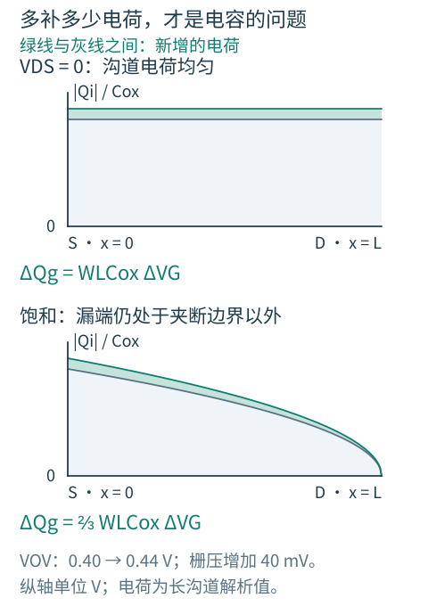
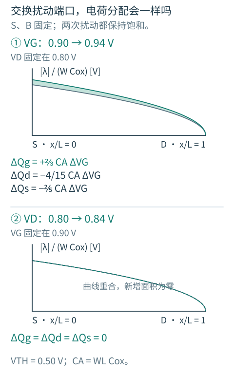

# 2.3 小信号模型：电流的斜率与电荷的去向

[第 2 章](../02-MOS器件.md) · [前一篇：非理想效应](02-非理想效应.md) · [下一章：单级放大器](../03-单级放大器/README.md)

只研究一个静态工作点时，电流由端口电压决定；信号变化起来以后，端口还要为变化的电荷供电流。因此，一个能够同时服务低频放大和频率响应的 MOS 模型，需要保留两类关系：电压怎样改变传导电流，电压怎样改变端口电荷。

## 把一条弯曲的特性，在工作点附近展开

把栅压抬高一点，会多出多少漏流？如果漏端也随之移动，这部分电流又该怎样计入？先把各端口的作用分开，就能把同一只 MOS 用于不同的放大电路。

以 NMOS 漏流从 D 到 S 为正，并固定温度。电流取决于三个端口相对电压：

$$
I_D=F(V_{GS},V_{DS},V_{BS}).
$$

围绕工作点作一阶展开：

$$
i_d\simeq
\left.\frac{\partial I_D}{\partial V_{GS}}\right|_Qv_{gs}
+\left.\frac{\partial I_D}{\partial V_{DS}}\right|_Qv_{ds}
+\left.\frac{\partial I_D}{\partial V_{BS}}\right|_Qv_{bs}.
$$

把三个系数分别记为 gm、gds、gmb，就有

$$
i_d=g_mv_{gs}+g_{ds}v_{ds}+g_{mb}v_{bs},
\qquad r_o=1/g_{ds}.
$$

图 2.3-1：受控源反映控制端口改变电流的能力，ro 反映漏端电压对电流的干扰。低频栅、体电流忽略时，它们只作为控制电压端口出现。所有系数属于同一个工作点。

gm 的单位是 A/V，也就是 S；ro 是 Ω。gmro 因而是无量纲量，表示单管在合适高阻负载下可以提供的本征电压增益幅值。VDS/ID 则是从原点到工作点的割线，不是输出特性在工作点的切线倒数；二者不能互换。

对强反型平方律求导，得到

$$
g_m=\beta V_{OV}=\frac{2I_D}{V_{OV}}
=\sqrt{2\beta I_D}.
$$

三种写法适合不同的设计约束：固定尺寸时看 gm 如何随电流变化；电流已知时用 gm/ID 看电流效率；已有余量预算时用 VOV 估算所需电流。它们共同依赖平方律前提，在真实工艺中应改用实际工作点或查表。

这个模型保留一阶变化，舍去高阶项。输出大幅摆动、器件跨越工作区或充放电限流时，要转向非线性瞬态分析。AC 分析中的幅值是线性结果的缩放，不会检验这些大信号过程。

## 栅极不导电，为什么前一级仍需要供电流

栅压变化会改变栅上的电荷，也会重新分配沟道和耗尽区电荷。即便没有穿过氧化层的传导电流，外部仍要提供位移电流。对一个简单电容，关系是 i=C·dv/dt；对 MOS，电荷同时依赖多个端口，电容也随工作点变化。

图 2.3-2：先用两端电容标出充放电路径。后文再从端口电荷偏导解释这种画法的边界：紧凑模型中的交叉电容不一定互易。

栅到源、漏、体的电容来自不同机制。沟道反型电荷需要在源漏端之间分配；栅与源漏扩散的重叠、边缘场还形成附加电容。漏体、源体 PN 结则形成反偏结电容，即使栅极不动，它们也会加载对应节点。

## 沟道电荷分布决定本征电容怎样分配

先采用长沟道、准静态、强反型近似，把重叠和边缘电容暂时分开。低 VDS 时，沟道电荷较均匀，栅端电荷变化大致由源漏两端分担；进入饱和后，漏端附近沟道夹断，漏端电压对本征栅电荷的作用减弱。用两端电容近似时，常把饱和区的本征栅电容画在源端一侧；稍后会看到，这幅栅端加载图并没有完整规定源、漏的瞬态电荷分配。

回到 2.1 的电荷分布，做一次相同的操作：源、体固定，栅压增加 40 mV。前一级需要补充多少栅电荷？先看新增的面积，而不是急着把电容分成 Cgs 和 Cgd。

图 2.3-2b：灰线是原来的电荷幅值，绿线是加栅压以后的电荷幅值，绿色条带表示两者之差。上图 VDS=0；下图漏压固定，且两次栅压下均保持饱和。长沟道模型取固定阈值，VOV 从 0.40 增至 0.44 V；图中省略耗尽、重叠与边缘电荷。

上图每一处都增加 $C_{ox}\Delta V_G$，沿长度累加便得到 $\Delta Q_g=WLC_{ox}\Delta V_G$。下图则按 $\sqrt{1-x/L}$ 加权，新增电荷只有前者的 2/3。**电容测量的是增加电压所需补充的电荷，不是栅下已有多少电荷。** 同一块栅面积，换一个工作区，增量电容就可能改变。

这一步得到的是源、体和漏电势固定时的总本征栅电荷斜率。它还没有逐项决定源、漏各承担多少位移电流；端口分配仍须结合偏置下的电荷模型。常用的结果是：

| 偏置与近似 | 常用本征电容图像（描述栅端响应） |
|---|---|
| 强反型、VDS 很小 | $C_{gs,\mathrm{int}}\approx C_{gd,\mathrm{int}}\approx\tfrac12WLC_{ox}$ |
| 长沟道强反型饱和 | $C_{gs,\mathrm{int}}\approx\tfrac23WLC_{ox}$，$C_{gd,\mathrm{int}}\approx0$ |
| 强反型、沟道有效屏蔽体区 | 本征 Cgb 较小 |
| 积累、耗尽与弱反型 | Cgb、Cgs、Cgd 随偏置与测量频率变化，不能统一套用上面的常数 |

表中的 2/3 系数来自非均匀沟道电荷，而不是几何面积只有三分之二。它适用于特定的长沟道准静态近似；短沟道、电荷分配和非准静态模型会改变定量关系。

推导一层：2/3 从哪里来？

在长沟道强反型饱和近似下，沿沟道的电流积分给出

$$
V_{OV}V(x)-\frac{V(x)^2}{2}
=\frac{V_{OV}^2}{2}\frac{x}{L}.
$$

整理得到 $V_{OV}-V(x)=V_{OV}\sqrt{1-x/L}$。若暂不考虑耗尽电荷对增量的影响，栅上平衡反型电荷的幅值为

$$
Q_{g,\mathrm{inv}}=WC_{ox}V_{OV}\int_0^L\sqrt{1-x/L}\,dx
=\frac23WLC_{ox}V_{OV}.
$$

在这个饱和、准静态近似中，漏端对本征栅电荷的影响忽略，源端和体端固定，因此对 VGS 求导得到约 2WLCox/3 的总本征栅电容。这个积分解释了总电荷斜率为何不再等于 WLCox；源、漏端各自的电荷电流还需要进一步分配。

尤其要分清“本征 Cgd≈0”和“实际栅漏耦合≈0”。重叠电容仍然存在，常按宽度缩放，且还有边缘电场贡献。一个高增益共源级即使本征 Cgd 很小，也可能通过这些附加电容产生明显的输入输出耦合。

## 结电容与输出摆幅也有关系

反偏 PN 结的耗尽区随反偏电压增加而变宽，结电容通常减小。工程模型常分别考虑底面积与侧墙周长，例如

$$
C_{db}\simeq
\frac{C_{j0}A_D}{(1+V_{DB}/\Phi_j)^m}
+\frac{C_{jsw0}P_D}{(1+V_{DB}/\Phi_{sw})^{m_{sw}}}.
$$

这里 Cj0 是单位面积零偏电容，Cjsw0 是单位长度零偏侧墙电容；AD、PD 分别为面积和周长。该式只说明反偏工作区的主要依赖关系，不用于正偏或击穿区域。

所以扩大器件宽度，不只是增大 gm，也会增加扩散和栅电荷。增大输出摆幅，也不只是在同一个固定电容上移动电压，节点电容可能沿着信号周期变化。这会影响带宽、失真与瞬态充放电行为。

## 完整模型为什么用电荷，而不只用几只固定电容

### 两端电容带来的一种直觉 {#two-terminal-charge}

先看一只实际的栅漏重叠电容，令它的端口电容值为 $C_p$，单位为 F。在把它近似成常数时，两块极板上的电荷为

$$
\begin{aligned}
Q_g&=C_p(V_g-V_d),\\
Q_d&=-Q_g.
\end{aligned}
$$

无论抬高哪一端，两块极板的电荷总是等量反号。而且 $\partial Q_g/\partial V_d=\partial Q_d/\partial V_g=-C_p$：交换激励与响应端口，交叉电荷斜率也相同。电荷守恒与互易在这里同时成立，很容易让人以为前者必然推出后者。

MOS 多了沟道与源、漏载流子交换。现在问：**四个端口的电荷总和为零，是否就要求“漏压改变栅电荷”与“栅压改变漏电荷”具有相同的斜率？**

### 守恒约束每一列，参考电位约束每一行 {#charge-constraints}

令 $Q_g,Q_d,Q_s,Q_b$ 为电荷模型分配给四个端口的带符号电荷，$V_g,V_d,V_s,V_b$ 是相对于同一参考点的绝对电位。在工作点附近定义电荷雅可比

$$
\begin{aligned}
J_{ij}&=\left.\frac{\partial Q_i}{\partial V_j}\right|_Q,\\
dq_i&=\sum_jJ_{ij}\,dv_j.
\end{aligned}
$$

下标的第一个位置是**观察电荷的端口**，第二个位置是**施加电压扰动的端口**；求偏导时其余端口电位固定。本文将流入器件的端口电荷电流取为正，因此

$$
i_{i,\mathrm{disp}}=\frac{dq_i}{dt}
=\sum_jJ_{ij}\frac{dv_j}{dt}.
$$

这里的电荷电流与前面的传导漏流 $g_mv_{gs}+g_{ds}v_{ds}+g_{mb}v_{bs}$ 分开计算，再在端口相加。

先只动漏压。如果栅端增加了一份电荷，其余端口合起来必须减少同样多的电荷。这就是

$$
\begin{gathered}
Q_g+Q_d+Q_s+Q_b=0,\\
\sum_iJ_{ij}=\frac{\partial}{\partial V_j}\sum_iQ_i=0.
\end{gathered}
$$

这对每个激励端口 $j$ 都成立。矩阵的一列描述同一次电压扰动在所有端口产生的电荷变化，所以**列和为零**。它没有要求其中某一项等于另一列中的某一项。

再把四个端口的电位同时抬高 $a$。所有端口间电压都没变，器件电荷也不应变化：

$$
\begin{gathered}
Q_i(\boldsymbol V+a\boldsymbol 1)=Q_i(\boldsymbol V),\\
\sum_jJ_{ij}=0.
\end{gathered}
$$

第二式由对共同变化量 $a$ 求导得到，对每个观察端口 $i$ 都成立。这给出**行和为零**。它约束的是共同平移参考电位的响应，也没有要求 $J_{ij}=J_{ji}$。如果已把源端设成零并删去对应行、列，剩下的约化矩阵就不必各行、各列都为零；不能把约化矩阵当成不守恒的证据。

还要分清符号：有的模型手册将 $J_{ij}$ 直接记作 $C_{ij}$；另一种常见约定是对角项 $C_{ii}=J_{ii}$、交叉项 $C_{ij}=-J_{ij}$。本节统一使用带符号的 $J$。前面的 $C_{gs},C_{gd}$ 两端图像，不应自动解释为两种方向完全相同的端口偏导。仿真器输出项也须先核对其具体定义。上述电荷导数及行、列约束见 [BSIM4v4.8.0 手册 §7.2.1](https://ngspice.sourceforge.io/external-documents/models/BSIM480_Manual.pdf#page=62)。

### 一个可以逐项求导的反例 {#nonreciprocal-example}

设 $C_0>0$，把栅源电压引起的负电荷按比例 $\eta$ 分给漏端，其余分给源端：

$$
\begin{aligned}
Q_g&=C_0(V_g-V_s),\\
Q_d&=-\eta C_0(V_g-V_s),\\
Q_s&=-(1-\eta)C_0(V_g-V_s),\\
Q_b&=0,\qquad 0<\eta<1.
\end{aligned}
$$

这是一个专门检验守恒约束的数学教学模型，不是某个工艺的 MOS 参数。它的电荷总和恒为零，也只依赖相对电压。按 $g,d,s,b$ 排列行、列，逐项求导得到

$$
J=C_0\begin{bmatrix}
1&0&-1&0\\
-\eta&0&\eta&0\\
\eta-1&0&1-\eta&0\\
0&0&0&0
\end{bmatrix}.
$$

每一列、每一行都加起来为零，但 $J_{gd}=0$，$J_{dg}=-\eta C_0\ne0$。只抬高漏压时，四份电荷都不变；只抬高栅压时，栅端电荷增加，源、漏端按所定比例分担相反的变化。**两次不同实验可以有不同的分配，每次实验仍然各自守恒。**

取 $\eta=0$，漏端退出分配，便退化为一只普通栅源电容：$Q_g=-Q_s=C_0(V_g-V_s)$，对应的矩阵恢复对称。非对称来自额外的端口分配关系，行、列和条件本身并没有排除它。这个反例也没有声称能用一个无源电容网络实现。

### 回到沟道：夹断隔离了哪一种扰动 {#ward-dutton-charge}

数学反例还不能说明 MOS 为什么如此。回到前面推导过的饱和沟道分布，令 $u=V_{GS}-V_{TH}>0$、$C_A=WLC_{ox}$。采用长沟道、强反型、准静态、恒定迁移率与阈值近似；忽略沟道长度调制、耗尽电荷的变化，以及重叠、边缘和结电容。这一简化模型只保留反型电荷贡献，取 $Q_b=0$，且扰动前后均在饱和区。

用 $\lambda(x)$ 表示沿沟道每单位长度的**负**反型电荷，与端口总电荷 $Q_d$ 区分：

$$
\begin{aligned}
\lambda(x)&=-WC_{ox}u\sqrt{1-x/L},\\
Q_{ch}&=\int_0^L\lambda(x)\,dx.
\end{aligned}
$$

栅压抬高，整条沟道的反型电荷幅值增加；漏压抬高而器件仍饱和时，这个忽略长度调制的模型保持同一条电荷分布。两次扰动改变的对象不同。夹断使漏压对栅下反型电荷的控制减弱，却没有阻止改变栅压时沟道电荷与端口电流发生变化。[Ward–Dutton 的原始论文](https://docenti.ing.unipi.it/~a008309/mat_stud/PSM/2023/Optional_Material/Articles/Dutton_Ward_JSSC_1978_charge_oriented_cap_model.pdf)在第 705 页、Fig. 4 附近专门比较了这两个方向。

要分别得到源、漏端的电荷电流，还须选择分配规则。这里采用 Ward–Dutton 线性电荷分配：靠近源端的沟道位置赋予较大的源端权重，靠近漏端的位置赋予较大的漏端权重：

$$
\begin{aligned}
Q_d&=\int_0^L\frac{x}{L}\lambda(x)\,dx,\\
Q_s&=\int_0^L\left(1-\frac{x}{L}\right)\lambda(x)\,dx,\\
Q_g&=-(Q_d+Q_s).
\end{aligned}
$$

两项权重在每个位置之和都是 1，因而逐点保证分配前后的电荷总量相同。这里的 $Q_d,Q_s$ 是计算端口瞬态电流的等效电荷，不是漏区、源区各自局部存储的全部电荷，也不是从哪一端注入电子的比例。线性分配式可对照 [BSIM4v4.8.0 §7.2.4，式 (7.22)](https://ngspice.sourceforge.io/external-documents/models/BSIM480_Manual.pdf#page=66)。

令 $z=x/L$。前面已经算过 $\int_0^1\sqrt{1-z}\,dz=2/3$；现在分别对同一条分布加权，得到

$$
\begin{aligned}
\frac{Q_d}{C_Au}&=-\int_0^1z\sqrt{1-z}\,dz=-\frac4{15},\\
\frac{Q_s}{C_Au}&=-\int_0^1(1-z)^{3/2}\,dz=-\frac25,\\
Q_g&=\frac23C_Au.
\end{aligned}
$$

这给出了本例饱和区的漏/源 40/60 电荷分配；不是在所有工作区都固定分成 40/60。若 $V_{DS}=0$，均匀的沟道分布配上线性权重，会恢复源、漏各承担一半的结果。

图 2.3-3 · 自绘长沟道电荷模型对照。绿色面积表示增加的反型电荷幅值；端口标注保留电荷正负号。源、体固定，所有扰动都保持饱和；图中不含重叠、耗尽和结电荷。

现在固定其余三个端口，分别求两个交叉偏导：

$$
\begin{aligned}
J_{gd}&=\frac{\partial Q_g}{\partial V_d}=0,\\
J_{dg}&=\frac{\partial Q_d}{\partial V_g}=-\frac4{15}C_A.
\end{aligned}
$$

一个为零，另一个非零。若采用交叉电容取负偏导的约定，对应 $C_{gd}=0$、$C_{dg}=4C_A/15$。它们在同一符号规则下仍不相等。

正向增加栅压时，栅端电荷电流为正，漏端和源端的电荷电流分别为负，三者之和为零。漏端的这部分变化须与 $g_mv_{gs}$ 传导电流相加；夹断不意味着漏端的增量电荷电流消失。原先的 $2C_A/3$ 栅电荷斜率也保留着，只是现在知道了另一端不能用一只互易 $C_{gs}$ 完整替代。

### 静电能量的互易性为什么不能直接套用 {#charge-and-energy}

对纯静电、无载流子输运的理想电容系统，若端口电荷是同一个平滑静电共能函数对各端电位的导数，电荷雅可比就是该函数的 Hessian，交叉偏导相等。这里的共能函数以端口电压为变量。这个额外的物理结构才保证互易；单靠电荷总和为零推不出来。

有偏置的 MOS 存在源漏输运。分配给源漏的等效端口电荷用来表示瞬态端口电流，不能直接当成一个孤立静电储能函数的共轭变量。因此，不能借静电网络的互易性强迫它们对称。

这也没有赋予无源网络凭空供能的能力。电荷守恒回答电流能否正确相加，能量平衡还要计入源漏偏置源、传导电流和耗散。只拿电荷矩阵，尤其是上面的数学反例，不能完成器件的功率核算。

### 把不同方向的响应放回小信号电路 {#charge-in-circuits}

在频率足够低、可以准静态线性化的工作点附近，端口方程写成

$$
\boldsymbol i=(G+sJ)\boldsymbol v.
$$

$G$ 保留跨导与输出电导，$J$ 保留电荷响应。要问漏端运动使前一级多提供多少电流，应看栅电流中的 $J_{gd}\,dv_d/dt$；要问栅端变化怎样进入漏端，则还须看漏电流中的 $J_{dg}\,dv_g/dt$ 和传导跨导。这是两个方向的响应，不能只凭一项电容值同时规定它们。

实际存在的栅漏重叠电容仍会贡献一组互易项：$J_{gg}$、$J_{dd}$ 各增加 $C_p$，$J_{gd}$、$J_{dg}$ 各减少 $C_p$。它与非互易的沟道电荷响应可以同时存在；加入它并不会自动让总矩阵变对称。

[6.2 的米勒与共源级](../06-频率响应/02-米勒与共源.md)先用一只互易二端 $C_f$ 解释电流路径；那里同一只电容两端的电流可以等量反号地写出。使用真实 BSIM 电荷模型时，应保留其完整端口电荷导数，或在明确的工作点、频段和终接下作近似，再验证端口响应。把不同方向的交叉项直接平均成一只常数电容，可能同时改变前馈、反馈和极点。

这些关系解释了原书电容图的用途和边界。它们不要求用长沟道分配替代实际模型：短沟道、耗尽电荷变化、DIBL、长度调制和非准静态效应都会改变定量偏导，工作区边界也需要平滑处理。

## 两个马上会用到的速度直觉

第一，一个电容是否重载输入，要看它两端的**相对变化**。共源级输出反相变化，Cgd 两端压差可能比输入更大；源跟随器的源端跟随输入，Cgs 两端变化可能反而较小。具体等效需要从电流 $i=C\,d(v_1-v_2)/dt$ 推导，第 6 章会展开 Miller 与自举效应。

第二，gm/C 是一个速度量级，但必须说明 C 与测量定义。源、体为交流地、输出短路等条件下，忽略次要寄生和前馈项，晶体管短路电流增益降到一的频率常近似为

$$
f_T\simeq\frac{g_m}{2\pi(C_{gs}+C_{gd})}.
$$

它不是任意电路的 −3 dB 带宽，也不是输入信号源电阻与栅电容形成的 RC 极点；后者还取决于前一级的输出阻抗。更大的 gm、更多的面积与更大的电容常一起变化，不能只挑有利的一项。

至此，我们已经拥有分析单级电路所需的低频斜率和动态接口。带着“相对电压怎样变、电流流到哪里”的问题进入 [第 3 章](../03-单级放大器/README.md)，比单独背一张小信号图更容易迁移到新电路。

本节原书对照：Razavi 第二版第 2 章，中文版印刷页 13 的 Fig. 2.10、式 (2.4)～(2.8)，以及印刷页 26～28 的 Fig. 2.31～2.34。端口矩阵约束与线性电荷分配进一步参考上述 BSIM4 手册和 Ward–Dutton 论文；最小反例、行列约束证明与加权积分由本文独立展开，不归作原书已有推导。[工艺模型及验证范围](../../models/README.md)另见实验资源。

[电荷模型核验脚本](../../scripts/check_charge_partition.py)用于复核本文的反例、全部端口偏导、沟道积分和电荷电流；在仓库根目录运行 `uv run --locked scripts/check_charge_partition.py`。
