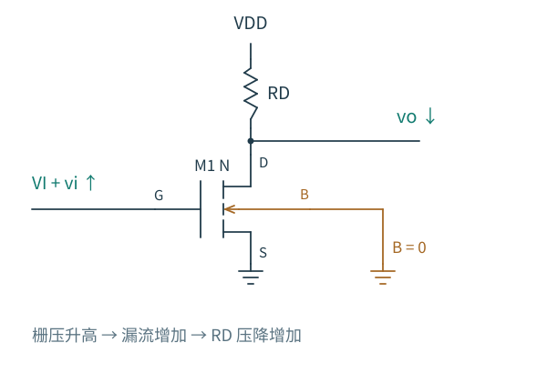
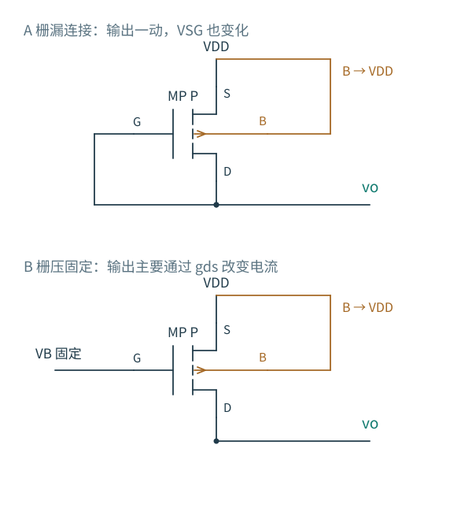
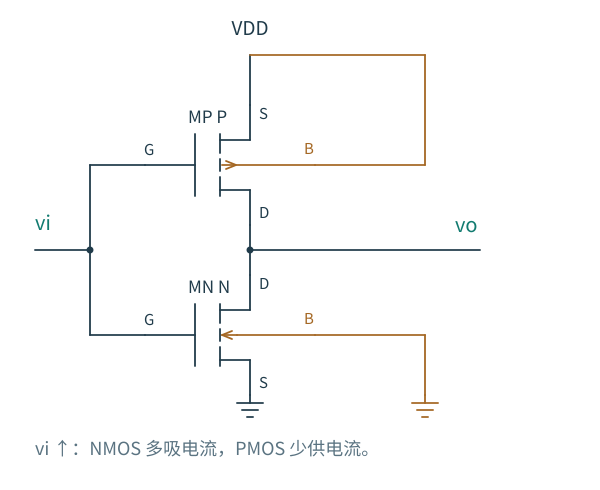

# 3.2 共源级：电流怎样换来电压增益

[本章导航](03-单级放大器/README.md) · [前一节：分析方法](03-单级放大器/01-分析方法.md) · [下一节：源跟随器](03-单级放大器/03-源跟随器.md)

栅极几乎不取低频电流，为什么一个很小的栅压变化还能在漏端产生明显的电压变化？器件只完成了其中一半：把栅源电压变化转成漏电流变化。另一半由漏端所连接的网络完成——它要改变输出电压，才能容纳这股新的电流。

所以，单独知道输入管 gm 还不足以知道电压增益。负载既决定如何建立直流电压，也决定漏端电流在小信号下能换成多大的电压。

图 3.2-1：输入加在 G，输出取自 D，S 为公共参考。输入升高使向下漏流增大，RD 必须从电源多送电流，输出因此降低。B 用独立的橙色支路接地，结箭头不表示漏源与体端的欧姆短接。

## 放大之前，漏端电压先在哪里

先取源、体接地，RD 接理想 VDD，输入直流为 VI。漏端满足

$$
\frac{V_{DD}-V_O}{R_D}=I_D(V_I,V_O).
$$

一边是电阻负载线，一边是器件输出特性，交点就是工作点。若 VI 很低，漏流很小，输出靠近 VDD；VI 升高以后，漏流增加，输出下降。再继续抬高输入，输出可能降到不足以让 NMOS 保持合适饱和余量的位置。

因此，RD 不能只按目标增益选择。增大 RD 会增加静态压降，也会移动工作点。对于长沟道强反型，常用 $V_O\gtrsim V_{OV}$ 检查饱和余量；真实模型中还应查看工作点和输出特性，不能把这条近似边界当作失真指标。

把输出静态放在电源一半附近，有时便于获得较均衡的上下余量，却不是所有拓扑的最优偏置。若输入管、负载管需要不同的余量，或负载电流不对称，可用摆幅也不会关于半电源对称。

沿着直流传输曲线，饱和区在哪里结束？

在长沟道平方律模型中，令 $\beta=\mu_nC_{ox}W/L$，忽略沟道长度调制。饱和与三极区的边界满足 $V_O=V_I-V_{TH}=V_{OV}$，把它代回负载线：

$$
V_{DD}-V_O=\frac12\beta R_DV_O^2.
$$

舍去负根，得到

$$
V_{O,\mathrm{boundary}}
=\frac{\sqrt{1+2\beta R_DV_{DD}}-1}{\beta R_D}.
$$

它回答的是：缓慢提高输入时，静态传输曲线何时离开该模型的饱和区。它没有回答交流摆幅允许多大失真；即使所有时刻都在饱和区，平方律本身也会产生非线性。

## 输入抬高 1 mV，漏端怎样重新平衡

在已经确定的工作点附近，理想电源是交流地，源和体也固定。先只考虑 gm 的作用，栅压增加 $v_i$，输入管会多吸收 $g_mv_i$ 的漏电流。输出降低，让 RD 从交流地向节点补入同样大小的电流，于是

$$
v_o\simeq-g_mv_iR_D.
$$

负号可以在列方程之前判断。接着加入 gds：漏端降低时，器件自身漏流也会略微减小，因此抵消一部分由栅端推动的电流变化。漏端 KCL 给出

$$
\frac{v_o}{R_D}+g_{ds}v_o+g_mv_i=0,
$$

$$
A_v=-\frac{g_m}{1/R_D+g_{ds}}
=-g_m(R_D\parallel r_o).
$$

图 3.2-2：RD 与 ro 都为输出电流提供恢复路径。S、B 固定，所以体跨导没有受到激励；这不等于器件没有体效应，而是此时 vbs=0。

这个式子也解释了本征增益为何不能直接当作实际增益。当 RD≪ro，输出主要由 RD 加载，增益接近 −gmRD；只有外部负载足够高阻，才可能接近 −gmro。

若暂时冻结器件工作点，增益对 RD 的相对敏感度是

$$
\frac{\partial\ln|A_v|}{\partial\ln R_D}
=\frac1{1+g_{ds}R_D}.
$$

增加一个本来已经很大的 RD，收益会逐渐变小。但真正调整电阻后，直流工作点还会移动，所以这个偏导只解释局部机制，不能代替重新求偏置。

## 负载换成 MOS，变化的不只是“电阻数值”

集成电路中，大电阻要占面积。MOS 可以承担负载，但先要问：输出端移动时，它的栅源电压会不会跟着动？这决定它表现为 1/gm 量级的低阻负载，还是 ro 量级的高阻负载。

图 3.2-3：两只 PMOS 的源、体都接 VDD。A 的栅漏相连，输出变化会直接改变 VSG；B 的栅压由偏置源固定，低频时 VSG 不变。图中只截取负载，下面的输入 NMOS 与图 3.2-1 相同。

### 二极管连接：用跨导产生恢复电流

对图 A 的 PMOS，输出升高使 VSG 减小，负载向输出提供的电流下降。这相当于输出节点多了一项 $g_{mp}v_o$ 的恢复电流，再加上它的 gds。于是二极管负载的增量电阻为

$$
r_{\mathrm{diode},p}=\frac1{g_{mp}+g_{dsp}},
$$

$$
A_v=-\frac{g_{mn}}{g_{dsn}+g_{mp}+g_{dsp}}
\simeq-\frac{g_{mn}}{g_{mp}}.
$$

后一个近似要求负载跨导主导输出总电导。两个强反型长沟道器件流过相同支路电流时，gm 与 $\sqrt{\mu C_{ox}(W/L)I_D}$ 成正比，因此增益可用尺寸比调节。但迁移率、偏置区间、失配和输出电导仍会影响这个比值；它不是对所有误差免疫。

二极管连接能自动用一个 VSG 建立直流压降，同时也把输出节点钳得较硬，因此电压增益通常不高。这两个特点来自同一个机制。

还有一种上拉方式：把 NMOS 的 D、G 一起接 VDD，从它的 S 端接到输出。它也是栅漏相连，但输出观察的是源端，若 B 接地，负载电导是 $g_{m2}+g_{mb2}+g_{ds2}$。不能照搬 PMOS 情况删掉 gmb。这也是为什么“二极管连接约为 1/gm”必须先说从哪一端观察、体端如何连接。

### 固定栅偏置：保留直流电流，减小增量加载

对图 B，PMOS 的 G、S、B 在小信号下都固定，输出只改变漏端。因此负载增量电阻主要为 rop：

$$
A_v\simeq-g_{mn}(r_{on}\parallel r_{op}).
$$

这里相较二极管负载，输出不再通过 gmp 受到强恢复作用，因此可以取得更高增益。代价是直流电流匹配更敏感：若上下管希望流过的电流略有差别，高阻节点会发生较大的电压移动，直到有限输出电导或工作区变化重新建立平衡。高交流阻抗不是稳定直流偏置的保证。

长沟道近似下，上下两管均保持饱和需要

$$
V_{OV,n}\lesssim V_O\lesssim V_{DD}-V_{OV,p}.
$$

这比用二极管负载消耗一个完整 VSG 的约束更有利于输出余量，但需要产生并维护合适的栅偏置。电流镜如何提供这种偏置，将在第 5 章讨论；当前先把镜像负载和固定偏置电流源负载区分开。

### 若让上下两管都接收输入

把 PMOS 的栅也接到输入，就得到在转换区偏置的互补反相器。输入升高时，下方 NMOS 多吸电流，上方 PMOS 少供电流，两种作用都推动输出下降，因此

$$
A_v\simeq-\frac{g_{mn}+g_{mp}}{g_{dsn}+g_{dsp}}.
$$

图 3.2-4：上下管共用输入和支路电流，但体端分别接各自电源轨。两个跨导共同推动输出，两个输出电导共同加载输出。

它能用同一支路电流同时取得两个跨导，不过两只管的 gm 不必相等，“跨导恰好翻倍”不是一般结论。输入电容增加，合适的直流输入范围与输出工作点也更依赖工艺和温度；因此它需要偏置或反馈来维持在模拟工作区。

## 源极电阻：少动一点 VGS，会怎样

若输出电流过于敏感地依赖输入管参数，可以在源端加入 RS。输入升高后，电流增加使源极升高，抵消一部分 VGS 增量。忽略体效应和输出电导，先写

$$
i_d=g_m(v_i-i_dR_S),
\qquad
G_m=\frac{i_d}{v_i}=\frac{g_m}{1+g_mR_S}.
$$

Gm 是输入管与 RS 这个组合的有效跨导。当 gmRS≫1，Gm 接近 1/RS，电流变化更由电阻决定；对 gm 的相对敏感度降为 1/(1+gmRS)。这能减轻一部分器件非线性，但不是消除所有失真。

保持 B 接地并恢复有限 ro，源端移动同时改变 VGS、VBS、VDS。利用 $v_s=i_dR_S$、$v_o=-i_dR_D$，得到

$$
A_v=-\frac{g_mR_D}
{1+(g_m+g_{mb})R_S+g_{ds}(R_D+R_S)}.
$$

这个公式适用于理想输入源、理想电阻、忽略低频栅体电流的模型。只有体端也跟随 S，体跨导激励才消失。若要进一步得到 $A_v\simeq-R_D/R_S$，还需 $g_mR_S\gg1$，并且 $g_{mb}R_S$ 与 $g_{ds}(R_D+R_S)$ 都远小于 $g_mR_S$。仅仅把 RS 增大，并不能自动消除体效应。RS 还消耗直流电压余量，并有自身热噪声，后续噪声章节需要把它一同计算。

### 一个可以迁移到共源共栅的阻抗结果

现在只保留 MOS 与 RS，从 D 端看入，输入 G 与 B 的增量置零，移开 RD。向 D 注入测试电流 ix，它也流过 RS，所以 $v_s=i_xR_S$。漏源关系给出

$$
i_x=-(g_m+g_{mb})v_s+\frac{v_x-v_s}{r_o}.
$$

因此

$$
R_{\mathrm{out},D}
=r_o+R_S+(g_m+g_{mb})r_oR_S.
$$

源极移动形成局部反馈，使漏端电流对漏端电压更不敏感，输出电阻反而提高。于是同一个 RS 同时减小有效输入跨导、提高看入漏端的电阻。若外部 RD 仍较小，总输出电阻还是会被 RD 限制，不能把两个效应各算一遍后重复放大增益。

[共源共栅](03-单级放大器/05-共源共栅.md) 会把这里的 RS 换成另一只 MOS 的 ro，正好复用这个分析。

## 让真实模型只回答一个有用的问题

现有 GF180MCU 实验取 3.3 V 供电、RD=39 kΩ。求得的工作点附近，gm≈0.313 mS，ro≈1.19 MΩ，而实际低频增益约 −11.83。它远低于单管本征增益，正好检验了“高 gmro 不保证接上负载后仍高增益”这个判断。

同一实验在保持栅极直流偏置不变时加入 1 kΩ 源极电阻，电流与 gm 也跟着下降。因此两版增益差异同时包含退化和工作点迁移，不能把全部变化归因于局部反馈。这是比小数点后的误差更值得带走的实验结论。

完整 OP、AC/DC 对照、频率响应和 CSV 保存在 [首版实验笔记](实验/首版共源级笔记.md) 与 [实验说明](实验/README.md)。频率响应会在第 6 章结合节点电容系统展开。

源极退化已经告诉我们：让源极随输出移动，器件会产生恢复作用。若干脆从源端取输出，就进入 [源跟随器](03-单级放大器/03-源跟随器.md)。
