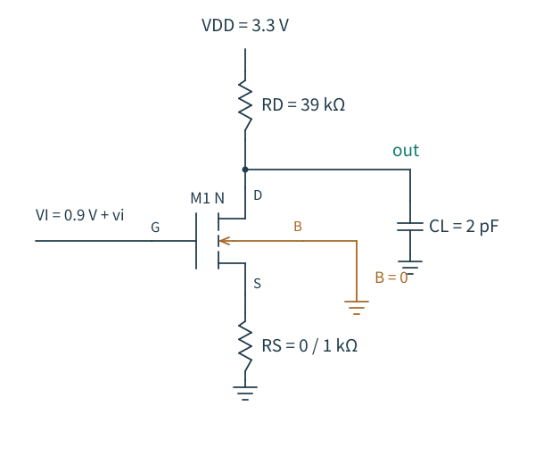
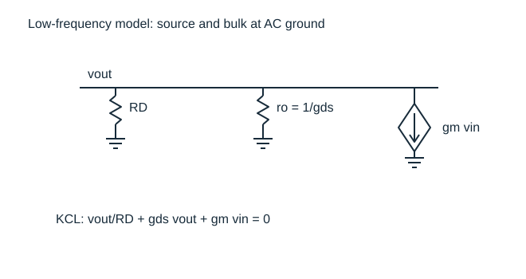
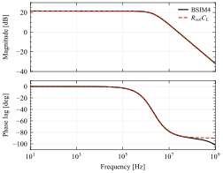

# 第 3 话：放大之前，先别让输出顶到电源

[上一篇：MOS 器件](02-MOS器件.md) · [系列首页](README.md) · [符号约定](约定.md)

本篇是第 3 章的共源级专题。源跟随器、共栅级与共源共栅结构尚未写入，不把这一篇当作整章已经覆盖。

上一只 NMOS 的 gm 约 0.313 mS，本征增益约 368。现在接上 39 kΩ 漏极电阻，真实仿真得到的低频增益只有约 −11.83 V/V。差距来自电路所提供的负载；在此之前，还需要确认这只管子能在电路中保持合适的工作点。

图 3-1：V1 取 RS=0，V1b 取 RS=1 kΩ。体端都接地。输入源的直流分量为 0.9 V，AC 幅值为 1，瞬态正弦幅值为 1 mV；这三种设置服务于不同分析，不可混为一个输入信号。所有数值见 [网表](实验/v1-common-source.cir)。

## 输出电压是解出来的

先取 RS=0，忽略理想电容的直流电流。漏端满足

$$
\frac{V_{DD}-V_D}{R_D}=I_D(V_G,V_D).
$$

左边是电阻负载线，右边是器件输出特性，两者的交点决定工作点。独立测试时强行指定的 VDS=1.65 V，在这里已经变成未知量。

本次求解得到 ID=40.693 µA、VD=1.71297 V。代回电阻压降：40.693 µA×39 kΩ≈1.58703 V，与 3.3−1.71297 V 一致。模型给出的 VDSAT≈0.22118 V，当前 VDS 明显高于它。至少在这个静态点，晶体管没有被推到低漏压区域。

若凭“增益与 RD 成正比”把 RD 增加到很大，负载线会下移并改变交点，输出电压可能被压到很低。此时 gm、gds 都会改变，原来的增益预测失效。设计高增益节点时，应同时做电流预算和余量预算。

输出上界也不是无条件等于 VDD。对于这里的理想电阻负载，管子趋近关断时输出可以接近 VDD；向下摆动则会逐渐损失饱和余量和线性度。以当前工作点估算，到 VDD 还有约 1.59 V，到模型 VDSAT 约有 1.49 V。它们只是静态余量估计，不是已经验证的对称线性输出摆幅；失真限制通常更严格。

## 增益来自漏端的电流平衡

图 3-2：理想 VDD 是交流地；源、体也接交流地。栅压改变引起向下的 gm·vin 电流，漏端通过 RD 与 ro 提供相反方向的电流增量。低频下先忽略器件和负载电容。

把漏端流出的电流相加：

$$
\frac{v_o}{R_D}+g_{ds}v_o+g_mv_i=0.
$$

于是

$$
A_{v0}=\frac{v_o}{v_i}
=-\frac{g_m}{1/R_D+g_{ds}}
=-g_m(R_D\parallel r_o).
$$

栅压增加会增加向下的漏流，因此输出需要降低，让 RD 从电源补进更多电流，负号就出现在这里。输入端主要控制沟道；输出信号的能量由直流电源提供。

该工作点 gm=313.439 µS、gds=0.842728 µS，得到 Rout≈37.76 kΩ、KCL 预测增益 −11.8351。真实 BSIM4 低频 AC 结果为 −11.8342；对直流输入作 ±0.1 mV 微扰，得到局部斜率 −11.8332。三条路径在 0.02% 内一致。解析式忽略了一些紧凑模型中的内部导纳，仍在本实验条件下给出了足够准确的局部预测。

若只忽略 gds，可得 −gmRD≈−12.224。误差约 3.3%，对应 gdsRD≈0.0329。写近似式前先看这个无量纲乘积，比笼统说“ro 很大”更具体。

## 368 倍的本征增益去了哪里

把增益幅值改写成

$$
|A_{v0}|=\frac{g_m}{g_{ds}}\frac{R_D}{R_D+r_o}.
$$

这里的负载电阻远小于 ro，电流扰动主要经 RD 转成电压，所以增益接近 gmRD。只有在负载阻抗远大于 ro、工作点仍合适时，单管电压增益的幅值才逼近 gmro。

假设暂时冻结 gm 和 gds，增益对 RD 的对数敏感度为

$$
\frac{\partial\ln|A_{v0}|}{\partial\ln R_D}
=\frac{1}{1+g_{ds}R_D}.
$$

RD 很小时，提高 RD 几乎按比例提高增益；RD 已远大于 ro 时，边际收益很小。这个偏导没有计入工作点迁移，所以只能解释局部机制。真正改电阻时必须重新求解上一节的直流方程。

有源负载将在后续电流镜章节提供更高的交流阻抗，同时用较小的直流压降支持偏置。但它也引入顺从电压、噪声、失配和极点，届时需要重新计算整个节点的电导。

## 加一只源极电阻，为什么增益会下降

现在把 RS 从 0 改成 1 kΩ，保持栅极直流偏置 0.9 V。源电压变为约 29.34 mV，VGS 随之减小，VSB 则增加；两种变化都压低漏流。新的 ID≈29.336 µA、VD≈2.15571 V、gm≈262.538 µS。这已经是一只重新偏置过的放大器。

先在新的工作点线性化。假设栅、体没有显著低频电流，源电流增量等于漏电流增量，有

$$
v_s=R_S i_d,\qquad v_o=-R_D i_d,
$$

$$
i_d=g_m(v_i-v_s)-g_{mb}v_s+g_{ds}(v_o-v_s).
$$

联立后得到

$$
A_{v0}\simeq-
\frac{g_mR_D}{1+(g_m+g_{mb})R_S+g_{ds}(R_D+R_S)}.
$$

gmb 不能在体接地时随意删除；源极动了，体源电压也在动。若体能随源端一起运动，才会消除这一项对应的体效应反馈。这样的连接是否可行还取决于工艺井结构。

在 $g_{ds}$ 很小、$g_{mb}$ 可忽略时，上式退化为熟悉的 $-g_mR_D/(1+g_mR_S)$；若再满足 gmRS≫1，增益近似 −RD/RS。这里 gmRS≈0.263，明显不满足最后一个条件，因此直接报 −39 倍是错误的。

| 测量 | V1：RS=0 | V1b：RS=1 kΩ |
|---|---:|---:|
| 栅极直流偏置 | 0.9 V | 0.9 V |
| ID | 40.693 µA | 29.336 µA |
| Vout | 1.71297 V | 2.15571 V |
| gm | 313.439 µS | 262.538 µS |
| gmb | 119.829 µS | 98.984 µS |
| KCL 预测增益 | −11.8351 | −7.3785 |
| 低频 AC 增益 | −11.8342 | −7.3708 |
| 直流局部斜率 | −11.8332 | −7.3702 |

带退化的解析预测与 AC 相差约 0.105%。完整 BSIM4 外部小信号行为还含内部寄生电阻、结导纳等，直接用内部器件 gm/gds/gmb 组成三参数模型是近似。运行器采用 0.3% 的一致性阈值，同时检查工作点；没有通过修改数据来让它们完全重合。

这组实验回答的是“保持栅偏置时加 RS 会怎样”。若要单独比较局部退化的作用，应调整直流输入，使两版 ID 相同，并检查 VDS、VSB 的差异。下一次拓扑对比必须先说清楚保持了什么；否则功耗下降、gm 下降与反馈作用会混在同一个“改进”里。

## 高阻节点为什么容易慢下来

先提前看一点频率响应。理想输入源把栅端小信号电压固定，因此当前电路没有输入源电阻带来的 Miller 极点；输出端的 2 pF 负载提供了主要的低频动态约束。

如果把所有 MOS 电容暂时略去，漏端 KCL 变为

$$
\left(\frac1{R_D}+g_{ds}+sC_L\right)v_o=-g_mv_i,
$$

$$
A_v(s)\simeq\frac{-g_mR_{out}}{1+sR_{out}C_L},\qquad
R_{out}=R_D\parallel r_o.
$$

这个单极点近似预测 $f_p\approx1/(2\pi R_{out}C_L)\approx2.108$ MHz，真实模型 AC 的 −3 dB 频率约为 2.097 MHz，相差约 0.55%。图中的偏差在高频相位上更容易看到，因为真实模型仍然保留了器件电荷和寄生。

图 3-3：2 pF 负载主导时，单极点近似与真实模型接近。黑实线为 BSIM4，红虚线为只保留 Rout·CL 的解析式。下图画的是 $\arg[-A_v(j\omega)]$，已去掉共源级的直流反相；它是附加动态相位，不是环路相位，也不能用来直接读相位裕度。数据见 [AC CSV](实验/data/cs-Rs0-ac.csv)。

在这个近似里，增大 Rout 同时提高低频增益并降低极点频率，而且

$$
|A_{v0}|f_p\simeq\frac{g_m}{2\pi C_L}.
$$

这是一阶模型下的增益带宽乘积关系。它不保证多极点放大器的单位增益带宽，更不能在输入源阻抗显著、Miller 效应明显或存在右半平面零点时直接套用。

提高电流可能提高 gm，但会消耗更多功耗、改变输出余量与 gds；如果为了维持跨导效率同时放大尺寸，电容也可能增加。没有固定住负载、尺寸和偏置条件，“电流翻倍，带宽就翻倍”缺少推导依据。

## 1 mV 正弦与 AC=1 是两回事

网表的 `ac 1` 用来归一化小信号传递函数。ngspice 先解直流工作点，再在线性化模型上计算频率响应；它并不对真实器件施加一个 1 V 的大信号正弦。因此 AC 增益可用于预测足够小的输入，但不能据此证明 1 V 输入时仍线性。

瞬态分析另外使用 1 mV、10 kHz 正弦，保留在 [瞬态 CSV](实验/data/cs-Rs0-tran.csv)。按低频增益预计输出基波约 11.83 mV，反相。后续研究失真时，应改变幅度，舍弃起始过程，再用基波和谐波的明确测量定义作比较。本次尚未给出 THD、最大线性摆幅或跨 PVT 的放大器规格，不把小信号一致性扩展成这些结论。

接下来的结构需要解决两个问题：如何让输入端不再受单个绝对栅压支配，以及如何用较少的直流压降获得更大的交流负载阻抗。它们分别引向差分对和电流镜。实施顺序见 [路线](../docs/PLAN.md)，目前尚未完成对应章节。

参考主线：Razavi 第二版 Chapter 3；本篇的频率预告对应 Chapter 6。控制命令与 AC 的工作方式参见 [ngspice 官方手册](https://ngspice.sourceforge.io/docs.html)。
