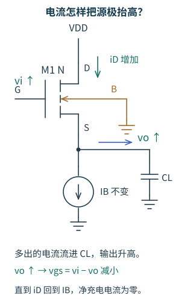
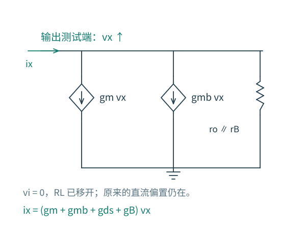
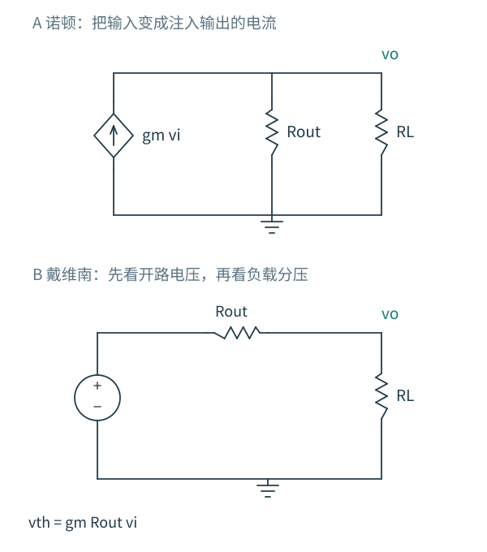

# 3.3 源跟随器：不到一的增益有什么用？

[第 3 章导航](README.md) · [前置：端口与小信号方法](01-分析方法.md) · [下一节：共栅级](04-共栅级.md)

前一级共源级的开路增益很高，接上负载后，输出却明显变小了。原因可能就在端口：前一级输出电阻为 100 kΩ，后一级的 10 kΩ 输入电阻会把它的开路输出压到十一分之一。

插入一个开路电压增益只有 0.8、输入几乎不取低频电流、输出电阻约 1 kΩ 的缓冲级，用同样的 10 kΩ 负载作端口模型估算：

| 连接方式 | 负载电压 / 前一级开路输出 |
|---|---|
| 直接接负载 | $10/(100+10)=1/11$ |
| 加缓冲级后接负载 | $0.8\times10/(1+10)=8/11$ |

缓冲级自身衰减了电压，却让负载上的信号比直接连接时大了八倍。源跟随器要解决的就是这个问题：**怎样把一个容易被负载拉动的电压，交给下一级？**

## 输出为何向输入追过去

先移开外部电阻负载，设偏置电流源理想，NMOS 在合适的饱和工作点。

把栅极电压稍微抬高。在源极还来不及变化的瞬间，VGS 增大，NMOS 从电源送到输出节点的电流增加。下面的偏置电流源暂时仍只取原来的电流；多出的电流给输出节点电容充电，源极电压随之升高。

源极升高又会减小 VGS，使刚才增加的电流回落。输出因此向输入的变化方向移动，而无需像共源级那样反相。这里已经出现一个局部纠偏过程：输出越接近输入，继续推动输出的栅源电压增量就越小。

图 3.3-1：漏端接 VDD，B 独立接地，源极同时连接偏置电流源与输出电容。青色箭头表示输入抬高后增加的漏电流，蓝色箭头标出流向 CL 的净充电电流。先移开外部电阻负载，暂忽略体效应与输出电导，研究饱和工作点附近的小扰动。

看图中的源节点：电容把净电流变成电压变化，而升高的源电压又减小 VGS。直到流入、流出重新相等，电压才停下来。后面的低频增益推导会把这个平衡写成方程。

但“追过去”不保证“追上”。若下面接一个电阻，输出升高还会增加负载电流，需要 NMOS 保持更大的 VGS 增量；若体端接地，源极升高也会提高阈值电压。两种情形都会留下跟随误差。

> **先看相对电压。** 栅极输入为 $v_i$，源极输出为 $v_o$，控制沟道的小信号是 $v_{gs}=v_i-v_o$，而不是 $v_i$。这一差别决定了源跟随器的增益和输出电阻。

## “减去一个 VGS”为何没有证明增益是一

直流恒等式确实是

$$
V_O=V_I-V_{GS}.
$$

如果 VGS 恰好不变，输出随输入等量移动。但等式本身没有承诺 VGS 不变。对输入求导，反而得到真正需要回答的问题：

$$
\frac{dV_O}{dV_I}=1-\frac{dV_{GS}}{dV_I}.
$$

电阻负载会让工作电流随 VO 改变，因而改变过驱动电压。即使换成理想偏置电流源、把 ID 固定，固定体端下的阈值也随 VSB 改变；为了维持相同 ID，VGS 仍要变化。因此，固定电流与固定 VGS 不是同一件事。

这种区分也解释了为什么直流电平移动和小信号增益必须分别讨论：源跟随器可以有一个接近 1 V 的栅源压降，同时传递一个几 mV 的输入变化。前者不是后者的误差百分比。

## 让电流平衡把“差一点”算出来

将漏端和体端置于交流地。把偏置电流源的有限输出电导记为 $g_B=1/r_B$；外部电阻负载的电导记为 $G_L=1/R_L$。低频分析暂时忽略电容、栅漏电流与体结电流。NMOS 的小信号漏流由漏流向源，流入输出节点：

$$
i_d=g_m(v_i-v_o)+g_{mb}(0-v_o)+g_{ds}(0-v_o).
$$

输出节点向负载和偏置支路流出的电流为 $(g_B+G_L)v_o$。令两者相等：

$$
g_mv_i=(g_m+g_{mb}+g_{ds}+g_B+G_L)v_o.
$$

于是

$$
A_v=\frac{v_o}{v_i}
=\frac{g_m}{g_m+g_{mb}+g_{ds}+g_B+G_L}.
$$

分子是栅端提供的推动能力；分母除了它自己，还包括体效应与各条输出电导。输出端需要额外电流的机制越多，给定输入变化下越难等量移动。

令外部负载开路，再把晶体管 ro 和偏置源 rB 都取无穷大，仍有

$$
A_{v,\mathrm{oc}}\simeq\frac{g_m}{g_m+g_{mb}}.
$$

这就是理想偏置电流源也不能消除的体效应损失。如果工艺允许把该管的体端与源极可靠地连接，使 $v_{bs}=0$，这一项才消失。对普通共衬底 NMOS，不能为了让公式好看，直接把整片衬底接到输出；独立体端需要合适的隔离井结构与合法的结偏置。

## 从输出端看：受控源变成了恢复电流

现在研究它为什么能带负载。先把外部 RL 移开，再将输入**小信号**置零。直流偏置依然存在，gm、gmb、gds 仍取原工作点的值。在输出加一个向上的测试电压 $v_x$。

源极被抬高，栅极不动，所以 $v_{gs}=-v_x$；体端不动，所以 $v_{bs}=-v_x$。NMOS 原本向输出提供的电流减小，从测试源的角度看，这等同于电路增加了一股把节点向下拉回去的增量电流。

图 3.3-2：求输出电阻时只把输入增量置零，受控源不能删除。外部测试源提供 ix；输出被抬高后，gm、gmb、gds 与偏置源的输出电导共同吸收增量电流。这里不把外接 RL 算入缓冲器自身的输出电阻。

因此

$$
i_x=(g_m+g_{mb}+g_{ds}+g_B)v_x,
$$

$$
R_{\mathrm{out}}=\frac{v_x}{i_x}
=\frac{1}{g_m+g_{mb}+g_{ds}+g_B}.
$$

当 gm 占主导时，这个电阻约为 1/gm。它远小于从一个栅、源、体都固定的漏端看进去的 ro。我们没有制造一只“电阻更小”的 MOS；改变观察端口后，测试信号能够通过 VGS 直接调动受控电流，端口性质就变了。

体效应在这里扮演了两个角色：它降低开路跟随增益，同时增加输出的恢复电导，使输出电阻减小。“输出电阻更小”因此也不能独自证明跟随更准确。

## 同一电路，换成更容易读懂的等效源

上面的源跟随器可在输出端写成一个诺顿源：向输出注入 $g_mv_i$ 的受控电流源，与 $R_{\mathrm{out}}$ 并联。把它转换为戴维南形式，则是

$$
v_{\mathrm{th}}=g_mR_{\mathrm{out}}v_i,
\qquad R_{\mathrm{th}}=R_{\mathrm{out}}.
$$

图 3.3-3：两种表示保留同一个输出端口的电压—电流关系。诺顿图适合数电流从哪里来、流到哪里去；戴维南图直接揭示接上 RL 后的分压。它们不保留晶体管内部的电流分布、直流功耗或温升。

接上 RL，就得到

$$
\frac{v_o}{v_i}
=g_mR_{\mathrm{out}}
\frac{R_L}{R_{\mathrm{out}}+R_L}.
$$

这个写法把跟随误差拆成两部分：开路时本来就存在的误差，以及负载分压新增的损失。它与前面的 KCL 结果完全相同。

取一组**解析例子**：gm=1 mS、gmb=0.2 mS、ro=rB=100 kΩ。缓冲器自身输出电阻约 820 Ω，开路增益约 0.820。接 10 kΩ 负载后增益约为 0.758；接 1 kΩ 后则只有约 0.450。源跟随器也会被足够重的负载拉垮，只是它比高阻增益节点更适合承担这项工作。

注意这些小信号系数属于一个指定的工作点。若把真实电阻直接接到直流输出，ID 也会变化，不能原封不动地沿用这组系数。公平比较增量负载时，需要维持相同工作点，或重新求偏置再计算。

## 电流源负载改善了什么，还留下什么

电阻既负责建立偏置，又是输出增量的泄放路径。把它换成高输出电阻的偏置电流源，可以减轻增量加载，使 ID 更不随输出变化。但它的有限 rB 仍在分母里，输入管的体效应仍然存在。

还要检查电压余量。对 NMOS 上管与 NMOS 下拉偏置管的源跟随器，长沟道强反型下大致需要

$$
V_O\gtrsim V_{OV,B},\qquad
V_O\lesssim V_{DD}-V_{OV,1}.
$$

输入端还要提供 $V_I=V_O+V_{GS,1}$，所以允许的输入共模范围可能先成为限制。这些是不进入明显线性区的粗略静态条件，不等同于规定失真下的可用摆幅。

驱动电容时，低输出电阻只描述工作点附近的微小扰动。对于理想下拉电流 IB、无额外电阻负载的情形，一旦大的向下阶跃让上管暂时关断，输出电容只能主要由 IB 放电：

$$
\frac{dV_O}{dt}\simeq-\frac{I_B}{C_L}.
$$

上升和下降的电流路径不同，压摆率就可能不对称。缓冲器不凭空提供驱动能量；它用直流电源和偏置电流换取较低的输出阻抗。

## 把方法带到下一个端口

现在把栅端固定，把信号改接到源端，并从漏端取输出。源极上升同样会降低 VGS 和 VBS，但这次我们观察的是漏端电阻压降，因此输出会同向上升——这就进入了共栅级。

在继续阅读前，试着回答：从源端看到的低输入电阻，在漏端负载趋于无穷大时还成立吗？[下一节](04-共栅级.md) 将用同一套测试源方法给出条件。

检验理解：三个改变，分别动了哪一项？

1. **提高偏置电流。** 在几何和工作区允许时，gm 往往增加，输出电阻可能下降；但 gmb、gds、工作点和功耗也改变，增益不能只按 gm 一个数预测。
2. **使体端跟随源端。** gmb 项对应的激励消失，开路跟随更接近一；输出的这部分恢复电导也随之消失。必须确认井结构和结偏置允许这种连接。
3. **增加一个并联负载。** 在相同工作点附近，GL 增加，带载增益下降。若是直接增加直流负载，先重新求偏置。

本节理论主线对应 Razavi 第二版 Chapter 3 的源跟随器。端口等效的教学组织参考见 [第二版编辑说明](../../docs/第二版编辑说明.md)；图与例子为独立设计。现有 GF180MCU 实验保留在 [实验资源](../实验/README.md)，不作为理解本节的前置条件。
