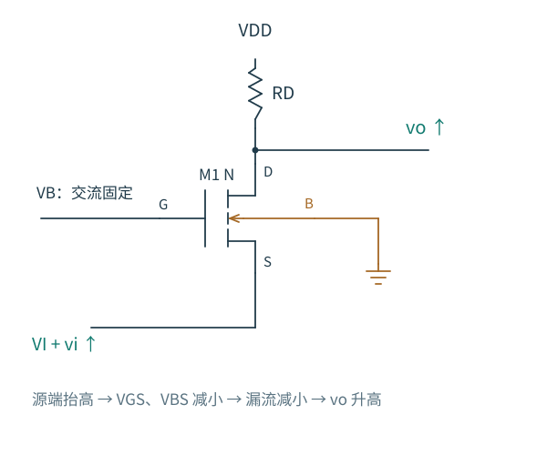
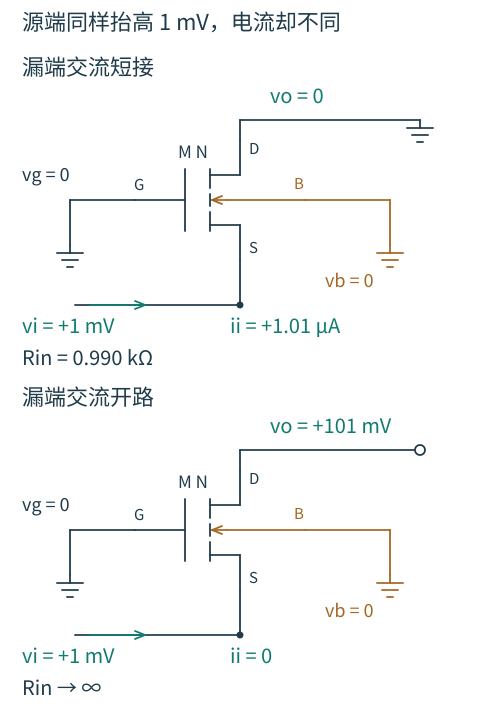

# 3.4 共栅级：低输入阻抗的用途与边界

[本章导航](README.md) · [前一节：源跟随器](03-源跟随器.md) · [下一节：共源共栅](05-共源共栅.md)

源跟随器用栅端接收电压、源端驱动负载。现在把栅端固定，让信号从源端进入，再从漏端观察输出。输入端不再绝缘：信号源必须实际向沟道提供或吸收电流。这改变了它适合连接的前一级。

图 3.4-1：栅极为交流固定的偏置，B 独立接地。图中的 VI 还须提供合适的直流源端电位。源端输入上升，VGS、VBS 下降，漏流减小，RD 压降减小，漏端输出同向上升。

## 为什么从源端看进去通常是低阻

先设漏端电压也固定。源端被信号源抬高 vi 时，NMOS 原有的 D→S 电流会减少。信号源为了维持这个更高的源电压，需要向器件提供增量电流；用输入电流 ii 流入 S 为正，有

$$
i_i=(g_m+g_{mb}+g_{ds})v_i.
$$

于是输入电阻约为 $1/(g_m+g_{mb})$，当 gm 占主导时接近 1/gm。这个结果与源跟随器求输出电阻时看到的恢复作用相同：从 S 施加信号会直接改变控制电压。

但真实共栅级的 D 并没有固定，RD 允许它随输入移动。我们需要检查这会怎样改变输入端。

## 漏端负载会“传回”源端

令 $g_t=g_m+g_{mb}$、$g_o=1/r_o$。在漏端列 KCL：

$$
\frac{v_o}{R_D}+g_o(v_o-v_i)-g_tv_i=0.
$$

所以电压增益为

$$
A_{v,S\to D}=
\frac{g_t+g_o}{1/R_D+g_o}.
$$

如果 RD≪ro，且 gt≫go，可近似为 $g_tR_D$。输入 vi 增大使 VGS、VBS 减小，输出上升，符号为正。

低频下没有栅、体电流，器件两端的增量电流必须守恒，因此输入端电流等于流过 RD 的增量电流：$i_i=v_o/R_D$。由此得到

$$
R_{\mathrm{in}}=\frac{v_i}{i_i}
=\frac{1+g_oR_D}{g_t+g_o}
=\frac{r_o+R_D}{1+g_tr_o}.
$$

现在条件看得更清楚了。只有当 RD 不足以使漏端移动过大，例如 RD≪ro 时，输入电阻才接近 1/gt。若 RD 与 ro 同量级，输入电阻可能接近 2/gt，而不是 1/gt。

更极端地，令 RD 趋于无穷大。漏端没有增量电流出口，它可以通过较大的电压变化抵消输入造成的电流变化，于是输入电流趋于零，Rin 反而趋于无穷大。这个极限只讨论已经建立偏置后的增量终接；实际电路不能靠一个没有直流供电路径的开路漏端自动建立原工作点。

图 3.4-2：固定 $g_t=1\ \mathrm{mS}$、$r_o=100\ \mathrm{k\Omega}$，同样从源端施加 +1 mV。两图都是保持直流偏置后的增量电路，G、B 交流接地；下图只把漏端的**交流终接**改为开路。绿色箭头定义输入电流的正方向，不代表下图仍有非零电流。

短接漏端时，它没有电压变化可以抵消 $g_tv_i$，输入源必须提供 1.01 µA。开路漏端时，漏压升到 101 mV，$g_o(v_o-v_i)=1.00\ \mathrm{\mu A}$ 恰好抵消 $-g_tv_i=-1.00\ \mathrm{\mu A}$，净电流变成零。这里起作用的不是栅端吸收了电流，而是**有限 ro 让漏压变化能反过来改变源端电流**。

如果给下图接回 10 kΩ 的交流负载，预测 Rin 会更接近哪一幅？代入原式得到约 1.09 kΩ：它接近短接的情况，因为 10 kΩ 仍明显小于 ro。

> **“源端低阻”是一种带终接条件的结论。** 源端测试信号能否产生电流，还要看漏端允许怎样移动。器件的不同端口通过有限 ro 相互联系。

## 电压源和电流源会怎样使用它

设输入电压源的内阻为 RS，原信号为 vsig，实际到达 MOS 源端的电压为 vi。先把输入分压写出来：

$$
\frac{v_i}{v_{\mathrm{sig}}}
=\frac{R_{\mathrm{in}}}{R_S+R_{\mathrm{in}}}.
$$

与前面的源端到漏端增益相乘，可得

$$
\frac{v_o}{v_{\mathrm{sig}}}
=\frac{(g_t+g_o)R_D}
{1+g_tR_S+g_o(R_D+R_S)}.
$$

例如作一个解析估算：gt=1 mS、ro=100 kΩ、RD=10 kΩ，则源端到漏端增益约 9.18，Rin 约 1.09 kΩ。若输入电压源内阻为 10 kΩ，真正到达源端的输入不到原信号十分之一，整体电压增益仅约 0.90。忽略输入源内阻会让判断完全不同。

因此，共栅通常不适合直接读取一个高内阻的微弱电压源；它容易加载前一级。对于近似电流源的输入，小输入阻抗却可能有益：可以用较小的输入节点电压变化接收电流，再让漏端高阻负载把电流转成电压。

这里需要区分电压增益与电流增益。在上述只有 RD 提供输出路径、栅体不取电流的低频模型里，流到 RD 的信号电流等于源端注入的信号电流，所以电流传递的幅值为一；电压增益则由输出与输入阻抗之比决定，完全可以大于一。不能因为它被称为电流缓冲器，就说它的电压增益接近一。

## 输出阻抗为什么也依赖输入终接

求输出电阻时，必须把原输入源的增量置零。若原输入是零内阻理想电压源，S 直接接交流地，从漏端看到的器件电阻就是 ro，再与 RD 并联。

若输入源内阻为 RS，置零以后 S 通过 RS 接地。它正好变成已经分析过的源极退化结构，因此

$$
R_{\mathrm{out}}=
\left[r_o+R_S+g_tr_oR_S\right]\parallel R_D.
$$

当 RS 很大，源端会随输出测试信号移动，形成局部反馈，提高从漏端看入的电阻。这个结论不与共栅输入低阻矛盾：两个阻抗问题把不同端口置零，也采用不同终接条件。

## 共栅放在另一只 MOS 上面，会发生什么

若下面接一只共源输入管，它希望把栅压扰动变成漏流；上面的共栅管从源端接收这股电流，并尽量减小下面漏端的电压变化。下面那只管子就不必承受完整的输出摆幅，其 gds 对支路电流的影响有机会减弱。

这个组合是 [共源共栅](05-共源共栅.md)。但上管的源端究竟有多“硬”，仍然受输出负载影响。下一节会同时检查阻抗提升和实际增益，不把“隔离”当作对所有负载都精确成立的假设。
