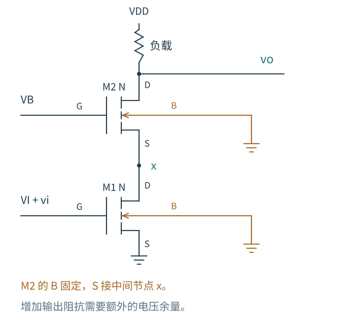
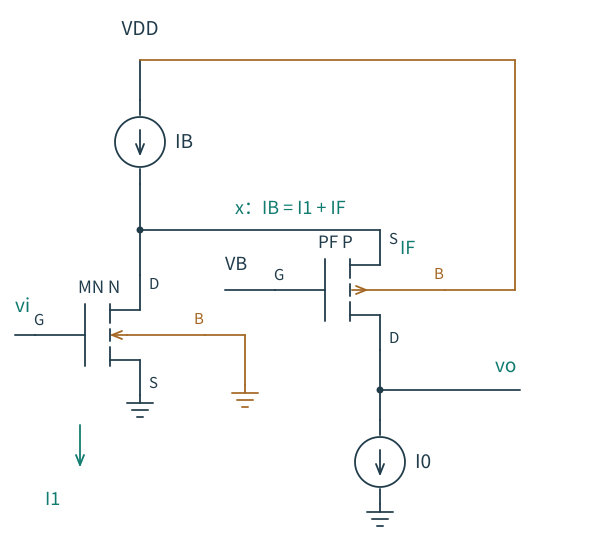

# 3.5 共源共栅：让漏端少干扰一只管子

[本章导航](README.md) · [前一节：共栅级](04-共栅级.md) · [系列首页](../README.md)

共源输入管希望用栅压控制电流，输出端却会通过 gds 反过来改变这股电流。若能让输入管的漏电压变化小一些，电流就更接近由输入决定。这是共源共栅结构值得尝试的理由。

图 3.5-1：M1 是共源输入管，M2 的 G 固定，源端接 M1 的漏端 x。两只 NMOS 的 B 都独立接地；M2 的体端没有与 x 短接。输出负载可以是电阻或高阻电流源，二者不能不加区分地使用同一个增益近似。

如果输入升高，M1 希望多吸电流。中间节点 x 稍微降低，M2 的 VGS、VBS 都增加，于是 M2 也增加向下流动的电流。这里 x 的小变化起到了传递电流需求的作用。至于 x 是否“几乎不动”，还要由 M2 的跨导、输出电阻和上方负载共同决定。

## 先关掉输入，研究输出电压能扰动多少电流

求这个两管组合本身的输出电阻，先移开外部负载，令输入增量和 M2 栅偏置增量均为零。在输出注入测试电流 ix。M1 的 G、S、B 都固定，因此小信号下只剩 ro1；同一股测试电流经过它，产生

$$
v_x=i_xr_{o1}.
$$

M2 的源端电压为 vx，栅和体为零，令 $g_{t2}=g_{m2}+g_{mb2}$，其漏电流为

$$
i_x=-g_{t2}v_x+\frac{v_o-v_x}{r_{o2}}.
$$

联立得到

$$
R_{\mathrm{cas}}=\frac{v_o}{i_x}
=r_{o1}+r_{o2}+g_{t2}r_{o1}r_{o2}.
$$

这正是 [源极退化](../03-共源级.md) 的输出阻抗公式，把 RS 换成 ro1。我们不必为每个新拓扑重新记一个结果，只要看清测试源问题已经化成什么已知结构。

输出抬高时，有限 ro2 会试图增加支路电流；电流增量使 x 升高，减小 M2 的 VGS、VBS，抵消刚才的电流增加。因此相同输出电压变化引起的电流变化更小，输出电阻提高。恢复作用由 $g_{t2}$ 与 ro1 的组合提供。

若 $g_{t2}r_{o1}$、$g_{t2}r_{o2}$ 都足够大，可取

$$
R_{\mathrm{cas}}\simeq g_{t2}r_{o1}r_{o2}.
$$

乘积项是比“两个电阻串联”多出来的部分：受控源参与了电流平衡，因而能用很小的电流变化承受较大的输出电压变化。

## 阻抗提高了，输入跨导会不会也成倍提高

不会。为得到端口有效跨导，把输出增量短接交流地，令输入为 vi。这里只短接小信号，直流工作点仍保持原值。用 $g_{o1}=1/r_{o1}$、$g_{o2}=1/r_{o2}$ 表示输出电导，在中间节点列 KCL：

$$
(g_{o1}+g_{o2}+g_{t2})v_x=-g_{m1}v_i.
$$

从输出端流入组合的短路电流为 $i_{\mathrm{sc}}=-(g_{t2}+g_{o2})v_x$，因此定义正的吸收电流跨导

$$
G_m=\frac{i_{\mathrm{sc}}}{v_i}
=g_{m1}\frac{g_{t2}+g_{o2}}
{g_{t2}+g_{o1}+g_{o2}}.
$$

它略小于 gm1。因为 x 会向下移动，M1 的 gds 路径减少一部分电流，输出端最后吸收的增量不完全等于 gm1vi。只有 gmt2 明显大于下管输出电导等项时，才可以近似 Gm≈gm1。

现在把组合表示为一个向下吸收 $G_mv_i$ 的诺顿源，与 Rcas 并联。接上外部小信号负载 RL：

$$
A_v=-G_m(R_{\mathrm{cas}}\parallel R_L).
$$

在本节采用的低频三参数 MOS 模型中，这个表达式同时包括有限输出电导对跨导和输出电阻的作用。比起先把两级的近似电压增益相乘，它更直接地显出负载限制。

## 一个反例：加了共源共栅，增益几乎没提高

作一个解析例子，设两只管均有 gm=1 mS、ro=100 kΩ，先忽略体效应。单管的 ro 为 100 kΩ；两管的 Rcas 约为 10.2 MΩ，提升很大。

但若外部 RL=10 kΩ，单管实际输出电阻约为 9.09 kΩ，共源共栅实际输出电阻约为 9.99 kΩ；有效 Gm 也略低于 gm1，增益只有有限改善。输出节点一直被小负载电阻主导，新增的高输出电阻无法充分表现出来。

若外部负载换成 ro=100 kΩ 的单管电流源，Rcas 仍会被这只负载的输出电阻限制。因此，想取得很高电压增益，往往需要上下两侧都提供高阻负载，而不只是把输入管一侧共源共栅化。

若外部负载趋于无穷大，在已有偏置的增量模型中可得

$$
A_{v,\mathrm{oc}}=-G_mR_{\mathrm{cas}}
=-g_{m1}r_{o1}(1+g_{t2}r_{o2}).
$$

这时才显出两个本征增益因子相乘的量级。不能把这条空载公式直接用于一个低阻电阻负载。

## 为什么中间节点既不能太高，也不能太低

M1、M2 都要维持足够的漏源余量。长沟道强反型的静态近似是

$$
V_X\gtrsim V_{OV,1},\qquad
V_O-V_X\gtrsim V_{OV,2}.
$$

相加得到输出下限大致至少为 $V_{OV,1}+V_{OV,2}$，实际还要留余量。如果把 VX 压得太低，M1 先失去饱和；如果把 VX 抬得太高，M2 留给输出向下摆动的空间变小。

VX 又与上管偏置相关：$V_X\approx V_B-V_{GS,2}$。M2 的源体反偏使它的阈值变化，ID 改变也会改变所需 VGS2，所以 VB 不是简单用两个标称阈值相加就能得到的常数。偏置电路需要在工艺与温度变化下维持可用余量。

这也说明共源共栅为何在较低供电电压下更难使用：希望每个器件都拥有足够的 gm 和 ro，却又要求多个器件共享有限的电压。增益、摆幅和偏置鲁棒性是同一张预算表里的约束。

## 输入与输出的隔离，怎样延伸到高频

M1 的栅漏电容连接输入与中间节点 x，而不是直接连接最终高摆幅输出。若 x 的增益幅值比原共源级漏端小，输入端因这只电容承担的 Miller 加载通常减轻。

不过，中间节点还有自己的寄生电容和有限阻抗，M2 也带来额外电荷。共源共栅不能无条件宣称“更快”；负载、电流、各节点阻抗和电容都需要比较。本章先建立低频结构，频率响应在第 6 章逐节点展开。

## 折叠：把电流接力放到另一条支路

上面的望远镜式堆叠让输入电流与上管电流流经同一支路。另一种安排是：用一个偏置支路在中间节点提供总电流，NMOS 输入管取走其中一部分，剩余电流由 PMOS 共栅管送向输出。

图 3.5-2：这是说明折叠原理的单端结构。上方偏置提供 IB，输入支路取 I1，余量 IF 经过 PMOS 共栅管到输出，因此 IB=I1+IF。输出另有下拉偏置支路。PMOS 的体端接 VDD，输入 NMOS 的体端接地。

当输入升高，I1 增加；若上方偏置支路电流近似固定，IF 减少，输出得到的电流变少，电压下降。信号仍完成从输入电压到输出电流的反相转换，但输入管不必与共栅管简单地同向串叠。

折叠给输入共模范围和器件极性安排提供了更多自由度，却增加偏置支路、功耗与噪声来源。在求输出电阻的测试中，折叠节点通常同时看到输入管的 ro 和偏置管的 ro。若这两个电阻并联为 RX，则看入共栅输出的一侧大致为

$$
R_{\mathrm{fold,branch}}
=r_{o,F}+R_X+(g_{mF}+g_{mbF})r_{o,F}R_X.
$$

输出端另一个偏置支路还会继续与它并联。所以“折叠更好”不是一般结论；它更适合哪种输入范围、输出摆幅、功耗与噪声约束，需要到完整差分放大器和运放设计中再判断。

## 从拓扑名称回到设计选择

本章已经能用同一套方法回答不同问题：共源用高阻节点换电压增益；源跟随器用局部恢复电流降低输出电阻；共栅让源端接收电流；共源共栅借用另一只器件的输出电阻形成更强的局部反馈。

面对一个陌生级，可以先确定输入、输出和交流固定端，再追踪一股小电流，最后检查负载是否允许预期的电压变化。这些工具将在 [第 4 章差分放大器](../04-差分放大器/README.md) 和后续电流镜中反复使用。后续章节的实际完成状态见 [知识覆盖](../../docs/知识覆盖.md)。
