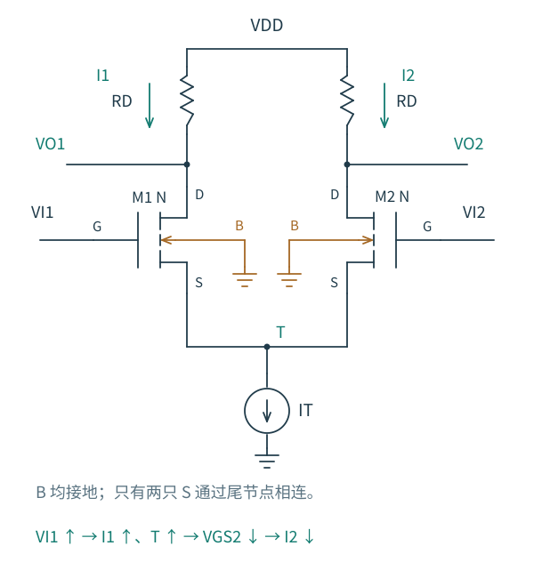
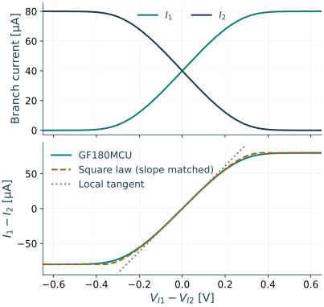

# 4.1 电流如何分配：一边增加，另一边为什么减少

[本章导航](README.md) · [下一篇：对称性与增益](02-对称性与差模增益.md)

先把两只匹配 NMOS 的源端接在一起，下面接一个向地吸收 $I_T$ 的理想电流源。两个漏端分别通过相同的 RD 接 VDD。输入栅极仍不取低频电流，电源通过两个漏端提供的电流则共同汇入尾端。

图 4.1-1：M1、M2 共享 T，体端 B 各自接地，B 与 T 没有短接。I1、I2 的正方向均向下；图下的 ↑、↓ 表示量的增减。这里先忽略栅、体的传导电流，因此 $I_1+I_2=I_T$。

## 两个输入相等，为什么各分一半

设两个输入都为 $V_{ICM}$，并且电流源与两只输入管都有足够的电压余量。两管的 VGS 相同、VDS 相同、体偏置相同，匹配的器件便给出相同电流；它们的和又必须为 IT。因此

$$
I_1=I_2=I_0=\frac{I_T}{2},\qquad
V_{O1}=V_{O2}=V_{DD}-\frac{I_T R_D}{2}.
$$

尾节点的位置不是由电流源指定的。它要移动到使每只输入管流过 I0 的位置：

$$
V_T=V_{ICM}-V_{GS}(I_0).
$$

这里的 $V_T$ 表示**尾节点电压**，阈值电压始终写 $V_{TH}$。体接地时，VGS 还依赖尾节点引起的体偏置，实际是一个需要自洽求解的关系。

如果输入共模太低，实际尾管没有电压维持 IT；如果输入共模太高，输入管可能失去饱和余量。左右相等本身并不能保证这个静态点存在。[4.4](04-余量与线性范围.md) 会沿器件堆叠逐项找边界。

## 只把左栅极稍微抬高

想象在尾节点尚未移动的一瞬间，M1 的 VGS 增大，漏流增加。M2 的栅压没变，它此刻还想取原来的电流。两支路总和便超过尾电流源愿意吸收的电流，多出来的电流使尾节点电容充电，T 升高。

T 升高同时减小两管的 VGS。M1 刚增加的电流被拉回一部分，M2 的电流则下降。直到两支路重新满足总电流约束，一边多取得的电流由另一边让出。在这次小变化中，M1 电流增加、左 RD 压降增加、VO1 下降；M2 电流减少、VO2 升高。

公共尾端通过源电压把两支路耦合起来，增加了一个电流分配约束。两只独立共源级的输出也可以相减，但这种读取方式没有给它们的电流总和增加相同的限制。

现在换成另一种实验：左栅升高一点、右栅降低同样多。在平衡点附近，两支路一开始增加和减少的电流已经相抵，尾节点就不必发生一阶移动。下一篇的半电路将利用这个性质。注意这里说的是一阶移动；幅度足够大时，T 仍会改变。

## 沿着整个输入差，能把电流转移到什么程度

为了把这个过程算清，暂用匹配、长沟道、强反型饱和的平方律模型，忽略沟道长度调制，并先取相同且固定的阈值。令

$$
\beta=\mu_nC_{ox}\frac WL,\qquad
I_k=\frac\beta2(V_{GSk}-V_{TH})^2.
$$

采用本章约定 $V_{I1}=V_{ICM}+V_{ID}/2$、$V_{I2}=V_{ICM}-V_{ID}/2$。把两个过驱动电压的平均值记为 $u$，则

$$
V_{GS1}-V_{TH}=u+\frac{V_{ID}}2,\qquad
V_{GS2}-V_{TH}=u-\frac{V_{ID}}2.
$$

把两条电流式相加，再使用尾电流约束：

$$
I_T=\beta\left(u^2+\frac{V_{ID}^2}{4}\right).
$$

定义零差分输入时每管的过驱动 $V_{OV0}=\sqrt{I_T/\beta}$，便有

$$
u=\sqrt{V_{OV0}^2-\frac{V_{ID}^2}{4}}.
$$

输入差增大时，平均过驱动反而减小，因为两管不能同时维持原来的过驱动，否则总电流会增加。对于常数阈值，T 的电压是 $V_{ICM}-V_{TH}-u$，因而随 $|V_{ID}|$ 增大而升高。刚才的一阶尾节点不动，与这里的大信号移动并不矛盾：u 在零点附近的变化从二次项才开始。

再把两条电流式相减，得到本节需要的转移关系：

$$
\Delta I=I_1-I_2
=\beta V_{ID}\sqrt{V_{OV0}^2-\frac{V_{ID}^2}{4}},
$$

$$
I_1=\frac{I_T+\Delta I}{2},\qquad
I_2=\frac{I_T-\Delta I}{2}.
$$

不能只检查根号是否非负。弱的一边还必须具有非负过驱动，即 $u\ge |V_{ID}|/2$。因此两管都导通的范围是

$$
|V_{ID}|\le \sqrt2 V_{OV0}
=\sqrt{\frac{2I_T}{\beta}}.
$$

正边界处，M2 在这个模型中刚好关断，M1 取得全部 IT；负边界则相反。超过边界应改用一管关断的分段模型：$\Delta I=\pm I_T$，不能继续延长根号公式。饱和余量仍要另外检查；负载过重时，某管可能在完成电流转向之前就进入三极区。

## 用很窄的一段曲线，解释线性从哪里来

在零点附近展开上式：

$$
\Delta I
=g_{m0}V_{ID}\left[1-\frac{V_{ID}^2}{8V_{OV0}^2}+\cdots\right],
\qquad g_{m0}=\beta V_{OV0}=\sqrt{\beta I_T}.
$$

一阶项给出差分电流的斜率 gm0，三次项使电流转向逐渐压缩。它解释了为什么小信号增益不能用于预测全部大信号行为。输出差为

$$
V_{OD}=-R_D\Delta I,
$$

所以曲线中央的差模增益为 $-g_{m0}R_D$；越靠近全转向区，局部斜率越小。输出电压没有可能沿同一条增益直线无限增长。

“两管都还导通”也不是线性的充分条件。若用相对于零点切线的**静态转移误差**不超过 ε 来定义线性范围，在小误差近似下需

$$
|V_{ID}|\lesssim\sqrt{8\varepsilon}\,V_{OV0}.
$$

例如解析模型取 ε=1%，得到约 0.28VOV0，远小于全部电流转向所需的 1.41VOV0。这不是 THD 指标；若输入正弦，还要由三次项怎样分解到基波与谐波来计算失真。

由三次项估算三次谐波

令 $V_{ID}=A\cos\omega t$，并令 $A\ll V_{OV0}$。使用 $\cos^3x=(3\cos x+\cos3x)/4$，三次谐波电流幅值约为 $g_{m0}A^3/(32V_{OV0}^2)$。忽略基波自身的三阶修正后，三次谐波与基波的幅值比约为 $A^2/(32V_{OV0}^2)$。这里的 A 是差分输入峰值，不能替换成单边峰值或 RMS 而不作换算。

## 真实器件怎样离开这幅图像

图 4.1-2：实线来自 Windows 原生 ngspice 的 GF180MCU 测试：输入管 W/L=10/1 µm、VDD=3.3 V、VCM=1.4 V、每侧 RD=20 kΩ，理想尾源 80 µA。上图是外部漏端支路电流；下图橙色虚线是解析平方律，并用零点附近的实测端口斜率对齐，灰点线是同一处切线。该对齐只便于比较形状，没有把平方律当成工艺模型。

先看上图：一边取得的电流越来越多，另一边越来越少，中央近似线性，远端趋于限幅。再看下图：即使让零点斜率一致，平方律仍不能精确描述整个转向过程。弱反型使关断成为连续过渡，有限输出电导让漏端电压也参与电流变化，完整模型还保留体端相关的电流。

因此，平方律中的全转向边界是理解机制的模型边界，真实 MOS 没有在某个输入差上突然变成绝对零漏流。实验已检查主要导通输入管的饱和余量，没有把三极区失效造成的变化混作这里的转向特性；完整条件、端口电流与 CSV 放在 [实验资源](../实验/差分对/README.md)。

如果固定总电流而增大输入管 W/L，VOV0 会减小，中央 gm 会增大，但在电压坐标上的线性范围会收窄。更大的跨导与更宽的线性输入范围并不会自动同时获得。后面加入源极退化时，我们会用局部反馈交换这两个指标。

接下来不再沿整条曲线移动，而是在平衡点附近研究一个微小信号。先弄清 [为什么可以使用半电路](02-对称性与差模增益.md)。
