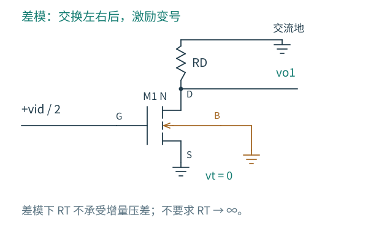

# 4.2 对称性与差模增益：尾节点为什么不动

[前一篇：电流分配](01-电流如何分配.md) · [本章导航](README.md) · [下一篇：共模与尾源](03-共模与尾源.md)

尾节点明明没有接到一个固定电压源，为什么差模分析常把它画成交流地？如果只记住这个画法，遇到单边输入、有限尾阻抗或器件失配，就很容易把不该接地的节点也接地。

先把分析范围缩到一个左右对称的静态点。输入管参数、负载和体偏置左右相同，所有器件都处在可线性化的工作区。我们讨论这个点附近的低频增量，不讨论一次大幅翻转。

## 交换左右，再把信号变号

施加纯差模输入 $v_{i1}=+v_{id}/2$、$v_{i2}=-v_{id}/2$。把左右支路互换，电路结构没变，输入却恰好变号。因此在具有唯一解的线性小信号网络中，所有对应的左右响应也互为相反数。

T 是两个支路共用的同一个节点，交换左右不可能把它换成另一个节点；按变号关系，它的电压又应等于自身的相反数。因此只有

$$
v_t=-v_t\quad\Longrightarrow\quad v_t=0.
$$

这不是由尾源阻抗无穷大推出来的。即使尾源具有有限小信号输出电阻 RT，只要它位于对称轴上、两边仍对称、激励仍为纯差模，这个端口的增量电压就是零。RT 上没有增量压差，因而不取差模增量电流。

反过来，大信号关系通常不是线性函数，不能使用“输入变号，全部响应也变号”这一步。上一节已经发现尾节点可随差分输入的平方移动。所谓虚地指的是特定模式下的**增量零点**，不是用导线把 T 接到了地。

图 4.2-1：RD 的上端为交流地，T 的增量由对称性固定为零；实际直流尾电压仍然存在。体端也固定，所以本模式下 vbs=0。左半成为第 3 章已经分析过的共源级。

## 从一边算起，二倍关系就不会丢

先保留输入管有限 ro，忽略低频栅、体传导电流。左漏端 KCL 为

$$
\frac{v_{o1}}{R_D}+\frac{v_{o1}}{r_o}
+g_m\frac{v_{id}}2=0.
$$

所以

$$
\frac{v_{o1}}{v_{id}}
=-\frac{g_m(R_D\parallel r_o)}2,
\qquad
\frac{v_{o2}}{v_{id}}
=+\frac{g_m(R_D\parallel r_o)}2.
$$

再按我们约定的输出差相减：

$$
A_{dd}\equiv\frac{v_{od}}{v_{id}}
=-g_m(R_D\parallel r_o).
$$

二倍关系来自两个步骤：每个输入栅端只承受总差分输入的一半；两个输出端又以相反方向运动。若只读左端，便得到差分输出增益的一半。若某份计算把每边都施加 vid、最后又用总差分输入 vid 作分母，就重复了一倍激励。

这个式子中的 gm、ro 都属于每支路 I0=IT/2 的工作点。若拿“单管流过全部 IT 时的 gm”代入，强反型平方律下还会多出一个 √2 的偏差。

同一总电流预算下，两支路各分一半电流，不能同时沿用原来单管流过 IT 时的 gm；若要让每管维持原共源级的电流，输入级总电流就要增加。还需要两路连线、输入电容与负载。差分读取的二倍关系是在固定每管参数下比较端口，不表示功耗和面积不变时免费得到二倍增益。

## 不切电路，也能检查结果

保留完整两支路，写出

$$
i_1=g_m(v_{id}/2-v_t)-g_{mb}v_t
+g_{ds}(v_{o1}-v_t),
$$

$$
i_2=g_m(-v_{id}/2-v_t)-g_{mb}v_t
+g_{ds}(v_{o2}-v_t).
$$

两式相减时，公共尾电压的项全部消去：

$$
i_1-i_2=g_mv_{id}+g_{ds}v_{od}.
$$

两只相等的负载给出 $v_{od}=-R_D(i_1-i_2)$，于是

$$
(1+g_{ds}R_D)v_{od}=-g_mR_Dv_{id}.
$$

它与半电路得到同一个结果。这次没有先宣布 T 接地，而是看到公共节点项怎样在相减时消失。对于陌生结构，这个检查很有用：先辨认哪些变化两边相同，哪些会相减留下，再决定能否拆分。

体跨导在这里消失，是因为两只管的体激励与源端变化具有共同的对称关系。它并没有从器件中消失；共模输入时，两只管的源端同向移动，gmb 会重新进入方程。

## 只驱动一个输入，仍然是纯差模吗

令 $v_{i1}=v$、$v_{i2}=0$。从定义直接得到

$$
v_{id}=v,\qquad v_{ic}=v/2.
$$

这个激励含有纯差模 $(+v/2,-v/2)$ 和纯共模 $(v/2,v/2)$。二者要分别求解后相加。假设对称电路的每边共模增益为 Acc，则

$$
v_{o1}=\frac{A_{dd}}2v+\frac{A_{cc}}2v,
\qquad
v_{o2}=-\frac{A_{dd}}2v+\frac{A_{cc}}2v.
$$

两个输出相减后，共模项抵消，仍有 $v_{od}=A_{dd}v$；但单边输出和尾节点一般不等于纯差模测试的结果。这个差别正是测量时要记录“驱动了哪两个端口、分别多大幅度”的原因。

在理想尾源、忽略体传导电流的简化模型中，Acc 可以为零，于是单端增益又恰好与纯差模的单端结果一致。这是一个附加条件带来的巧合，不能倒过来证明单边驱动就是纯差模。

## 对称性还会筛掉哪些失真

在完全对称、固定输入共模的电路中，交换两个输入只会交换两个输出。因此准静态差分输出满足 $F(-V_{ID})=-F(V_{ID})$，对称工作点附近的展开只含奇数次项。二次失真可出现在单端输出或输出共模，却在相减时消去；三次项仍然会留下。

这给了差分输出一个实际优点，但它没有证明单管线性，也没有证明电路只剩一种失真。负载、器件或输入幅度不对称，都会破坏抵消条件；动态电容和非对称终接也要重新分析。

可以用一个反例自查：若左边 RD 增加 1%，纯差模输入时两边漏端变化还会严格相反吗？有限 gds 会把不同的漏端变化传回电流，T 也可能获得一个小的一阶响应。此时应回到完整节点方程，而不是在一幅已经失去对称性的图上继续强制 vt=0。

下一篇把两个栅极一起升高，观察 [共模激励怎样通过尾源进入输出](03-共模与尾源.md)。
