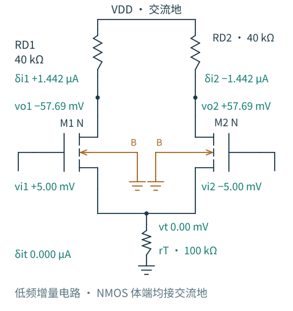
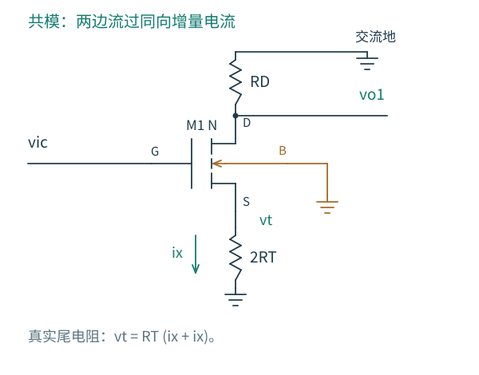
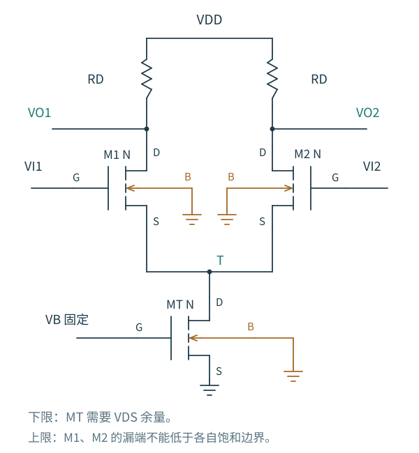
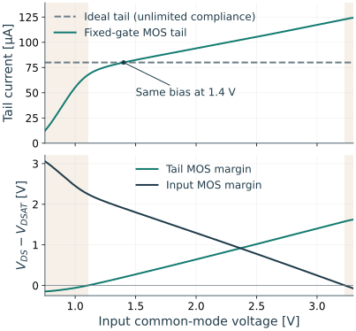

# 4.3 共模与尾源：一起移动的输入去了哪里

[前一篇：对称性与增益](02-对称性与差模增益.md) · [本章导航](README.md) · [下一篇：余量与线性范围](04-余量与线性范围.md)

把两个栅极一起抬高，暂时把 T 看成不动，两只输入管的电流都会增加。这次没有另一支路主动减少电流来抵消；总增量必须经过尾端，或者先给尾节点电容充电。尾源能否多吸收电流，就决定了后面的变化。

理想尾源不增加电流，于是 T 升高，逐渐抵消两个栅极的作用。在忽略体传导电流的对称模型中，每管仍流 IT/2，两个输出不变。体接地时，T 升高也使 VTH 升高，所以 T 不必与栅极升高相同的幅度。理想尾源保持电流，并没有强迫 VGS 为常数。

<!-- interactive: differential-modes -->

图 4.3-0：固定工作点的解析对照，gm=0.3 mS、gmb=0.1 mS、gds=1 µS，每侧负载 40 kΩ，尾端输出电阻 100 kΩ。图中差模输入为 +5/−5 mV，两支路一增一减，尾端总增量为零。RT 画在增量等效电路里，不负责建立直流尾电流。

比较时先盯住 T，再看两输出。差模中，匹配支路允许一增一减，T 不动；共模中，两只栅极同向移动，T 的移动才是减小 VGS 激励的主要途径。最后只改变右侧负载：有限尾阻抗允许共同电流变化，不等负载才有机会把它转换成输出差。切换到理想尾源，两支路增量都为零，这次转换也随之消失。下面分别把这三步算出来。

## 有限 RT 给共同电流开了一条路

实际尾管的栅、源固定时，漏端 T 升高会增加其电流。把这一工作点附近的尾端输出电阻记为 RT；它是局部斜率的倒数，不是把尾管的直流电压除以电流。

先忽略输入管 gds，保持体端为交流地。纯共模输入下，两边响应相同，每支路增量电流为

$$
i_x=g_m(v_{ic}-v_t)-g_{mb}v_t.
$$

尾端电阻要通过两倍支路电流，因此

$$
\frac{v_t}{R_T}=2i_x.
$$

联立得到

$$
\frac{v_t}{v_{ic}}
=\frac{2g_mR_T}{1+2(g_m+g_{mb})R_T},
$$

$$
A_{cc}\equiv\frac{v_{o1}}{v_{ic}}
=\frac{v_{o2}}{v_{ic}}
=-\frac{g_mR_D}{1+2(g_m+g_{mb})R_T}.
$$

RT 较小时，T 不容易抬高，两只管都能多取电流，输出明显下降。RT 增大以后，尾节点的上升消去大部分栅极激励，每边剩余的电流变化减小。当 $2(g_m+g_{mb})R_T\gg1$ 时，

$$
A_{cc}\simeq-\frac{g_m}{g_m+g_{mb}}\frac{R_D}{2R_T}.
$$

若再忽略体效应，便是熟悉的 $-R_D/(2R_T)$。这里的 2 来自两条支路共同通过一个尾阻抗，不是输出是否相减造成的。

图 4.3-1：共模时两边各有 ix，尾节点电压为 RT·2ix。只保留一侧时，必须用 2RT 才能让同样的 ix 产生同样的 vt；直接画 RT 会高估共模增益。

这也是第 3 章源极退化的一次复用：共模半电路是一只源极接 2RT 的共源级。加入有限 ro 后，可直接重用那个完整 KCL 结果：

$$
A_{cc}
=-\frac{g_mR_D}
{1+2(g_m+g_{mb})R_T+g_{ds}(R_D+2R_T)}.
$$

它适用于这里的匹配三参数低频模型。RT 趋于无穷大时 Acc 趋于零；但尾节点的共模变化仍然存在，其极限为 $g_m/(g_m+g_{mb}+g_{ds})$，而非必然等于一。

## 共模增益没有消失，输出差为什么还能为零

刚才算的是每边输出相对地的变化。由于 $v_{o1}=v_{o2}$，相减后当然有 $v_{od}=0$，即使 RT 有限也如此。

为了不混淆测量端口，完整写成

$$
\begin{bmatrix}v_{od}\\v_{oc}\end{bmatrix}
=
\begin{bmatrix}A_{dd}&A_{dc}\\A_{cd}&A_{cc}\end{bmatrix}
\begin{bmatrix}v_{id}\\v_{ic}\end{bmatrix}.
$$

第一个下标表示输出模式，第二个下标表示输入模式。对称线性电路的 $A_{dc}=A_{cd}=0$：共模不会变成差模，差模也不会产生一阶输出共模。有限 RT 会增大 Acc，却不必破坏这种模态分离。

因此共模抑制有两道不同的作用：高 RT 先减少两边输出共同移动的幅度，差分读取再消去剩余的相同部分。第二道作用依赖两路相同；第一道作用则还能帮助维持输出工作点和后级共模范围。不能因为理想相减为零，就容许两边输出移动到失去饱和余量的位置。

若只读左输出，以同一个输出端定义

$$
\mathrm{CMRR}_{1}=\left|
\frac{\partial v_{o1}/\partial v_{id}}
{\partial v_{o1}/\partial v_{ic}}\right|.
$$

忽略 gds、采用上一节的 $A_{d1}=-g_mR_D/2$，得到

$$
\mathrm{CMRR}_{1}
=\frac{1+2(g_m+g_{mb})R_T}{2}.
$$

若读差分输出，则应定义 $\mathrm{CMRR}_d=|A_{dd}/A_{dc}|$。完全对称模型的 Adc 为零，该比值形式上无穷大。这与单端的有限比值没有冲突。用差分输出的差模增益除以单边输出的共模增益，会把两个不同端口拼到一起；不先说明这种约定，就容易出现二倍误会。CMRR 的 dB 数值使用 $20\log_{10}$。

## 一点负载不对称，怎样把共模变成差模

先保持输入管匹配，并忽略 gds，让两只负载变为

$$
R_1=R_D+\frac{\Delta R}{2},\qquad
R_2=R_D-\frac{\Delta R}{2}.
$$

共模引起的支路增量电流仍相同，为 $i_x=g_mv_{ic}/[1+2(g_m+g_{mb})R_T]$。但相同电流通过不同电阻会产生不同压降：

$$
v_{od}=-R_1i_x+R_2i_x=-\Delta R\,i_x,
$$

$$
A_{dc}=-\frac{g_m\Delta R}{1+2(g_m+g_{mb})R_T},
\qquad
\mathrm{CMRR}_d\simeq
\frac{R_D}{|\Delta R|}[1+2(g_m+g_{mb})R_T].
$$

这个例子把两项设计工作分开了：提高尾阻抗，减少共同电流的变化；改善匹配，减少共同电流向不平衡电压的转换。若只有负载电阻不匹配而尾源理想，在这个简化模型里，共模增量仍不能产生支路电流，因此不会产生 Adc；它却已经造成一个静态输出差 $-I_0\Delta R$。静态偏移与共模转换也不能混为一谈。

真实输入管的 gm、gmb、ro 和阈值都可能不匹配，共模上升时，两管对源、体、漏电压变化的响应也可能不同。此时即使总电流理想固定，电流仍可在两支路间重新分配，不能再用“尾电流不变”证明 Adc 为零。

把器件失配换算成输入失调

在平方律、忽略 gds、失配很小的近似下，定义 $\Delta V_{TH}=V_{TH1}-V_{TH2}$、$\Delta\beta=\beta_1-\beta_2$，β 是平均值。围绕对称电流 I0 展开，两支路相减后公共源压的一阶项消去：

$$
\Delta I\simeq g_mV_{ID}-g_m\Delta V_{TH}
+I_0\frac{\Delta\beta}{\beta}.
$$

若把“让两支路电流重新相等所需的左减右输入差”定义为 VOS，就有

$$
V_{OS}\simeq\Delta V_{TH}-\frac{V_{OV0}}2\frac{\Delta\beta}{\beta}.
$$

M1 阈值更高时，必须给它更高的栅压，第一项的正号符合直觉。这个符号取决于我们明确规定的输入与失调定义。

若还存在 ΔR，并把失调定义成“使差分输出为零”，则需要

$$
V_{OS,\mathrm{out}}\simeq
V_{OS}-\frac{I_0\Delta R}{g_mR_D}.
$$

因为较大的左电阻已使左输出偏低，抵消它需要减小左支路电流。器件电流平衡与输出电压平衡是两个不同条件。这里只作确定性一阶分析；不由一个偏移样例推断统计 σ、版图匹配能力或量产良率。

## 把理想尾源换成一只真实 MOS

下面使用固定栅偏置的 NMOS 作为尾管，源、体接地。输入共模升高时，尾节点随之升高，尾管的 VDS 增大，有限输出电导使 IT 上升；这部分电流由两个输入管分担，两边输出一起下降。

图 4.3-2：尾管 MT 的栅固定，T 是其漏端；它的 ro 决定局部尾端阻抗。图中各 B 独立接地，没有把输入管体端接到 T。固定栅偏置由测试电压源提供，偏置产生方法留到第 5 章。

比较两种尾源前，先把它们在 VCM=1.4 V 处的尾电流都校准为 80 µA，使用相同输入管和 RD。这样初始 gm、输出和尾节点基本相同，不会把换尾源时发生的偏置变化误算成尾阻抗的作用。随后锁定尾管栅压，不沿共模扫描重新调电流。

图 4.3-3：上图为真实尾端电流，实线采用 GF180MCU 固定栅偏置尾管 W/L=10/0.28 µm，虚线采用理想尾源；其余条件同图 4.1-2。下图是实际 MOS 尾源电路的器件饱和余量代理量。浅色区域表示按 ngspice VDSAT 判断至少一类器件已无非负余量，不表示精确的失真边界。

上图中间已经有斜率，不必等尾管进入三极区，共模电流就会改变。左端首先是尾管缺少 VDS，右端则是输入管缺少 VDS。这两种失败发生在堆叠的不同位置。理想尾源没有顺从电压限制，它在左侧还能维持 80 µA，并不表示用单电源真实器件也能实现同样的工作点。

沿着这条直流曲线移动，输入管的电流、gm 和尾管的 RT 都会改变。标称点算出的局部增益描述的是曲线在该点附近的变化，不能把同一组小信号参数当作整个共模扫描的常数。

这个实验还检验了模态区分：完全匹配时，有限尾阻抗使两边输出产生共同变化，但差分输出的共模响应仍接近数值零。将负载改为 20.1 kΩ 与 19.9 kΩ 后，共同变化就不再完全抵消。

同一电路为什么会报告两个很不同的 CMRR

不等负载、真实尾源电路在标称工作点附近，实测左端差模增益约 −3.09，共模增益约 −0.263，按左端定义的 CMRR 约 21 dB。差分输出的差模增益约 −6.15，共模转换约 −0.00258，按差分端口定义则约 68 dB。两个数字都来自 1 Hz AC，描述的是不同的输出读取方式；不能只摘取较大的那个当作所有端口的性能。

完整工艺模型还有简化电路图省略的电流。即使使用理想尾源，漏端电流也不必严格等于源端电流；本实验通过体端回流核对了它们的差。结果出现了很小的单端共模响应，而对称的两边相减仍可抵消。三参数模型的零 Acc 与工艺模型的微小非零值应放在各自假设下理解，不能把差异当作仿真器出错，也不能把它全部归因于 gm 的体效应。端口定义、完整结果和复现命令见 [实验资源](../实验/差分对/README.md)。

最后考虑一个偏置选择：若直接用接地电阻代替尾源，要在该电阻上流过 IT，就必须付出 $I_T R_{\mathrm{tail}}$ 的直流压降。80 µA 流过 100 kΩ 已需要 8 V，3.3 V 供电无法做到。MOS 尾源的价值正在于，用较小的直流压降获得较大的局部输出电阻；它的代价是有限顺从范围，以及产生合适偏置的需要。
