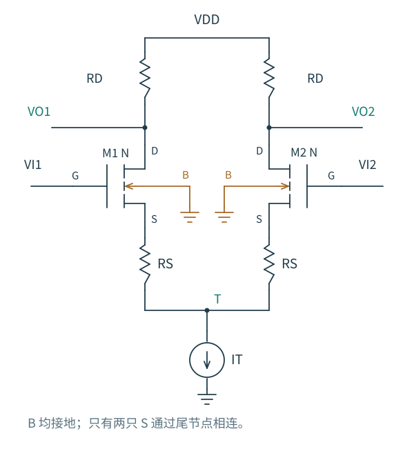
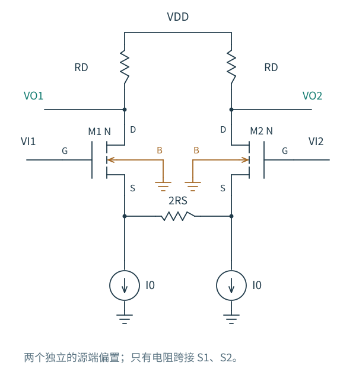

# 4.4 余量与线性范围：三个范围不能混着用

[前一篇：共模与尾源](03-共模与尾源.md) · [本章导航](README.md) · [下一篇：MOS 负载](05-MOS负载.md)

一个差分对可能有很大的零点增益，却无法接收传感器给出的输入共模；也可能偏置合适，却在差分信号稍大时严重压缩。前者关乎器件在供电轨之间站在哪里，后者关乎电流分配曲线弯得有多快。输出端还另外受可用电压余量约束。

先用平衡、无退化的 NMOS 输入对与 NMOS 尾管，把这些约束放回同一张 [实际尾管电路图](../图/diff-tail.svg)。采用长沟道强反型近似，供电为 0 到 VDD。

## 从地一路走到输入栅极

在零差分输入时，每支路 I0=IT/2，输出静态电压为 $V_{OQ}=V_{DD}-I_0R_D$。尾管要保持合适的饱和余量，需要

$$
V_T\gtrsim V_{OV,T}.
$$

输入管还需要一个 VGS 才能在该源电压上导通，因此

$$
V_{ICM}=V_T+V_{GS,n}(I_0,V_T),
$$

$$
V_{ICM,\min}\simeq
V_{OV,T}+V_{GS,n}(I_0,V_T\simeq V_{OV,T}).
$$

这个下限依赖尾管所需压降，也依赖输入管在相应体偏置下的阈值与过驱动。不能只写一个零体偏置的 VTH 加上任意 VOV，就当作工艺通用的输入下限。

再沿输入管走到漏端。对每一只正在导通的 NMOS，

$$
V_{Ok}-V_T\gtrsim V_{Ik}-V_T-V_{TH,k},
$$

源电压在这个简单边界式中消去，得到

$$
V_{Ok}\gtrsim V_{Ik}-V_{TH,k}.
$$

平衡时，输入共模上限因而近似为

$$
V_{ICM,\max}\simeq V_{OQ}+V_{TH,n}(V_T).
$$

上式仍包含体偏置依赖，要与工作点一起求解。若不允许输入超过供电轨，还要与 $V_{ICM}\le V_{DD}$ 等接口约束取交集；工艺的氧化层与结可靠性限制也不是由“输入管还在饱和”自动保证的。

为什么增大 RD 可能降低可用输入共模上限？因为它把静态输出拉低了。一个以为只在调整增益的选择，已经改变了输入管的漏端余量。

## 输出差不能独立于输入共模选择

设输出共模为 VOCM，输出差为 VOD；输入也按 VCM±VID/2 分解。两边输入管的长沟道饱和条件分别是

$$
V_{OCM}+\frac{V_{OD}}2
\gtrsim V_{ICM}+\frac{V_{ID}}2-V_{TH,1},
$$

$$
V_{OCM}-\frac{V_{OD}}2
\gtrsim V_{ICM}-\frac{V_{ID}}2-V_{TH,2}.
$$

这两式能直接用于检查一组输入、输出瞬时电压，而不必先背一个“最大摆幅”。正差分输入会把左输入抬高、左输出拉低，恰好同时从两头挤压左输入管的饱和余量。

在匹配常数阈值、理想尾源、电阻负载的模型中，$V_{OCM}=V_{DD}-I_TR_D/2$ 不随电流如何分配而变；电流全转向时，VOD 可达到 ±ITRD，两个单端输出分别趋于 VDD 与 VDD−ITRD。这只是电流约束给出的电压跨度。如果下方那只管先失去饱和，这个转向模型便不能继续使用。

实际尾电流会随 T 改变，负载也有输出电导，因此 VOCM 还可能移动。选定一个输出静态点后，仍要把两端摆幅与输入范围一起检查。某个 VDSAT 判据通过，表示没有触碰所采用模型的饱和代理边界，不表示已达到规定的 THD 或压缩指标。

### 一组单项合格、组合失败的选择

做一次解析检查：取 VDD=3.3 V、IT=80 µA、每只输入管 VOV0=0.2 V、常数阈值 0.7 V、尾管所需压降 0.15 V，忽略体效应和输出电导。这些是假设的模型数值，不是 GF180MCU 工作点。

每管 gm=2I0/VOV0=0.4 mS。若选 RD=25 kΩ，零点差模增益为 −10，静态输出为 2.3 V。零差分输入时，估计输入共模可在 1.05～3.0 V 之间；50 mV 差分峰值按平方律三次项估计，静态转移相对切线的误差还不到 1%。

于是把 VCM 选为 2.9 V，好像每项都通过了。现在检查正输入峰值：左输入为 2.925 V，先按饱和转向模型试算，左输出约为 2.05 V。但左输入管需要的条件是

$$
V_{O1}\gtrsim V_{I1}-V_{TH}=2.225\ \mathrm V.
$$

2.05 V 已经低于这条边界。因此试算使用的饱和模型在信号峰值不再成立，实际输出不能继续按 −10 放大。零输入时的共模范围与原有电流曲线的线性范围各自合格，并没有保证二者组合后也合格。

若保持同一组尺寸、电流和负载，把 VCM 降到 1.5 V，这次峰值的输入管余量就宽裕得多，同时仍要检查 T 没有降到尾管下限以下。这个修正没有改变零点 gm，却改变了能否实际使用那份增益。

## 给每只源极加一个电阻，电流会怎样改选路径

如果希望扩大差分线性范围，可以让每支路新增电流在自己的源极上产生反向电压。左支路增加电流时，左 RS 上的压降增大，左源极升高，减小它原本获得的 VGS 优势；右支路的变化相反。

图 4.4-1：每侧各有 RS，电阻下端汇到公共 T。纯差模的一阶 T 电压仍为零，但每只 MOS 的 S 已不再位于 T；分析时必须保留 RS 上的电压，B 仍接地。

先忽略体效应与 gds。设两侧电流差为 ΔI，源极电压差就是 RS·ΔI，所以输入差满足

$$
V_{ID}=(V_{GS1}-V_{GS2})+R_S\Delta I.
$$

在平方律模型里，再代入各管电流对应的 VGS，得到一个很方便的隐式大信号关系：

$$
V_{ID}=
\sqrt{\frac{I_T+\Delta I}{\beta}}
-\sqrt{\frac{I_T-\Delta I}{\beta}}
+R_S\Delta I.
$$

第一部分是原有 MOS 对为了产生电流差而需要的栅源电压差，最后一项是电阻额外要求的电压。它没有消除 MOS 的非线性，而是让同样的电流差需要更大的外部输入差。在零点求导：

$$
\left.\frac{dV_{ID}}{d\Delta I}\right|_0
=\frac1{g_{m0}}+R_S,
\qquad
G_{md}=\left.\frac{d\Delta I}{dV_{ID}}\right|_0
=\frac{g_{m0}}{1+g_{m0}R_S}.
$$

当电阻项占主导，ΔI 对输入电压的斜率接近 1/RS，因而更少受器件 gm 变化影响。全转向的近似输入差则从 √2VOV0 增加到

$$
|V_{ID,\mathrm{steer}}|
=\sqrt2V_{OV0}+I_TR_S.
$$

线性范围仍需用自己的误差或失真定义确定，不能把这个转向边界当作线性上限。两侧源极分开以后，固定体端会产生不同的体偏置，所以上面的隐式平方律关系还明确忽略了体效应；它适合看退化机制，精确设计应恢复 gmb 与实际模型。

回到差模半电路，用第 3 章已有的含 ro、gmb 结果，可得到低频差分电压增益

$$
A_{dd}=-\frac{g_mR_D}
{1+(g_m+g_{mb})R_S+g_{ds}(R_D+R_S)}.
$$

输出相减又抵消了每边输入幅度的一半。只有在 gmRS≫1、gmb 与 gds 项相对较小的条件下，才接近 −RD/RS。若体端固定，单纯增加 RS 不会让 gmb 自动消失。

共模时，每个 RS 流过本支路的 ix，尾阻抗 RT 流过两支路的 2ix，所以每只输入管的源端增量电压为 $i_x(R_S+2R_T)$。共模半电路因此使用 RS+2RT，而差模半电路只使用 RS；把这个端口关系代回前面的退化共源公式，就能继续求共模增益，不必另背一条独立公式。

## 退化的代价落在哪个电压上

平衡时每个 RS 都消耗 I0RS，故输入共模下限变成大致

$$
V_{ICM,\min}\simeq
V_{OV,T}+I_0R_S+V_{GS,n}.
$$

输入管源电压升高还可能增大其体效应，VGS 要在新的体偏置下计算。电阻也带来热噪声，后续第 7 章要计入。更宽线性范围的收益因此要与增益、电压余量和噪声一起衡量。

另一个变式先让两支路分别由电流源偏置，再在两只独立的 S 之间跨接一只电阻。纯差模下，这只跨接电阻的中点为增量虚地，若其值为 2RS，每边看入的差模退化恰好仍是 RS；但共模时跨接电阻没有压差，它不会像两只独立 RS 那样产生共模退化或相同的静态压降。两种电路可以具有相同的差模半电路，却有不同的共模与直流性质。这正是不能只看一张半电路就判断整个电路的例子。

图 4.4-2：两个电流源分别偏置 M1、M2，平衡时跨接电阻无直流压差。差模时两端反向运动，共模时两端同向运动，因而同一电阻在两种模式下具有不同作用。与图 4.4-1 的偏置连接不同，不能直接照搬其共模公式。

如果要实际采用这种跨接结构，两个源端还需各有合适的偏置电流路径，不能一边保留原来的源端短接，一边把电阻跨接在同一个节点的两端。这里比较的是连接方式对模态阻抗的影响，不是让一只电阻凭空建立两支路偏置。

到这里可以把一次设计检查串起来：先用 IT 与尺寸选择 gm、VGS 和线性电压量级；再用 RD 决定静态输出与电流到电压的转换；沿供电堆叠检查尾管和输入管余量；最后在所需输入差、输入共模和输出摆幅的组合上重新求工作点。若某项不满足，就回到对应的尺寸、偏置或退化选择，而不是只继续增大零点增益。
