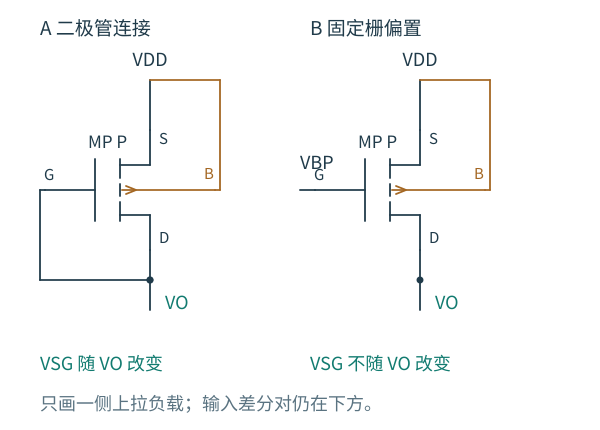
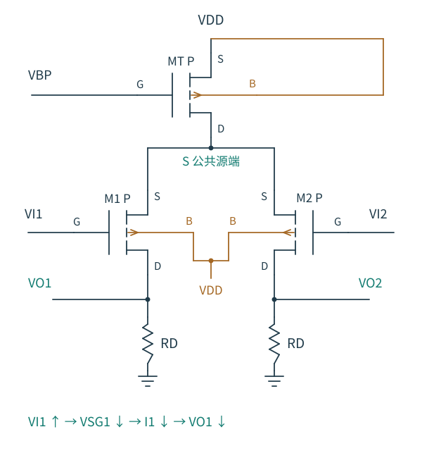

# 4.5 MOS 负载：增益与偏置怎样兼顾

[前一篇：余量与线性范围](04-余量与线性范围.md) · [本章导航](README.md) · [下一篇：Gilbert 单元](06-Gilbert单元.md)

电阻负载的差分对已经能比较两个输入。若想在集成电路中继续提高增益，马上会遇到两件事：大 RD 占面积，也产生更大的直流压降。第 3 章已经研究过 MOS 作为单边负载的性质；现在要问，把它们成对放到差分输出上，会不会又引入新的约束？

## 二极管连接的负载，为什么容易建立输出电平

先在每个漏端上方接一只二极管连接 PMOS，S、B 接 VDD，G、D 接该侧输出。每个负载自动建立流过 I0 所需的 VSG，因而在平衡时给出

$$
V_{OQ}=V_{DD}-V_{SG,p}(I_0).
$$

图 4.5-1：只截取一侧负载，左右两侧使用相同连接。A 的输出变化直接改变 PMOS 的 VSG；B 的 VSG 在低频下固定，因而具有更高的增量阻抗。两种连接的体端都接 VDD。

左输入升高时，下方 NMOS 多吸电流，左输出降低；这又使左负载的 VSG 增大，主动多供电流，阻止输出继续下降。因此二极管负载使直流容易落定，却也强烈加载信号节点。

在纯差模下，源端仍可按对称性视为增量固定。每侧输出总电导为 $g_{dsn}+g_{mp}+g_{dsp}$，故差分增益是

$$
A_{dd}=-\frac{g_{mn}}{g_{mp}+g_{dsp}+g_{dsn}}
\simeq-\frac{g_{mn}}{g_{mp}}.
$$

后一个近似要求 gmp 主导负载电导。两种管都处在强反型长沟道、并流过相同 I0 时，gm 比约为 $\sqrt{\beta_n/\beta_p}$。它可以用尺寸比安排，但会同时改变电容、面积和所需 VSG；不宜只把尺寸当作一个无代价的增益旋钮。

二极管连接 PMOS 通常能够自行满足饱和条件，但它消耗的是一个完整 VSG。下方输入管能否保持饱和，还需检查 $V_{OQ}\gtrsim V_{ICM}-V_{TH,n}$。输出电平已经由负载电流和 VSG 决定，不能再任意把它指定为半电源。

若使用 G、D 接 VDD、从 S 端上拉输出的 NMOS 负载，观察端口已经变为源端，体接地时负载电导还包含 gmb。它不是把图中的 PMOS 字母换成 NMOS 就能得到的同一个公式；可回到 [第 3 章负载分析](../03-共源级.md) 核对控制电压。

## 固定栅偏置负载，为什么高增益反而更难偏置

把每只 PMOS 的栅改接固定 VBP，输出不再改变其 VSG；忽略栅体电流，负载主要表现为 rop。纯差模增益变为

$$
A_{dd}\simeq-g_{mn}(r_{on}\parallel r_{op}).
$$

这与电阻负载的分析形式相同，只是负载阻抗提高了。左右对称仍帮助我们分离差模与共模，但它只能保证两个输出相等，不能决定它们相等于多少伏。

设理想尾源吸取 IT，两个理想上拉电流源各提供 IP。若 $2I_P\ne I_T$，两输出电容必然共同充电或放电，直到实际器件的输出电导或工作区变化让电流重新平衡。若 $2I_P=I_T$ 且所有输出电阻都为无穷大，这个理想模型又没有为输出共模选定唯一电压：许多输出电平都能满足相同电流。

恢复有限输出电导后，可以在某个候选工作点附近写每边的静态电流误差 δI。为了抵消误差，输出约要移动

$$
\delta V_O\simeq-\frac{\delta I}{g_{dsn}+g_{dsp}},
$$

这里 δI 定义为下管相对上管多吸收的电流。相同的小电流误差，在高阻节点上会换成很大的电压移动。求得某次 OP 收敛，并不代表这个输出共模对工艺、温度和偏置误差都足够稳健。

这为后续共模反馈留下了明确任务：检测两个输出的平均值，再调节合适的偏置，使输出共同回到目标位置。第 9 章才系统讨论反馈结构；当前先认识到“差模增益很高”和“输出共模被控制”是两项不同工作。

固定栅负载自身也要有余量。长沟道近似下，同一侧上下输入/负载管保持饱和的区间为

$$
V_T+V_{OV,n}\lesssim V_O
\lesssim V_{DD}-V_{OV,p}.
$$

若还要串入共源共栅管，提高输出电阻就会再消耗一份饱和余量。可以利用 [第 3 章的阻抗提升方法](../03-单级放大器/05-共源共栅.md) 分析对称的差模半电路，但不能把 ro 的提升倍数直接当作整个差分级的增益倍数；有效跨导、另一侧负载和偏置范围都要一同检查。

## 反过来采用 PMOS 输入对，会改变哪一端的共模范围

若信号靠近地，前面的 NMOS 输入对常先遇到下限。可以把电流方向翻转：上方用 PMOS 尾管从 VDD 提供电流，两只 PMOS 输入管共用源端，下方的相等电阻接地。输入管与尾管的体接 VDD。

图 4.5-2：这里的公共源端位于输入管上方，电流经输入管流向下方电阻。左输入升高使左 VSG 减小、左支路电流减小，左输出随之降低；按同一输入差与输出差定义，电压增益仍为负。

本段的 I0 取从 VDD 向地流动的支路电流幅值，平衡时 $V_{OQ}=I_0R_D$。设上方公共源端为 S，尾管要留出 $V_{DD}-V_S\gtrsim V_{OV,Tp}$，输入管又需要 $V_{ICM}=V_S-V_{SG,p}$，因此共模上限大致为

$$
V_{ICM,\max}\simeq
V_{DD}-V_{OV,Tp}-V_{SG,p}.
$$

输入 PMOS 的饱和条件为 $V_D\lesssim V_G+|V_{TH,p}|$，给出平衡时的另一端边界

$$
V_{ICM,\min}\simeq V_{OQ}-|V_{TH,p}|.
$$

与 NMOS 输入对相比，难以接近的那一端供电轨交换了。VSG、阈值和饱和余量仍应在实际体偏置下计算，不能由此宣布一个 PMOS 对就能覆盖轨到轨输入。迁移率、面积和噪声的取舍也随极性改变。

两种极性的差分对、二极管负载与高阻负载，都可以复用同样的步骤：先找静态电流和端口位置，再分解模式，最后在每一条电流路径上核对电压余量。

下一章电流镜会进一步回答 VBP 和 IT 怎样由参考电流建立，以及如何把两支路信号汇成一个单端输出。这里的两只独立固定栅负载还不是电流镜负载，不能提前套用镜像合流后的跨导或增益。
