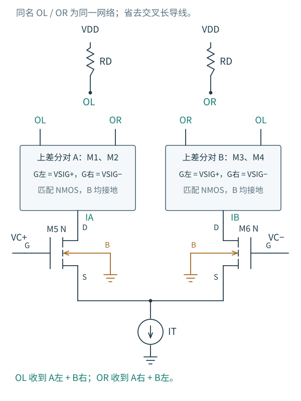

# 4.6 Gilbert 单元：用电流控制增益

[前一篇：MOS 负载](05-MOS负载.md) · [本章导航](README.md) · [系列首页](../README.md)

差分对已经做过两种转换：输入电压差改变电流分配，负载又把电流差换成输出电压差。现在提出一个新任务：能不能用另一组电压控制增益，让增益从正值连续走过零，再变成负值？

只改变一只放大器的尾电流，可以改变 gm，却不能让跨导变号。要得到正负增益，可以让两只放大器以相反极性贡献输出，再改变它们各自的权重。

## 同样的输入，以相反极性汇入输出

取两个相同的上层 NMOS 差分对 A、B，都接收差分输入 VSIG。A 的左、右漏流分别汇入 OL、OR，B 则交叉接入 OR、OL。两个输出各用 RD 上拉到 VDD。用下层的另一只差分对控制 A、B 的尾电流 IA、IB，且 IA+IB=IT，就得到 Gilbert 单元的六管核心。

图 4.6-1：上层两个方框各代表一只由两管构成的差分对，明确标出 G 与输出网络；下层 M5、M6 分配 IA、IB。OL、OR 的同名标签表示相连，避免交叉长导线遮住电流分组。四只上管和两只下管的 B 均接地。VSIG 与 VC 各有自己的直流共模，图中只突出差分端口及电流路径。

设 A 左减右的支路电流差为 ΔIA，B 左减右为 ΔIB。按图上的连线，两个输出节点吸收的电流为

$$
I_L=I_{A,L}+I_{B,R},\qquad
I_R=I_{A,R}+I_{B,L}.
$$

因此

$$
I_L-I_R=\Delta I_A-\Delta I_B.
$$

这一步决定了电路的正负号。若把 B 也按 A 的方向连接，两者只会相加；无论怎样改变 IA、IB，都得不到所需的抵消和增益变号。

## 先让上层只处理很小的信号

忽略输出电导、体传导电流与电容，采用匹配的强反型平方律。每只上管的参数为 βu；上对 A 的尾电流为 IA，故在零 VSIG 附近的差分跨导为

$$
g_A=\sqrt{\beta_u I_A},\qquad
g_B=\sqrt{\beta_u I_B}.
$$

注意 IA 是上对 A 的总尾电流，每只上管只流 IA/2；这里已经用过第 4.1 节的跨导关系，不需要再人为多乘一个 2。对一个足够小的上层信号，

$$
i_L-i_R\simeq(g_A-g_B)v_{sig},
$$

$$
A_{sig}=\frac{v_{od}}{v_{sig}}
\simeq-R_D\sqrt{\beta_u}
\left(\sqrt{I_A}-\sqrt{I_B}\right).
$$

当 IA=IB，两路贡献大小相同、方向相反，输出信号相消；它们各自仍在消耗偏置电流，电路没有停止工作。IA 占优时是一种极性，IB 占优时则反过来。全部 IT 转到一边时，增益趋向相应的极限值，而不是无限增加。

## 平方根为什么恰好把控制电压取了出来

下层 M5、M6 匹配，每管参数为 βl，共用一个源端。定义 $V_C=V_{C+}-V_{C-}$。只要下层两管都在强反型饱和区，平方律给出

$$
\sqrt{I_A}=\sqrt{\frac{\beta_l}{2}}(V_{GS5}-V_{TH,l}),
$$

$$
\sqrt{I_B}=\sqrt{\frac{\beta_l}{2}}(V_{GS6}-V_{TH,l}).
$$

源端和阈值在相减时消去：

$$
\sqrt{I_A}-\sqrt{I_B}
=\sqrt{\frac{\beta_l}{2}}\,V_C.
$$

于是上层信号的小信号增益变成

$$
A_{sig}(V_C)\simeq
-R_D\sqrt{\frac{\beta_u\beta_l}{2}}\,V_C.
$$

电压控制先产生两个电流，电流又决定两路的 gm；相反极性的输出相减后，平方根把下层的栅压差取了回来。在这组理想模型条件内，控制电压不必也被限制为零点附近的无穷小量，增益对 VC 的线性关系可延伸到下层两管保持导通的区间。

但对上层信号的要求还在。它必须相对于两组上管各自的过驱动足够小。随着 VC 把一组尾电流压得越来越低，该组的允许线性 VSIG 范围也会收窄。因此不能固定一个很大的 VSIG，再把这个增益式无条件延长到控制端全转向的位置。真实器件的非平方律、有限 ro、尺寸与负载误差也会破坏理想线性关系。

这给出一种模拟乘法关系：

$$
V_{OD}\simeq-KV_CV_{SIG},\qquad
K=R_D\sqrt{\frac{\beta_u\beta_l}{2}}.
$$

K 的单位为 V⁻¹，使两项输入电压相乘后仍输出电压。这里 VSIG 表示在指定控制偏置下足够小的信号，公式不是对任意两个输入幅度都精确的乘法器规格。

若两个输入都是零均值的小交流量，它们的乘积是一个二阶项。在两个输入同时为零的工作点，只做一次普通一阶 AC 分析会把这个乘积丢掉，不能用“AC 增益为零”断言电路没有乘法作用。应在非零控制偏置下测量另一个端口的局部增益，或用非线性瞬态观察两信号相乘的频率分量。

## 同一张图还可以做电流换向

让上层 VSIG 成为足够大的正负控制电压时，每个上对会把自己的尾电流主要转到一边。正状态下 OL 主要收到 IA、OR 主要收到 IB；反状态下两者交换。因此

$$
I_L-I_R\approx
\operatorname{sgn}(V_{SIG})(I_A-I_B).
$$

下层仍可把一个模拟输入转为 IA−IB，上层负责周期性换向。乘一个正负切换的波形，就会把输入频谱搬移；这为后续混频电路提供了入口。这里不把这个硬切换近似与前面的上层小信号乘法公式混用，也不据此报告转换增益、噪声或高频隔离指标。

## 多叠一层，也多付一层电压

图中的每条导通路径要经过负载、上层差分管、下层差分管和尾源。若实际尾源也用 MOS，在平衡点附近，长沟道余量预算大致需要

$$
V_{DD}-\frac{I_TR_D}{2}
\gtrsim V_{OV,u}+V_{OV,l}+V_{OV,T}.
$$

每只上管在控制平衡时流 IT/4，每只下管流 IT/2，两个过驱动不能不加区别地取成同一个值。上下层还需要不同的输入共模，以便把中间漏/源节点放在合适位置。低电源下，电流分组的代数关系仍然成立，但器件可能没有足够余量实现所假设的电流。

这一节把整章的方法用在了一个初看更复杂的结构上：先按支路分组，判断输出相加还是相减；在每组所需的工作点求跨导；最后沿纵向电流路径检查余量。用这种方法读六只 MOS，比先寻找一条“Gilbert 增益公式”更容易发现连接、偏置或近似中的错误。

到第 5 章，我们还要让 IT、IA/IB 的偏置和 MOS 负载的栅电压有可实现的来源。理想电流源、固定电压源在本章帮助隔离机制；电流镜将把这些偏置要求变成实际电路，并带来新的误差与余量约束。
