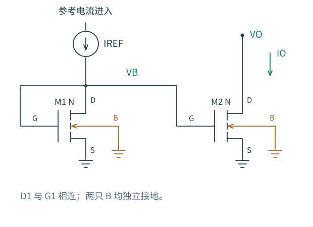

# 5.1 普通电流镜：共同栅压复制了什么

[本章导航](README.md) · [下一篇：共源共栅镜](02-共源共栅镜.md)

假设差分对需要 80 µA 尾电流。直接给尾管一个固定栅电压，看起来很简单；但第 2 章已经告诉我们，同一栅压下的电流会随阈值、迁移率、温度和漏端电压变化。能不能先建立一股参考电流，再让另一只管子跟着它工作？

图 5.1-1：参考电流进入 M1 的漏栅节点 VB；M2 共享栅压与源端电位，但输出漏压由外部电路决定。两只体端分别接地。这里讨论吸收电流的 NMOS 镜；PMOS 源出电流时，把电压方向和源、体连接相应翻转。

## 参考支路先把电流翻译成电压

如果 VB 太低，M1 暂时不能吸收全部参考电流，多余电流便使栅漏节点电容充电；VB 升高，M1 电流增加。若 VB 太高，则反向调整。稳态由 $I_{D1}(V_B,V_B)=I_{REF}$ 决定，而不是先随意规定 VB。

对于增强型长沟道 NMOS，二极管连接使 $V_{DS1}=V_{GS1}$。导通时 $V_{GS1}>V_{TH1}$，便自动满足 $V_{DS1}>V_{GS1}-V_{TH1}$。这是参考管容易保持饱和的原因；它不保证参考电流发生器也有足够压降，更不保证输出管饱和。

先采用强反型平方律、忽略沟道长度调制，且两管阈值与体偏置相同：

$$
I_{REF}=\frac{\beta_1}{2}(V_B-V_{TH})^2,
\qquad V_B=V_{TH}+\sqrt{\frac{2I_{REF}}{\beta_1}}.
$$

M2 的源端也接地，因此共享同一过驱动，得到

$$
\frac{I_O}{I_{REF}}=\frac{\beta_2}{\beta_1}
\simeq\frac{(W/L)_2}{(W/L)_1}=m.
$$

电流镜完成的是“电流 → 栅压 → 电流”两次转换。尺寸比只在共同的器件关系允许消去栅压时，才成为电流比。若两源端不等电位，或两管的体偏置不同，连“相同 VGS”这个出发点也没有了。

参考端的小信号输入电阻也由这两次转换解释。给二极管节点增大 $v_b$，电流同时通过跨导和输出电导增加：

$$
r_{in,REF}=\frac1{g_{m1}+g_{ds1}}\simeq\frac1{g_{m1}}.
$$

M1 的源、体均交流接地，故这里没有 gmb 项。M2 输出电阻则近似为 $r_{o2}$。一个低阻的电流输入端，通过共同栅极控制另一个高阻电流输出端，这比把整只镜都叫作“理想电流源”更能说明端口差异。

## 同一 VGS，为什么电流仍会不同

M1 的漏压等于 VB，M2 的漏压却可能从几百毫伏变到几伏。保留一阶沟道长度调制：

$$
\frac{I_O}{I_{REF}}
=m\frac{1+\lambda_2V_O}{1+\lambda_1V_B}.
$$

若两管 λ 相同且 $\lambda V\ll1$，相对于理想尺寸比的误差约为 $\lambda(V_O-V_B)$。因此，让两管 VDS 接近通常比仅仅把尺寸比写得很精确更有用。短沟道真实器件还包含 DIBL 等效应；不能用一个常数 λ 精确拟合整条 GF180 曲线。

在某个已确定工作点附近，小变化满足

$$
\delta I_O\simeq
\frac{g_{m2}}{g_{m1}+g_{ds1}}\delta I_{REF}
+g_{ds2}\delta V_O.
$$

第一个系数是参考电流变化怎样传到输出，第二项则是负载扰动。两者不是同一种误差。即使参考电流完美，有限输出电阻仍会让负载调节率变差。

输出顺从电压来自 $V_O\ge V_{GS2}-V_{TH2}=V_{OV2}$。输出低于它以后，继续把饱和区的 $g_{ds}$ 直线外推没有依据。电流不会突然归零，而会沿三极区关系降低。真实模型的 VDSAT 是工作点诊断量，也不等于“误差小于 5% 的最低电压”；后者必须按指定电流容差检查。

## 多花一点面积，会买到什么

加长 L 常能减小漏端调制，但如果只加长 L、不增加 W，β 就变小。固定电流时过驱动增大，顺从电压也随之增加。若希望保持近似相同的电流密度和过驱动，应同时增大 W，使 W/L 大致保持不变；代价是面积和栅电容增加。真实阈值、迁移率和短沟道效应也会变，保持 W/L 并不是保持所有参数。

本章 40 µA 任务比较了短沟道初始方案与两种保持 W/L=10 的长沟道方案。GF180 nominal 结果显示，加长沟道显著减小了窗口内的复制误差；从 1 µm 再加长到 2 µm，改善已较小，几何面积却增至四倍。完整误差、输出电阻与面积对照见 [5.5](05-设计一次电流源.md)。

## 器件并不完全相同时

在相同源、体偏置、近似相同 VDS 的条件下，令 M2 相对 M1 的小差异为 $\Delta\beta$、$\Delta V_{TH}$，在平方律工作点线性化：

$$
\frac{\Delta I}{I}\simeq
\frac{\Delta\beta}{\beta}-\frac{2\Delta V_{TH}}{V_{OV}}
+\lambda\Delta V_{DS}.
$$

它说明小过驱动有助于电压余量，却放大了阈值差对电流的相对影响。增大面积通常有助于降低局部随机失配的方差，但仅凭上式不能给出某块芯片的良率；必须有合法且适用的统计模型与匹配结构。普通 ss/ff 工艺角描述的是全局偏移，不能替代两只相邻晶体管之间的局部失配。

较大倍率宜考虑相同单位器件组合，而不只是任意改变单管长度。共心、交叉、相同朝向与邻近环境是在控制梯度和系统误差；它们也不能让随机失配消失。本章没有版图或 Monte Carlo 良率结论。

如果普通镜的输出电阻仍不够，需要处理的便是漏端扰动的传播路径。[下一篇](02-共源共栅镜.md) 用一只共栅管保护这个节点。
