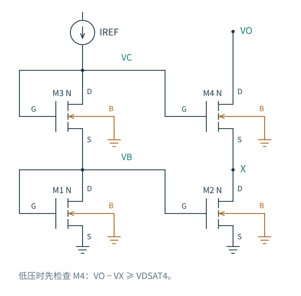
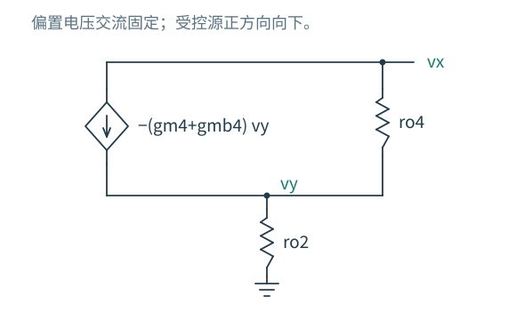
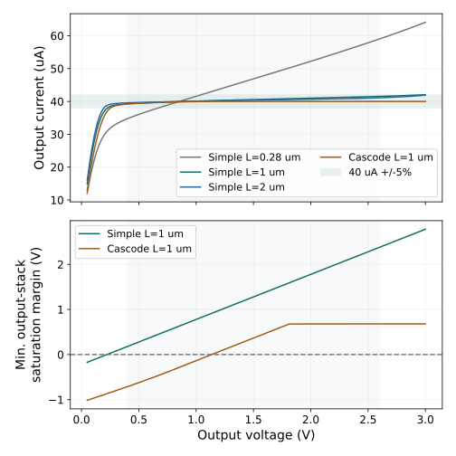

# 5.2 共源共栅电流镜：保护内部节点需要多少电压

[上一节：普通镜](01-普通电流镜.md) · [本章导航](README.md) · [下一节：有源镜](03-有源镜与OTA.md)

普通镜的输出管漏压随外部节点一起移动。第 3 章的共源共栅已经给出一个办法：把决定电流的管子放在下面，用上方的共栅管吸收大部分输出电压变化。问题在于，这只保护管的栅极该接到哪里？

图 5.2-1：M1、M3 二极管连接，参考电流依次流过它们，建立 VB、VC。M2 与 M4 分别复制下面和上面的栅偏置；X 是输出堆叠的内部节点。四只 NMOS 的体端均接地，M3、M4 的源端却不接地，因此须保留体效应。

## 输出动了，X 为什么不愿意跟着动

先固定 VB、VC，令 VO 上升。M4 的有限输出电导倾向于增大向下电流；它把 X 拉高一点，随即减小自己的 VGS 和 VBS，使电流变化受到抑制。X 只需很小的移动，就能使 M4 的跨导电流补偿大部分漏端扰动。下管 M2 因此少承受了一次 VDS 变化。

这是局部的源端反馈关系，不需要提前引入整章反馈理论。不要把它说成 X 完全不动：正是有限的移动，产生了补偿电流。

图 5.2-2：把两路栅偏置交流固定，给输出施加 vx。内部节点电压为 vy；受控源从输出指向内部节点的电流为 −(gm4+gmb4)vy。下管的栅源小信号为零，只留下 ro2。

令 $g_{o2}=1/r_{o2}$、$g_{o4}=1/r_{o4}$，在 X 写 KCL：

$$
(g_{o2}+g_{o4}+g_{m4}+g_{mb4})v_y=g_{o4}v_x.
$$

输出测试电流最终经过 ro2 流向地，故 $i_x=g_{o2}v_y$。于是

$$
R_{out}=r_{o2}+r_{o4}+(g_{m4}+g_{mb4})r_{o2}r_{o4}.
$$

在跨导增益很大时，最后一项占优。这个结果要求两管在所用工作点附近保持饱和，栅偏置低频固定；有限偏置阻抗与寄生电容的动态影响不能直接藏在这个直流公式里。

同构参考支路还处理了复制误差：M3、M4 在相近电流、相同源体偏置下需要相近 VGS，因而输出内部 X 接近参考内部 VB。M1、M2 的漏压也接近。高输出电阻和内部漏压匹配是有关联但不同的两项收益。

## 为什么经典结构仍要付出一个阈值压降

下面的参考管二极管连接，使 $V_B=V_{GS1}$。为了让输出上管取到相同电流，X 约等于 VB；于是

$$
V_{O,min}\simeq V_X+V_{OV4}
\simeq V_{TH1}+V_{OV1}+V_{OV4}.
$$

注意 M2 本身只需要 $V_X\ge V_{OV2}$，经典偏置却把 X 放到了约 VGS1。额外的阈值压降来自偏置生成方式，不是“两管串联”不可避免的全部代价。

参考输入端的电压更高，约为 $V_{GS1}+V_{GS3}$。参考电流发生器必须在这个电压以上还留有自己的顺从余量。因此，只检查输出支路，不检查参考支路，也可能得到一个无法供电的电流镜。

## 宽摆幅偏置：把 X 放低一点

若独立提供下管 VB 与上管 VC，可以把目标 X 选在 $V_{OV2}+\delta$，其中 δ 是余量裕度。此时所需上管栅压为

$$
V_C=V_X+V_{GS4}(I,V_{SB4}=V_X),
\qquad V_{O,min}\simeq V_{OV2}+\delta+V_{OV4}.
$$

一个阈值压降被省下来了，但 VC 必须正确产生，不能只在原理图旁边写一个理想电压数值。忽略体效应、两输出管过驱动相同为 VOV 时，目标约为 $V_C=V_{TH}+2V_{OV}$；同电流下，一个 β 为输出管四分之一的二极管 MOS 可产生这个电压。下管栅偏置另由普通参考管产生。

这个比例只是初估：上管体效应改变 VTH，实际电流与几何比也非理想。两路参考可能增加支路功耗，复制下管漏压的方式也必须一起检查；把 X 恰好放在饱和边界，在 PVT 下通常没有裕度。宽摆幅镜是一次重新分配偏置和面积的设计，而不是删掉阈值项就结束了。

更强的调节式共源共栅还能用辅助放大器稳定 X，但会带来辅助级供电、噪声、极点和稳定性问题。本章先建立它要控制的节点，完整环路设计留到反馈与运放章节。这里没有声称宽摆幅或调节式结构已完成 GF180 实现。

## 在电流容差内，是否就能称作高阻电流源

图 5.2-3：全部实线为同一 GF180 typical、27 °C、40 µA 参考的 ngspice DC 结果；淡色窗口为 0.4–2.6 V，绿带为 ±5% 电流容差。下图单独检查输出堆叠中最小的 VDS−VDSAT；负值表示至少一只管不再饱和。余量不等于电流误差。

在 VO=1.65 V，L=1 µm 普通镜的局部输出电阻约为 1.17 MΩ，经典共源共栅镜约为 356 MΩ。但是后者在约 1.14 V 以下不能让两只输出管同时饱和。低压端电流没有立刻消失，甚至仍能落在 5% 容差内；那里不能继续承诺上面的数百兆欧输出电阻。

<!-- interactive: mirror-compliance -->

先预测：把 VO 从 1.65 V 降到 0.4 V，哪一只管先失去饱和？观察 X 怎样改变，再检查电流误差是否同时越界。[在线交互版](https://liuxd-1230.github.io/TechCodex/analog/mirrors/cascode/#mirror-demo-title)用上述原始数据联动原理图与曲线；GitHub 和无脚本阅读仍可使用图 5.2-1、5.2-3。

选择拓扑时，需要把误差容差、局部输出电阻、可用电压、参考支路和复杂度放在同一张约束表上。“增加两只管”本身并不是一种性能指标。
