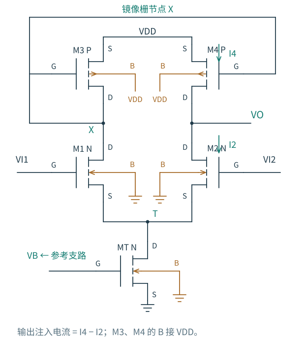
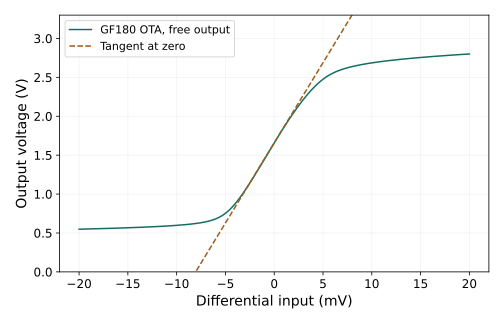

# 5.3 有源镜像负载：让两边的变化共同推动一个输出

[上一节：共源共栅镜](02-共源共栅镜.md) · [本章导航](README.md) · [下一节：偏置网络](04-偏置与启动.md)

第 4 章的电阻负载差分对有两个输出。如果只取右边，就只读取右支路的变化。左边也带着同样有用的差模信息，能不能把它送过来？电流镜此时处理的是信号电流，而不只是静态偏置。

图 5.3-1：M3 二极管连接，M4 与它组成 PMOS 电流镜。M1、M2 是 NMOS 输入对，MT 是实际尾管，VB 由下一节的电阻参考支路产生。镜像栅节点 X 与输出 VO 不直接相连；图上两处 VDD 体端标签连接到同名电源。五管指放大核心，完整偏置还包括 MR 和 RREF。

## 电流增加，输出却向上走

令 $v_{i1}=+v_{id}/2$、$v_{i2}=-v_{id}/2$。在理想尾电流约束、小输入、近似理想镜像下，M1 电流增加 $g_{mn}v_{id}/2$，M2 电流减少同样多。M3 为了供给增大的左支路电流，栅漏节点 X 下降；M4 的 VSG 增加，于是右边从电源送入的电流增加。

右边同时发生两件事：上方送来的电流增多，下方吸走的电流减少。定义输出**注入**电流 $i_{inj}=i_4-i_2$，则

$$
i_{inj}\simeq \frac{g_{mn}v_{id}}2-\left(-\frac{g_{mn}v_{id}}2\right)
=g_{mn}v_{id}.
$$

若暂接一个输出电容，$C_L\,d v_o/dt=i_{inj}$，所以正差分输入使右输出上升。这与原先“左共源输出反相”的说法不冲突：现在读的是右端，而且左电流经过了一个有源镜。

不要把这一过程解释成 M4 的漏端短接 M3，或两只电流源永远完全相等。只有栅极相连；电压改变后，两只管仍各自服从自己的输出特性。

## 先找跨导，再找输出电阻

把输出的小信号电压暂时固定为零，测得的注入电流除以 vid，是整个级的短路跨导 Gm。它不是某只输入管 gm 的定义，尽管理想镜和很高的本征增益下两者接近。

M3 所在的 X 节点不是无限低阻。若把尾端一阶固定、忽略下管 ro，仅保留镜的主要低频项，M3、M4 的电流传递系数约为

$$
a\simeq\frac{g_{mp4}}{g_{mp3}+g_{op3}},\qquad
G_m\simeq\frac{1+a}{2}g_{mn}.
$$

保留下管输出电导后，X 的负载还会增加。高精度计算应同时解 X、T、VO，不能不断在这条近似上补零散修正。

将差分输入置零，从输出施加测试电流，可得到 Rout；第一近似是 $r_{o2}\parallel r_{o4}$。于是开路电压增益为

$$
A_{vd}=G_mR_{out}\simeq g_{mn}(r_{o2}\parallel r_{o4}).
$$

这是从电流平衡得到的单端差模增益，没有再乘二。右支路单独贡献半个 gm，镜像来的左支路补回另半个 gm。若接入负载 RL，就要将 RL 并入输出端；OTA 也不是能够任意驱动低阻负载的理想电压源。

还有一个方法上的变化：**不能直接沿用第 4 章的对称半电路。** 左边是二极管节点，右边是高阻输出，左右负载不再对称。有限 ro 使两个漏端的不同变化反馈到尾端，纯差模输入时 T 也可能有一阶移动。保留有限器件参数时，应检查完整三节点模型。

## 共模变化能否被镜完全消掉

两个栅极一起上升时，有限尾管输出电导会使尾电流增大。上方镜跟着左电流变化，右侧也吸取相近的变化，因而大部分共模电流在输出抵消；但 X 必须移动才能建立新的 PMOS 电流，VO 不会完全不变。

在左右输入管匹配、左右 PMOS 匹配、它们分别处于相同标称 VDS 的小信号模型中，令

$$
g=g_{mn},\quad b=g_{mbn},\quad n=g_{on},\quad
p=g_{mp},\quad e=g_{op},\quad t=g_{ot},\quad k=g+b+n.
$$

栅偏置 VB 和电源交流固定，忽略栅、体的低频传导，三个节点的 KCL 为

$$
\begin{aligned}
(p+e+n)v_x-kv_T&=-g v_{i1},\\
p v_x+(e+n)v_o-kv_T&=-g v_{i2},\\
-n(v_x+v_o)+(2k+t)v_T&=g(v_{i1}+v_{i2}).
\end{aligned}
$$

这组方程既保留体效应，也让镜节点与尾节点自己求解。共模时两式相减给出 $v_o=v_x$；再消去尾节点，得到

$$
A_{vc}=\frac{v_o}{v_{ic}}
=-\frac{gt}{2k(p+e)+t(p+e+n)}.
$$

当尾管输出电导很小、p 远大于 n、e 时，近似为 $-\frac{g}{g+b}\frac{g_{ot}}{2g_{mp}}$。它与电阻负载差分对的共模增益不是同一个公式。理想尾源 $t\to0$ 时，本模型共模增益趋零；真实尾源和不完全镜像都会留下共模响应。

同一组 KCL 如何给出差模增益

令 $h=n+e$，$D=2k(p+e)+t(p+h)$。差模输入使两式相减得到 $v_o-v_x=(g/h)v_{id}$，但 vx 不是零。由尾节点方程代回：

$$
\frac{v_x}{v_{id}}=-\frac{g(ke/h+t/2)}D,
\qquad
A_{vd}=\frac gh\left[1-\frac{ke+th/2}D\right].
$$

当 p 足够大时，括号中的修正很小，便回到 $g/(n+e)$。仓库用独立节点导纳矩阵检查这两个闭式表达式；真实工艺的完整 DC/AC 结果还与三参数 gm/gmb/gds 模型交叉比较。矩阵近似没有抹去完整模型中的体端相关电流。

输入共模不是只影响一个增益数。它同时改变尾管 VDS、输入管 VGS 与体偏置、镜节点 X，以及所有管的饱和余量；接近边界时，本节线性公式便不再适用。单端读出也意味着，系统不能再依赖差分相减消除所有镜像误差。CMRR 应按这里定义的 $|A_{vd}/A_{vc}|$ 计算，不能拿第 4 章的双端口结果拼接。

## 大信号下，输出怎样找到平衡

理想镜会把 I1 复制为 I4，因此注入电流为 $I_1-I_2$。但一个没有外部直流负载、也不含无限大输出电阻的实际 OTA，最终必须满足输出 KCL：$I_4(V_O,V_X)=I_2(V_O,V_T)$。输入差迫使输出移动，有限输出特性参与恢复平衡；移动过大时，某只输出管进入三极区，增益压缩。

图 5.3-2：GF180 nominal、VCM=1.4 V，输出无直流外部负载。实线为实际 DC 解，虚线只是在零点测得的约 206 V/V 切线，纵轴固定 0–3.3 V。差分对还远未完成电流转向，输出就已经无法沿切线继续变化。

这说明输入对本身的线性范围与整级允许的线性输入范围不同。高增益级常在很小的开环输入差下就接近输出边界；以后加入反馈，是让输入差保持很小，同时让外部信号可以较大，不是让器件的电压余量消失。

## 先把直流余量留出来

输入 NMOS 与 PMOS 负载至少要求

$$
V_T+V_{DSAT2}\le V_O\le V_{DD}-V_{SD,sat4}.
$$

左支路也要同时满足 $V_X-V_T\ge V_{DSAT1}$。输入共模下限约为 $V_{GS,n}+V_{DSAT,T}$；上限来自 $V_X\ge V_{ICM}-V_{TH,n}$，其中阈值随体偏置改变。以上是工作点附近的估算，不能把不同工作点提取的阈值、VDSAT 任意混用。

本章 OTA 的最终静态点、1 Hz 增益与共模响应，以及两种扫描下的饱和网格，集中列在 [5.5 的检查表](05-设计一次电流源.md)。这些扫描只给出 DC 工作区边界，不是 THD 或满摆幅线性度保证。

这些结果依赖下一节的实际偏置。单独给 MT 一个恰好合适的理想栅电压，只能说明放大核心可能工作，还没有完成偏置设计。
