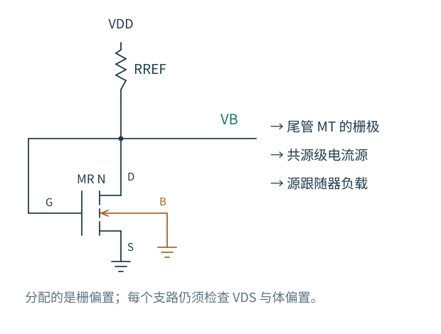
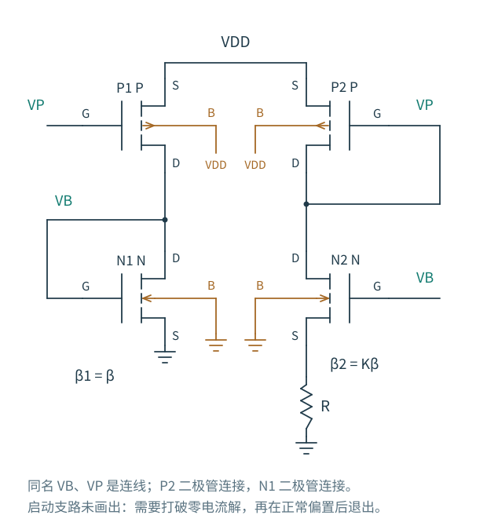

# 5.4 偏置网络：先让每一级站在合适的位置

[上一节：有源镜与 OTA](03-有源镜与OTA.md) · [本章导航](README.md) · [下一节：完成设计](05-设计一次电流源.md)

一个小信号电路图常把电源和偏置都画成交流地。读到这里，可以反过来想：在把它们置零之前，哪些真实电路负责建立这些直流量？偏置网络决定 gm、ro、节点余量与静态功耗，也决定前面那些小信号模型究竟能在哪个工作点成立。

## 用电阻把电源变成参考电流

图 5.4-1：VDD 经 RREF 向二极管连接的 MR 供电。VB 同时送到 MT 和其他负载的栅极；箭头表示偏置分配关系，不是这些栅极各消耗一股直流电流。所有使用 VB 的器件仍需独立检查源、体和漏端条件。

参考电流由交点决定：

$$
I_{REF}=\frac{V_{DD}-V_B}{R_{REF}},\qquad
I_{REF}=I_{DR}(V_B,V_B).
$$

这不是一个与供电无关的绝对电流参考。令 MR 的二极管小信号电导为 $G_D=g_{mR}+g_{oR}$，忽略温度变化，电源增量满足

$$
\delta I_{REF}=\frac{G_D}{1+R_{REF}G_D}\delta V_{DD}
=\frac{\delta V_{DD}}{R_{REF}+1/G_D}.
$$

参考节点会随供电上升一些，但不能把电阻上的电压变化完全抵消。温度还会同时改变电阻、迁移率和阈值。若系统要求更准确的电流，需要更稳定的电压参考、补偿、修调或其他机制；镜像本身只复制来源，不能使来源变得绝对准确。

本章先用此结构作为可启动、可复现的基础偏置，而不提前设计带隙基准。RREF 由目标 40 µA 和真实 MR 的栅漏电压估算，随后保留该电阻值，不在每个工艺角重新调整。

## 共源、共栅、源跟随器分别需要什么

对共源放大器，偏置要先建立输入管的电流，并让输出静态点处在足够的上下余量之间。电流源负载提高输出电阻，却不替你指定一个理想的输出电压。复制相同电流密度的 VGS 可以改善阈值跟踪，但只有在源、体、漏条件可比时才有效。信号输入通常围绕这个栅极直流值变化。

共栅级需要同时满足目标电流与输入源端的静态电位：

$$
V_{G,CG}=V_{S,Q}+V_{GS}(I_Q,V_{SB,Q}).
$$

把普通镜的 VB 不加思考地送给一个源端已经抬高的共栅管，会减小它的过驱动，甚至使它关断。共源共栅镜的上管偏置也是同一个问题。

源跟随器则要求 $V_{G,Q}=V_{O,Q}+V_{GS}(I_Q,V_{O,Q}-V_B)$。下面的偏置电流源控制电流，输入直流值主要决定输出电位；两者一起决定可用摆幅。体接地时，输出升高会改变阈值，所以不能用一个常数“减去 0.7 V”来安排整个信号范围。若使用复制源跟随器建立偏移，复制支路也要具有相近的电流和体偏置。

差分对的尾管最直接使用电流镜：MR 与 MT 共栅共源，MT 的 W 取两倍，可初估 $I_T\simeq2I_{REF}$。但是 MR 的 VDS=VB，MT 的 VDS=T；这个漏压不一致正是 [5.1](01-普通电流镜.md) 的复制误差。最终约 78.5 µA，而不是严格的 80 µA，有可追踪的电路原因。

## 多个镜像支路为何不是互不相关

理想 MOS 栅极不消耗直流电流，所以不能把一只参考管的 40 µA 按输出数量平分。各输出支路的电源电流由各自 MOS 从电源取得。总功耗需要把参考支路和所有输出支路相加。

不过，多支路共享了一个实际节点。参考节点电容包括 MR、布线和所有栅极的电容，建立偏置会变慢；任一漏端的快速变化还可能经 Cgd 耦合到 VB，再传到其他支路。共同的参考变化会产生相关的 gm 和电流变化。这些是后续频响与噪声需要研究的耦合路径，此处先在原理图中把它们认出来。

分配之前应画一张电压预算：每个支路的源端在哪里，体端接哪里，漏端可能走到哪里。靠近地的 NMOS 电流镜不能直接为所有高侧器件提供合适栅压；NMOS/PMOS 之间的电流传递需要极性转换的参考支路，并增加它的余量与功耗。

## 自偏置为什么还要讨论启动

为了减少对电源和阈值的依赖，可以让电路自己建立一个差值电压。例如，两条等电流支路使用 β 与 Kβ 的 NMOS，其中较大的管在源端串 R；上方 PMOS 镜闭合电流关系，两栅相连。

图 5.4-2：N1 二极管连接建立 VB，P2 二极管连接建立 VP；同名 VB、VP 分别连接两只 NMOS 和两只 PMOS 的栅极。N2 源端串 R，体端仍接地。图中只画主偏置环路，启动支路尚未实现，不能据此声称已保证启动。

先忽略体效应与输出调制，则

$$
IR=V_{GS,1}-V_{GS,2}
=\sqrt{\frac{2I}{\beta}}\left(1-\frac1{\sqrt K}\right),
$$

$$
I=\frac{2}{\beta R^2}\left(1-\frac1{\sqrt K}\right)^2.
$$

在这个非零解上，小管跨导为 $g_m=\sqrt{2\beta I}=2(1-1/\sqrt K)/R$，所以它常被称作建立跨导的偏置。恒定的是一个近似由电阻决定的关系，不是电流与温度都自动不变。源电阻抬高大管体偏置，实际 VTH 差会进入方程；R 和迁移率也有工艺与温度依赖。

还遗漏了一步：得到非零解时我们除以了 $\sqrt I$。原始网络通常也允许 **I=0**。如果所有器件都关断，镜中没有电流，电阻上没有压降，没有任何一条理想直流关系迫使系统离开零电流。

启动支路因此要在低电流状态向合适节点注入或抽走少量电流，使主环路离开零解；进入目标状态后再退出，避免改变准确性。应检查启动管的开关判据、退出后的泄漏、不同上电斜率、掉电再启动、温度和工艺变化。仅仅 `.op` 求出了非零工作点，或给一个节点加初始电压使它成功一次，不能证明可靠启动。

本章 OTA 使用电阻参考，供电建立后有直接的电流通路，不属于上述再生自偏置环路。实验额外检查一次 1 µs 电源上升、1 pF 输出负载的瞬态，能回到预期工作点。这个结果只支持这条上电轨迹；β 倍增器的完整晶体管实现、启动网络与多条件启动保证没有在本章冒充完成。

给自偏置网络作一次纸面启动检查

把所有支路电流设为零，看每个栅极是否仍有明确的充放电路径。如果方程仍成立，再画出供电开始上升时每个电容最初接到什么电位。随后问：启动管依赖哪个节点判定“主电路已经工作”？若它提前退出，或在正常状态仍取明显电流，会分别产生什么结果？这两种失败不能靠修改非零稳态公式解决。

到这里，偏置不再是一串写在管旁的电压值，而是一套需要同时满足电流、余量、启动和相互耦合条件的电路。[最后一篇](05-设计一次电流源.md) 把这些条件收回到最初的两个设计任务中。
