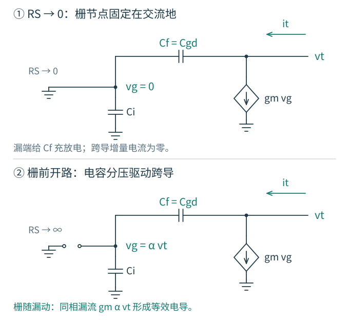

# 6.2 · Cgd 很小，输入为什么仍然吃力

在共源级上，栅电压升高，漏电压下降。跨在两者之间的 $C_{gd}$ 一端向上、另一端向下，它两端的电压变化比栅端本身更大。输入源必须为这份额外电荷提供电流。

图 6-1 · 从哪一端看电容，必须先说明另一端怎样动。上方 VO 为漏端节点，直流负载在本图省略，统一进入后文的 $R_o$；源、体分别接地，$C_O$ 是输出对地电容。

## 先算电流，再谈“变大”

输入端流入跨端电容的电流为

$$
i_{gd}=C_{gd}\frac{d(v_g-v_o)}{dt}.
$$

若在所讨论频段，局部增益 $v_o/v_g\approx A_0$ 可以视为常数，则

$$
i_{gd}\approx C_{gd}(1-A_0)\frac{dv_g}{dt}.
$$

当 $A_0=-50$，输入端需要提供相当于 $51C_{gd}$ 的电流。物理电容的面积并没有变；输入端看到的电流与自身电压变化率之比变了。

注意这里是 $A=v_o/v_g$，不是包含输入串联电阻以后、从信号发生器到输出的 $v_o/v_{in}$。后者还包含输入加载，不能混用。

精确的米勒端口关系实际上可以写为

$$
Y_{in,gd}(s)=sC_{gd}[1-A(s)],\qquad
Y_{out,gd}(s)=sC_{gd}[1-1/A(s)].
$$

这是使用实际局部电压比得到的端口电流恒等关系。它没有自动把求解变简单，因为 $A(s)$ 本身取决于原电路；变换后的支路一般是频率相关导纳。只有在增益可近似为常实数的频段，才得到常用的两只正值等效电容。$A=0$ 附近尤其不能使用含 $1/A$ 的形式。

## 两个节点完整保留，会出现什么

图 6-2 · $C_f=C_{gd}$；$C_i$ 包括 $C_{gs}$，$C_o$ 包括 $C_{db}$ 与负载，$R_o=R_D\parallel r_o$。源端与体端交流接地；负载本身的附加动态尚未加入。跨导源正方向由输出流向地。

### 先关掉输入，从漏端施加扰动 {#drain-perturbation}

刚才是栅端变化、漏端跟着反相变化。现在反过来问：**漏端受到扰动时，栅端还能固定不动吗？** 将独立输入电压源置零，保留它的输出电阻 $R_S$，在漏端施加测试电压 $v_t$。这里的 $R_S$ 是栅前的信号源电阻，不是接在 MOS 源极上的退化电阻。

先看两个极限。$R_S\to0$ 时，栅端被理想电压源固定在交流地。经栅漏支路流出的电流只用于给 $C_f$ 充放电；$v_g=0$，跨导源没有增量电流。此时 $C_f$ 对漏端就是一只对地电容。

若栅前支路近似开路，漏端上升会通过 $C_f$ 抬高栅压。$C_i$ 把栅端拉向交流地，因而栅压上升小于漏压，但方向相同。晶体管随之增加流向地的漏流：测试源既要给电容充电，还要补足这股沟道电流。原书 Fig. 6.14 所求的正是这一漏端阻抗。注意原书 Fig. 6.13 的 X 标在栅节点，而 Fig. 6.14 的 $Z_X$ 表示从漏端看入的阻抗；本节统一用 $v_g$ 和 $v_t$ 区分这两个端口。

图 6-2a · 两幅图施加相同的漏端测试电压。只画参与反馈的 $C_i,C_f,g_m$；完整输出端还并联图 6-2 中的 $R_o,C_o$。箭头给出测试电流和受控源电流的正方向；栅与漏之间没有导线。

### 栅极不传导，漏端电导从何而来 {#capacitive-feedback}

近似开路的栅前支路不能送走增量电荷。在零初始扰动的小信号分析中，栅节点两只电容极板上的电荷变化之和为零：

$$
C_i\,\delta v_g+C_f(\delta v_g-\delta v_t)=0.
$$

因此，令 $C_\Sigma=C_i+C_f$，便有

$$
v_g=\alpha v_t,\qquad \alpha=\frac{C_f}{C_\Sigma}.
$$

这是电容分压，不需要电荷穿过栅氧化层。漏端电压变化先改变栅上电荷分布，再通过栅压控制沟道电流。对稳态正弦扰动，$\alpha$ 是正实数，$g_mv_g$ 就与 $v_t$ 同相；测试端必须提供一股与自身电压成正比的电流，所以会测到正的等效电导。

把漏端流入这部分网络的电流分成两项，可以分别看出电阻和电容从哪里来：

$$
\begin{aligned}
i_t&=g_mv_g+sC_f(v_t-v_g)\\
   &=\left[g_m\alpha+sC_f(1-\alpha)\right]v_t.
\end{aligned}
$$

于是这部分网络的漏端等效为

$$
\boxed{\begin{aligned}
R_x&=\frac{C_i+C_f}{g_mC_f},\\
C_{eq}&=\frac{C_iC_f}{C_i+C_f}.
\end{aligned}}
$$

这就是 $Z_{\mathrm{branch}}=R_x\parallel1/(sC_{eq})$。$C_{eq}$ 是两只电容经浮置栅节点形成的串联等效；$R_x$ 来自电容分压驱动的跨导。它不是 MOS 的 $r_o$，也不是栅极漏电。若把 $g_m$ 置零，电导就消失，只留下串联电容。将 $R_o,C_o$ 接回后，总漏端阻抗近似为 $(R_o\parallel R_x)\parallel1/[s(C_o+C_{eq})]$。

### “大 Rs”必须相对于时间尺度来判断

对于有限 $R_S$，栅节点始终有一条经信号源电阻回到交流地的路径。它何时来不及固定栅压？直接写栅节点电流，得到

$$
\begin{aligned}
\frac{v_g}{R_S}+sC_iv_g+sC_f(v_g-v_t)&=0,\\
\frac{v_g}{v_t}&=\frac{sC_f}{1/R_S+sC_\Sigma}.
\end{aligned}
$$

在 $\omega R_SC_\Sigma\gg1$ 的频段，电容电流占优，栅前电阻才可以近似开路，得到刚才的 $\alpha$。因此，“大”不能只看 $R_S$ 是否大于 $R_o$。反过来，$\omega R_SC_\Sigma\ll1$ 时，$v_g/v_t\approx sR_SC_f$，栅端扰动很小；但它产生的跨导电流与 $sC_fv_t$ 之比约为 $g_mR_S$。若要连跨导电流也忽略，$g_mR_S\ll1$ 是一个充分条件。**小电压不一定意味着可忽略的小电流。**

恢复正常输入以后，低阻信号源使栅压近似跟随 $v_{in}$；“栅节点交流固定”只针对输入已置零的漏端测试。

对任何有限 $R_S$，当频率降到足够低时，电容耦合消失，测试所见的直流输出电阻仍为 $R_o$。不能把高于上述转折频率才出现的 $R_x$ 当成一只始终接在输出上的直流电阻。先令 $R_S\to\infty$ 与先令频率趋零，所保留的栅节点约束不同。

这一推导采用源、体交流固定、饱和工作点附近的常数 $g_m,r_o$ 和准静态二端电容。实际应用中，开路近似还必须处在这个器件模型有效的频段内；源端运动、栅漏电或额外动态需要重新写节点方程。

### 这个漏端 RC 对应哪个极点

在大 $R_S$、输入变化远慢于输出内部调整的情况下，漏端网络给出一个较快的自然模态估计：

$$
\begin{aligned}
\omega_{\mathrm{fast}}&\approx
\frac{1/R_o+1/R_x}{C_o+C_{eq}}\\
&=\frac1{(R_o\parallel R_x)(C_o+C_{eq})}.
\end{aligned}
$$

同一个 $C_f$ 一方面使输入源承担米勒电荷，形成较慢的输入变化；另一方面在较快的输出调整中，允许栅压随漏压同向变化，增加恢复电流。两个效应属于同一个耦合电路的不同时间尺度。不能先按固定栅压算一次输出 RC，再另加一只 $R_x$：固定栅压与浮栅分压是两种不同约束。

若两极点不分离，或者估计出的频率还不满足 $\omega R_SC_\Sigma\gg1$，这个端口 RC 就不足以代表某个独立极点。下面保留两个节点，检验这幅物理图像。

### 让两个节点一起求解 {#two-node-kcl}

令 $G_i=1/R_S$、$G_o=1/R_o$。两个节点的 KCL 直接给出

$$
\begin{aligned}
\bigl[G_i+s(C_i+C_f)\bigr]v_g-sC_fv_o&=G_iv_{in},\\
(g_m-sC_f)v_g+[G_o+s(C_o+C_f)]v_o&=0.
\end{aligned}
$$

第二式已经显露两条相反的路径：$g_mv_g$ 向下拉输出，而输入经 $C_f$ 的位移电流向输出注入。消去 $v_g$ 得到

$$
\boxed{H(s)=\frac{v_o}{v_{in}}=\frac{G_i(sC_f-g_m)}{d_0+d_1s+d_2s^2}}
$$

$$
\begin{aligned}
d_0&=G_iG_o,\\
d_1&=G_i(C_o+C_f)+G_o(C_i+C_f)+g_mC_f,\\
d_2&=C_iC_o+C_f(C_i+C_o).
\end{aligned}
$$

低频检查得到 $H(0)=-g_mR_o$。将 $C_f$ 置零，则分母可以分成 $(G_i+sC_i)(G_o+sC_o)$，输入与输出只剩单向跨导传递。这个退化情况帮助检查符号和单位。

推导核对：有限 Rs 的漏端导纳怎样回到完整分母

输入置零、保留漏端测试源时，将上面的 $v_g/v_t$ 代入漏端电流，可得

$$
Y_{out}(s)=G_o+sC_o+
\frac{sC_f(G_i+g_m+sC_i)}{G_i+sC_\Sigma}
=\frac{d_0+d_1s+d_2s^2}{G_i+sC_\Sigma}.
$$

这与两节点行列式使用同一个分母多项式。取 $G_i\to0$ 且 $s\ne0$，得到 $G_o+g_m\alpha+s(C_o+C_{eq})$；取有限 $G_i$ 后再令 $s\to0$，则只剩 $G_o$。

在 $R_S$ 足够大且极点分离时，$d_1\approx G_oC_\Sigma+g_mC_f$，于是

$$
\begin{aligned}
\omega_{\mathrm{slow}}&\approx\frac{d_0}{d_1}
\approx\frac1{R_S[C_i+C_f(1+g_mR_o)]},\\
\omega_{\mathrm{fast}}&\approx\frac{d_1}{d_2}
\approx\frac{G_o+g_m\alpha}{C_o+C_{eq}}.
\end{aligned}
$$

前一个是常见的输入米勒时间常数，后一个是浮栅条件下的漏端 RC。快模态近似消除了较慢的栅前电阻通路；它没有使原电路的慢模态消失。

### 零点来自路径抵消，而不是“又多了一只电容”

分子在 $s=+g_m/C_f$ 为零，是 RHP 零点。这个说法来自复频域中两条路径的代数抵消；在真实正弦频率轴上，$j\omega C_f$ 不会等于正实数 $g_m$，所以不会在那一频率出现幅度降为零的凹口。

从时域也能预见这个符号：输入突然向上，电容先把输出推高；随后晶体管增大漏流，把输出拉低。最初运动方向与最终反相响应相反，是这一简化共源级非最小相位行为的线索。

结论依赖于源极交流固定、跨导为常数、$C_f$ 为互易二端电容以及负载模型。真实 BSIM 中的电荷分配、移动源端和有源负载都可能改变零点，不能把 $g_m/C_{gd}$ 作为所有 MOS 放大器的零点公式。

## 米勒近似能估计什么，丢掉什么

从输出节点 KCL 可以直接读出实际局部增益：

$$
A(s)=\frac{v_o}{v_g}
=\frac{sC_f-g_m}{G_o+s(C_o+C_f)}.
$$

它不含栅前的输入分压。输出电容可以先使这个局部增益下降，随后改变输入端的米勒加载；不能只凭总增益 $H(s)$ 的 −3 dB 位置去调整米勒倍数。

以 $A_0=-g_mR_o$ 替代实际 $A(s)$，得到

$$
C_{Mi}=C_i+C_f(1+g_mR_o),\qquad
C_{Mo}=C_o+C_f\left(1+\frac1{g_mR_o}\right).
$$

两只孤立 RC 的模型为 $H_M=-g_mR_o/[(1+sR_SC_{Mi})(1+sR_oC_{Mo})]$。它可以估计哪个端口先受加载，尤其适用于一个极点远低于其余动态且零点更高的情况。但它丢掉了前馈零点，还把随频率变化的导纳冻结了。不要把它的两个 RC 数值都称为原电路的精确极点。

这项近似不是“精确米勒定理”的直接数值结果：恒等关系使用实际 $A(s)$，而这里主动替换成 $A_0$，再把两个端口近似解耦。之后若看见两条曲线偏离，应回查这一替换，而非修改物理电容去强行对齐。

完整分母的一阶系数更有信息量：

$$
\frac{d_1}{d_0}=R_SC_i+R_oC_o+C_f(R_S+R_o+g_mR_SR_o).
$$

桥接电容对应的电阻包含 $g_mR_SR_o$。这里能看到米勒效应如何进入时间常数，又不必预先拆成两只等效电容。[6.7](07-近似与设计判断.md) 会从测试端口推导这个电阻。

有一个实负慢极点充分主导时，$\omega_{\mathrm{slow}}\approx d_0/d_1$；再忽略 $R_o(C_o+C_f)$，才回到输入米勒估计 $1/(R_SC_{Mi})$。这说明输入米勒、漏端 $R_x$ 和开路时间常数可以相互校验，却不是三份应叠加的独立修正。时间常数法中，计算 $C_f$ 的测试电阻时要把 $C_i,C_o$ 开路；推导 $R_x$ 时却必须保留 $C_i$ 来建立电容分压，测试条件并不相同。

## 用一组小参数检查直觉

取 $g_m=1$ mS、$R_S=10$ kΩ、$R_o=50$ kΩ、$C_i=C_o=1$ pF。$C_f$ 仅为 0.1 pF，低频输入等效电容却达到 6.1 pF。完整二次分母的极点是 1.439 MHz、29.33 MHz；前馈 RHP 零点为 1.592 GHz。−3 dB 带宽约 1.436 MHz，接近慢极点是因为这里恰好有较好的极点分离。

去掉 $C_f$ 后，两个极点变成 3.183 MHz、15.92 MHz，−3 dB 带宽约 3.067 MHz。**跨端电容既把慢极点拉低，又把快极点推高**，并非给两个原节点各增加同一比例的电容。

若只把 $R_S$ 改成 1 MΩ，$R_x=11$ kΩ、$C_{eq}=0.0909$ pF。漏端 RC 预测快极点约 16.18 MHz，完整两节点解为 16.30 MHz；与此同时，慢极点降至 25.90 kHz。只看漏端 RC 会漏掉这个真正限制带宽的慢变化。这里两极点相隔约 629 倍，才适合分别解释它们的电荷路径。

图 6-3 · 这是显式线性教学模型，已经用独立原生 ngspice 网表核对，非 GF180 曲线。固定增益米勒近似能解释低频加载；高频时，忽略耦合和零点使相位判断发生偏差。幅度为 $20\log_{10}|v_o/v_{in}|$，相位相对低频反相增益。

<!-- interactive: miller-poles -->

可以依次做三次预测：把 $C_f$ 减到零，零点会去哪？增加 $C_f$，两个精确极点是否同时降低？把观察频率移到很高处，输入是否仍能用 6.1 pF 解释？上面的静态图和公式已经给出完整答案；交互用于把这些关系放到同一次操作中观察。

提高 $g_m$ 一方面增加驱动电流，另一方面在这里增加低频反相增益和输入端的米勒负担。若限制来自输出电容，较大 $g_m$ 未必移动该输出 RC 极点；若输入受限，变化方向还要连同 $R_S$ 和 $R_o$ 判断。

下一节：[换一个端口，电容的命运也变了](03-源跟随与共栅.md)

原书对照与勘误

拉扎维《模拟 CMOS 集成电路设计》第二版，本地中文版印刷页 164～167（PDF 第 188～191 页）。Fig. 6.13～6.15、式 (6.21)～(6.30) 对应输入米勒估计、漏端端口等效及完整两节点分析；式 (6.35)、(6.39)～(6.42) 讨论极点分离。本文沿用 $C_i,C_f,C_o,R_o$ 的统一符号，图示为独立绘制，有限 $R_S$ 的端口导纳由本节 KCL 推导。

本扫描版印刷第 166 页例 6.6 的式 (6.32) 分母漏写 $s$，应为 $1+sR_DC_{gd}$；同页式 (6.31) 下的 $\omega_0$ 应取所列 RC 时间常数之和的倒数。这两处在原页图中也存在，不能只依靠文字识别纠正，须用 KCL 和量纲复核。

