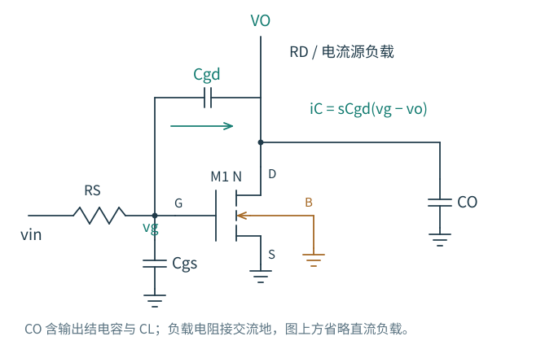
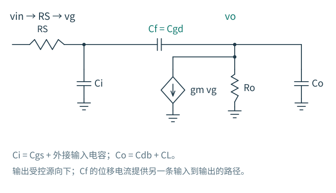
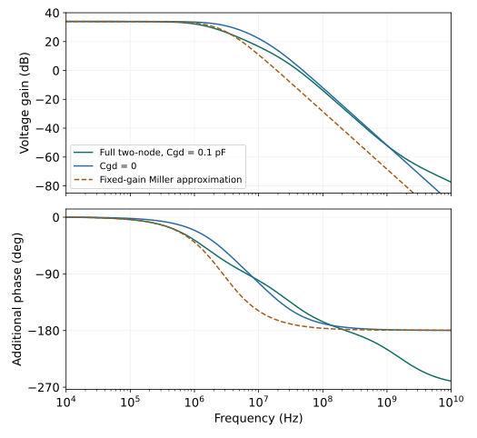

# 6.2 · Cgd 很小，输入为什么仍然吃力

在共源级上，栅电压升高，漏电压下降。跨在两者之间的 $C_{gd}$ 一端向上、另一端向下，它两端的电压变化比栅端本身更大。输入源必须为这份额外电荷提供电流。

图 6-1 · 从哪一端看电容，必须先说明另一端怎样动。上方 VO 为漏端节点，直流负载在本图省略，统一进入后文的 $R_o$；源、体分别接地，$C_O$ 是输出对地电容。

## 先算电流，再谈“变大”

输入端流入跨端电容的电流为

$$
i_{gd}=C_{gd}\frac{d(v_g-v_o)}{dt}.
$$

若在所讨论频段，局部增益 $v_o/v_g\approx A_0$ 可以视为常数，则

$$
i_{gd}\approx C_{gd}(1-A_0)\frac{dv_g}{dt}.
$$

当 $A_0=-50$，输入端需要提供相当于 $51C_{gd}$ 的电流。物理电容的面积并没有变；输入端看到的电流与自身电压变化率之比变了。

注意这里是 $A=v_o/v_g$，不是包含输入串联电阻以后、从信号发生器到输出的 $v_o/v_{in}$。后者还包含输入加载，不能混用。

精确的米勒端口关系实际上可以写为

$$
Y_{in,gd}(s)=sC_{gd}[1-A(s)],\qquad
Y_{out,gd}(s)=sC_{gd}[1-1/A(s)].
$$

这是使用实际局部电压比得到的端口电流恒等关系。它没有自动把求解变简单，因为 $A(s)$ 本身取决于原电路；变换后的支路一般是频率相关导纳。只有在增益可近似为常实数的频段，才得到常用的两只正值等效电容。$A=0$ 附近尤其不能使用含 $1/A$ 的形式。

## 两个节点完整保留，会出现什么

图 6-2 · $C_f=C_{gd}$；$C_i$ 包括 $C_{gs}$，$C_o$ 包括 $C_{db}$ 与负载，$R_o=R_D\parallel r_o$。源端与体端交流接地；负载本身的附加动态尚未加入。跨导源正方向由输出流向地。

令 $G_i=1/R_S$、$G_o=1/R_o$。两个节点的 KCL 直接给出

$$
\begin{aligned}
\bigl[G_i+s(C_i+C_f)\bigr]v_g-sC_fv_o&=G_iv_{in},\\
(g_m-sC_f)v_g+[G_o+s(C_o+C_f)]v_o&=0.
\end{aligned}
$$

第二式已经显露两条相反的路径：$g_mv_g$ 向下拉输出，而输入经 $C_f$ 的位移电流向输出注入。消去 $v_g$ 得到

$$
\boxed{H(s)=\frac{v_o}{v_{in}}=\frac{G_i(sC_f-g_m)}{d_0+d_1s+d_2s^2}}
$$

$$
\begin{aligned}
d_0&=G_iG_o,\\
d_1&=G_i(C_o+C_f)+G_o(C_i+C_f)+g_mC_f,\\
d_2&=C_iC_o+C_f(C_i+C_o).
\end{aligned}
$$

低频检查得到 $H(0)=-g_mR_o$。将 $C_f$ 置零，则分母可以分成 $(G_i+sC_i)(G_o+sC_o)$，输入与输出只剩单向跨导传递。这个退化情况帮助检查符号和单位。

### 零点来自路径抵消，而不是“又多了一只电容”

分子在 $s=+g_m/C_f$ 为零，是 RHP 零点。这个说法来自复频域中两条路径的代数抵消；在真实正弦频率轴上，$j\omega C_f$ 不会等于正实数 $g_m$，所以不会在那一频率出现幅度降为零的凹口。

从时域也能预见这个符号：输入突然向上，电容先把输出推高；随后晶体管增大漏流，把输出拉低。最初运动方向与最终反相响应相反，是这一简化共源级非最小相位行为的线索。

结论依赖于源极交流固定、跨导为常数、$C_f$ 为互易二端电容以及负载模型。真实 BSIM 中的电荷分配、移动源端和有源负载都可能改变零点，不能把 $g_m/C_{gd}$ 作为所有 MOS 放大器的零点公式。

## 米勒近似能估计什么，丢掉什么

以 $A_0=-g_mR_o$ 替代实际 $A(s)$，得到

$$
C_{Mi}=C_i+C_f(1+g_mR_o),\qquad
C_{Mo}=C_o+C_f\left(1+\frac1{g_mR_o}\right).
$$

两只孤立 RC 的模型为 $H_M=-g_mR_o/[(1+sR_SC_{Mi})(1+sR_oC_{Mo})]$。它可以估计哪个端口先受加载，尤其适用于一个极点远低于其余动态且零点更高的情况。但它丢掉了前馈零点，还把随频率变化的导纳冻结了。不要把它的两个 RC 数值都称为原电路的精确极点。

这项近似不是“精确米勒定理”的直接数值结果：恒等关系使用实际 $A(s)$，而这里主动替换成 $A_0$，再把两个端口近似解耦。之后若看见两条曲线偏离，应回查这一替换，而非修改物理电容去强行对齐。

完整分母的一阶系数更有信息量：

$$
\frac{d_1}{d_0}=R_SC_i+R_oC_o+C_f(R_S+R_o+g_mR_SR_o).
$$

桥接电容对应的电阻包含 $g_mR_SR_o$。这里能看到米勒效应如何进入时间常数，又不必预先拆成两只等效电容。[6.7](07-近似与设计判断.md) 会从测试端口推导这个电阻。

## 用一组小参数检查直觉

取 $g_m=1$ mS、$R_S=10$ kΩ、$R_o=50$ kΩ、$C_i=C_o=1$ pF。$C_f$ 仅为 0.1 pF，低频输入等效电容却达到 6.1 pF。完整二次分母的极点是 1.439 MHz、29.33 MHz；前馈 RHP 零点为 1.592 GHz。−3 dB 带宽约 1.436 MHz，接近慢极点是因为这里恰好有较好的极点分离。

去掉 $C_f$ 后，两个极点变成 3.183 MHz、15.92 MHz，−3 dB 带宽约 3.067 MHz。**跨端电容既把慢极点拉低，又把快极点推高**，并非给两个原节点各增加同一比例的电容。

图 6-3 · 这是显式线性教学模型，已经用独立原生 ngspice 网表核对，非 GF180 曲线。固定增益米勒近似能解释低频加载；高频时，忽略耦合和零点使相位判断发生偏差。幅度为 $20\log_{10}|v_o/v_{in}|$，相位相对低频反相增益。

<!-- interactive: miller-poles -->

可以依次做三次预测：把 $C_f$ 减到零，零点会去哪？增加 $C_f$，两个精确极点是否同时降低？把观察频率移到很高处，输入是否仍能用 6.1 pF 解释？上面的静态图和公式已经给出完整答案；交互用于把这些关系放到同一次操作中观察。

提高 $g_m$ 一方面增加驱动电流，另一方面在这里增加低频反相增益和输入端的米勒负担。若限制来自输出电容，较大 $g_m$ 未必移动该输出 RC 极点；若输入受限，变化方向还要连同 $R_S$ 和 $R_o$ 判断。

下一节：[换一个端口，电容的命运也变了](03-源跟随与共栅.md)
