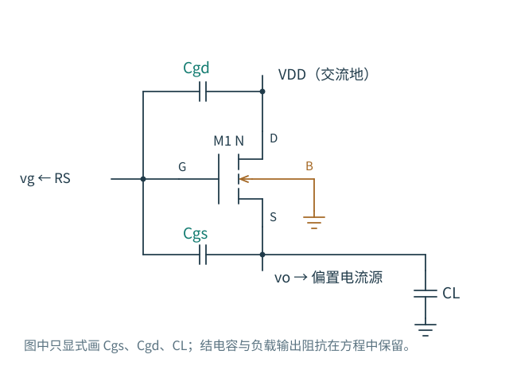
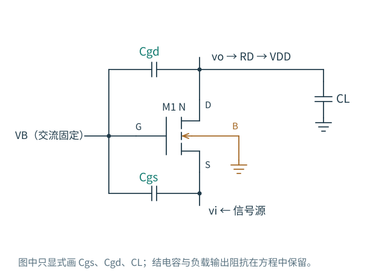

# 6.3 · 电容接在哪一端，比它叫什么更重要

共源级的输入和输出反向运动，$C_{gd}$ 承受很大的电压变化。如果改成源跟随器，输出随输入同向移动，跨在栅源间的 $C_{gs}$ 反而可能只看到很小的变化。这种“自举”不需要给电容取一个新名字，只需重新检查两端电压。

## 源跟随器：输出跟随，Cgs 的充电需求减小

图 6-4 · 漏极接 VDD、体端单独接地。$C_{gs}$ 跨输入与输出，$C_{gd}$ 的另一端交流固定。输出还接偏置电流源；它的有限输出电阻、结电容与外接负载应进入模型，不能把它当成无条件理想开路。

先假定栅由理想电压源驱动，漏、体交流固定。令 $G=1/r_o+1/R_L+g_{o,bias}$，$C_o$ 收纳源体结电容、偏置支路输出电容和 $C_L$，不重复计入 $C_{gs}$。源节点 KCL 为

$$
[G+g_m+g_{mb}+s(C_o+C_{gs})]v_o=(g_m+sC_{gs})v_g.
$$

所以

$$
\frac{v_o}{v_g}=\frac{g_m+sC_{gs}}
{G+g_m+g_{mb}+s(C_o+C_{gs})}.
$$

低频增益 $A_0=g_m/(G+g_m+g_{mb})<1$；输出导纳包含 $g_m$，这是低输出阻抗的来源。输出若被向上扰动，$v_{gs}$ 下降、晶体管供给源端的电流减少，节点受到恢复作用。

分子的 $+sC_{gs}$ 是栅到源的前馈路径，对应 LHP 零点 $-g_m/C_{gs}$。与共源级的 $C_{gd}$ 不同，输入向上时，电容瞬时推动源端的方向与最终跟随方向相同。但这个零点来自当前简化模型，不是所有跟随器都保留同一零点。

在输出仍能跟随的频段，输入端电流为

$$
i_g=sC_{gd}v_g+sC_{gs}(v_g-v_o)
\approx s[C_{gd}+C_{gs}(1-A_0)]v_g.
$$

若 $A_0$ 接近 1，$C_{gs}$ 的输入加载显著减小。体效应降低 $A_0$，自举就不完全；$C_{gd}$ 接交流地，无法靠源端跟随消除。频率上升、输出开始落后后，$A(s)$ 变成复数，也不能继续把 $C_{gs}(1-A_0)$ 当作全频固定电容。

### 信号源有电阻，低输出阻抗也带上频率条件

保留 $R_S$，令 $G_i=1/R_S$。栅与源的两节点方程为

$$
\begin{bmatrix}
G_i+s(C_{gd}+C_{gs})&-sC_{gs}\\
-(g_m+sC_{gs})&G+g_m+g_{mb}+s(C_o+C_{gs})
\end{bmatrix}
\begin{bmatrix}v_g\\v_o\end{bmatrix}
=\begin{bmatrix}G_iv_{in}\\0\end{bmatrix}.
$$

分子仍为 $G_i(g_m+sC_{gs})$；分母是矩阵行列式。有限输入电阻使栅也成为动态节点，不能仅用 $1/(g_mC_L^{-1})$ 的直觉给整个跟随器一个带宽。

把输入发生器置零，从输出注入测试电流，消去栅压，可得

$$
Z_{out}^{-1}(s)=G+g_m+g_{mb}+s(C_o+C_{gs})
-\frac{(g_m+sC_{gs})sC_{gs}}{G_i+s(C_{gd}+C_{gs})}.
$$

测试保留了外部负载 $G,C_o$；要测放大器本身的输出阻抗，应先移除对应外接负载。这个式子说明，只有栅交流足够固定时，才可直接用 $1/(G+g_m+g_{mb})$ 解释输出电阻。有限 $R_S$ 让输出扰动经 $C_{gs}$ 反过来移动栅，改变恢复电流；某些参数下还会出现感性阻抗特征与峰化。它不意味着芯片里真的藏着一只电感，也不意味着所有源跟随器都会峰化。

真实 GF180 对照采用第 5 章同量级的每支路 40 µA、输入管 10/1 µm，$R_S=10$ kΩ、$C_L=1$ pF，理想电流源负载。得到低频增益 0.755，−3 dB 带宽约 68.6 MHz；低频增益与实际工作点的 $g_m/(g_m+g_{mb}+g_{ds})$ 相符。较宽的带宽伴随电压增益小于 1、输入输出直流电平差以及电流驱动限制，不是无代价的放大。

## 共栅级：输入电流从源端进入

图 6-5 · 本图的 $v_i$ 指实际源节点；若信号发生器有 $R_S$，发生器输出另记 $v_{in}$。栅、体分别交流固定，漏端经 $R_D$ 接 VDD。此处 $C_{gd}$ 不跨接输入和高增益输出。

源压上升使 $v_{gs}$、$v_{bs}$ 都减小，漏电流减小，电阻上的压降减小，所以漏压同向上升。虽然源到漏可以有较大的正增益，$C_{gd}$ 的栅端并不跟着源输入移动；典型共源级中“反相高增益跨在 Cgd 两端”的条件消失了。

令 $u$ 为源节点，$G_D=1/R_D$，$g_o=1/r_o$，$g_\Sigma=g_m+g_{mb}+g_o$。忽略跨漏源电容，定义 $C_i=C_{gs}+C_{sb}$，$C_o=C_{gd}+C_{db}+C_L$。保留信号源 $R_S$ 时：

$$
\begin{aligned}
(G_i+g_\Sigma+sC_i)u-g_ov_o&=G_iv_{in},\\
-g_\Sigma u+(G_D+g_o+sC_o)v_o&=0.
\end{aligned}
$$

第一式中的 $-g_ov_o$ 表示漏压也会改变流入源端的电流。第二式给出局部增益

$$
\frac{v_o}{u}=\frac{g_\Sigma}{G_D+g_o+sC_o},\qquad
Y_{in}(s)=g_\Sigma+sC_i-
\frac{g_og_\Sigma}{G_D+g_o+sC_o}.
$$

若 $g_o\ll G_D$，输入电阻约 $1/(g_m+g_{mb})$，源端时间常数约 $(R_S\parallel R_{in})C_i$，输出时间常数约 $(R_D\parallel r_o)C_o$。输出若接高阻有源负载，有限 $g_o$ 的反馈可能使输入电阻显著变化；此时应回到两节点方程。

总增益为

$$
\frac{v_o}{v_{in}}=
\frac{G_ig_\Sigma}
{(G_i+g_\Sigma+sC_i)(G_D+g_o+sC_o)-g_og_\Sigma}.
$$

这让“输入节点快”与“整个放大器快”分开了：输入端低阻有助于接收电流，输出若仍是高阻大电容节点，带宽照样会受它限制。直接电压驱动还要为较低输入电阻付出源电流。

真实对照在 40 kΩ、1 pF 输出负载下得到共栅级约 4.07 MHz 带宽，几乎与同一工作点的共源级相同。因为这组条件本来就主要受输出负载限制；它并不否定共栅输入端避免典型米勒放大的优势。

下一节：[把共源与共栅接起来](04-共源共栅.md)
