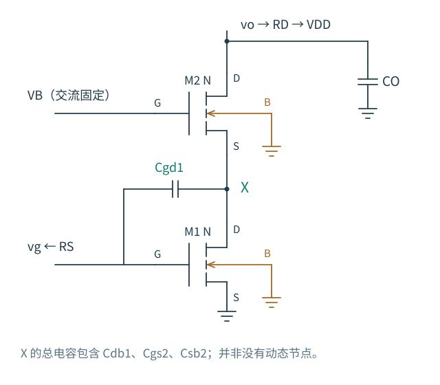
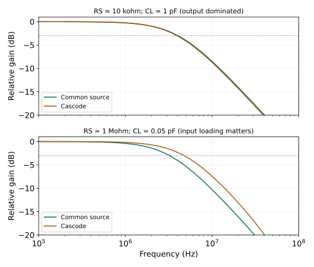

# 6.4 · 把大摆幅留在上面，下面就快了吗

普通共源级的漏端反相运动，栅漏电容两端的电压差因此比输入更大，前一级要提供更多充放电电流。上面接一只共栅管，把最终输出与下管漏端 X 分开，就有机会减轻这份加载。但 X 仍然要移动、要充放电；限制它摆幅的那只上管，也不是理想的电流传送器。

图 6-6 · $C_{gd1}$ 的另一端是 X，不能把总输出增益代进它的米勒公式。两只体端均接地；上管源端不接体端。上栅偏置 $V_B$ 和 VDD 均为交流固定点。输出负载经 $R_D$ 到 VDD，$C_O$ 包含 $C_{gd2},C_{db2},C_L$；图中省略的 X 对地电容稍后逐项归入 $C_X$。

## 先看局部电流怎样被接走

让下管栅压 $v_g$ 升高一点。M1 先试图增加向下的漏流；若 M2 还没有增加供给 X 的电流，差额便由 X 上的电荷承担，X 电压开始下降。M2 的栅和体都固定，因此它的 $v_{gs2}$、$v_{bs2}$ 同时增加，向下流入 X 的电流也增加。这个响应使电流差额缩小。**X 的小幅下降，是传递电流需求的过程，不是一个可以直接删去的节点。**

先在低频忽略电容，令 $g_1=1/r_{o1}$、$g_2=1/r_{o2}$，并记

$$
\begin{aligned}
g_{t2}&=g_{m2}+g_{mb2},\\
k_2&=g_{t2}+g_2.
\end{aligned}
$$

两管漏电流均以从漏到源为正。M1 源、体固定，故 $g_{mb1}$ 不产生信号电流；M2 则有 $v_{gs2}=v_{bs2}=-v_x$，于是

$$
\begin{aligned}
i_{d1}&=g_{m1}v_g+g_1v_x,\\
i_{d2}&=-g_{t2}v_x+g_2(v_o-v_x)\\
&=g_2v_o-k_2v_x.
\end{aligned}
$$

这里 $g_{m2}$ 与 $g_{mb2}$ 都增强源端移动引起的恢复电流，$g_2$ 则同时响应源、漏两端。若把上管体端误接到源端，$g_{mb2}$ 这一项就会改变，不能沿用同一方程。

在 X 令 $i_{d1}=i_{d2}$，在输出令 $G_Dv_o+i_{d2}=0$，其中 $G_D=1/R_D$，得到

$$
\begin{aligned}
(g_1+k_2)v_x-g_2v_o&=-g_{m1}v_g,\\
(G_D+g_2)v_o&=k_2v_x.
\end{aligned}
$$

第二式告诉我们：X 向下，输出也向下。消去输出后，X 对输入的低频局部增益为

$$
\begin{aligned}
G_{X0}&=g_1+k_2\frac{G_D}{G_D+g_2},\\
A_{x0}\equiv\frac{v_x}{v_g}&=-\frac{g_{m1}}{G_{X0}}.
\end{aligned}
$$

其中 $1/G_{X0}$ 是输入栅置零、保留输出负载时，从 X 看入的低频小信号阻抗。若单看上管源端，不含下管的 $r_{o1}$，则为

$$
R_{\mathrm{in},2}=\frac{1+g_2R_D}{k_2}.
$$

这正接上了 [3.4 的终接问题](../03-单级放大器/04-共栅级.md)：漏端负载越高，上管源端未必仍然低阻。在 $g_2R_D\ll1$、$g_1,g_2\ll g_{t2}$ 时，可简化为

$$
A_{x0}\approx-\frac{g_{m1}}{g_{m2}+g_{mb2}}.
$$

在有限 $R_D$ 下忽略两管输出电导，也得到这一结果。两管跨导同量级时，局部增益约为 −1；总输出增益却还要乘上 $k_2/(G_D+g_2)$。计算 $C_{gd1}$ 的输入电流时，用的是前一个关系：

$$
\begin{gathered}
C_f=C_{gd1},\\
i_{g,C_f}=sC_f(v_g-v_x),\\
C_{\mathrm{in,LF}}\approx C_{gs1}+C_f(1-A_{x0}).
\end{gathered}
$$

这才得到熟悉的 $C_f[1+g_{m1}/g_{t2}]$ 米勒项。若输出在低频近乎开路而 $g_2\ne0$，则 $G_{X0}\to g_1$，X 可能有很大摆幅。不能先假设 X 接地，再用这个假设证明它摆幅很小。

## 输出抬高一点，X 为什么也会上升 {#output-to-x}

现在把输入置零，用理想测试源规定输出增量，仍先忽略电容。输出升高使 M2 的 $g_2(v_o-v_x)$ 项试图增加向下电流。电流流入 X，使 X 上升；随之减小的 $v_{gs2}$ 和 $v_{bs2}$ 又抵消大部分电流变化。由同一条 X 方程可得

$$
\left.\frac{v_x}{v_o}\right|_{v_g=0}
=\frac{g_2}{g_1+k_2}>0.
$$

比值通常很小，却不是零。[3.5 的输出测试图](../03-单级放大器/05-共源共栅.md)已经把这次抵消画在原电路上。这里要注意测试条件：输出由测试源强制运动，已不服从刚才自由输出时的 $v_o/v_x$ 关系。外接 $R_D$ 会改变测试源提供的电流，不改变这个规定电压下的低频比值。上管 $r_{o2}\to\infty$ 时，$g_2\to0$，本模型的输出到 X 反馈才消失。

终接还随频率变化。先移开 X 上的并联电容，只看上管传导支路；输出由 $R_D\parallel1/(sC_O)$ 终接时，源端看到

$$
Z_{\mathrm{in},2}(s)
=\frac{G_D+g_2+sC_O}{k_2(G_D+sC_O)}.
$$

低频很高的输出负载，在较高频率可能被 $C_O$ 旁路。当 $|G_D+sC_O|\gg g_2$，这个阻抗又接近 $1/k_2$：输出不能再通过 $r_{o2}$ 充分跟着 X 运动，上管源端恢复了较强的电流响应。因此，低频较大的 X 摆幅，并不能直接证明整个高频范围都存在同样大的米勒倍乘。这也是原书习题 6.11 特别提出“大 $C_L$”条件的原因。

## X 没有消失，它有自己的电荷

在本节的常数二端电容近似中，先把路径分清：

| 电容 | 两端与作用 |
|---|---|
| $C_{db1}$ | X 到固定体端，属于 X 的对地电荷 |
| $C_{gs2}$、$C_{sb2}$ | X 到固定的上栅、体端，也属于对地电荷 |
| $C_f=C_{gd1}$ | 输入栅到 X，两个端点都可能运动，须保留 $sC_f(v_x-v_g)$ |
| $C_{gs1}$ | 输入栅到地，首先加载输入源 |
| $C_O=C_{gd2}+C_{db2}+C_L$ | 输出到地，改变输出终接，也间接改变 X 的阻抗 |

以下记 $C_X=C_{db1}+C_{gs2}+C_{sb2}$，不重复计入 $C_f$。忽略直接漏源跨接电容，假设上栅偏置始终交流固定。若偏置网络有显著阻抗，$C_{gs2}$ 的另一端也会移动，需要把偏置节点纳入分析。

若把输入栅与输出都用理想电压源固定，X 受到的恢复导纳就是 $g_1+k_2$，需要充放电的电容是 $C_X+C_f$。这个明确的端口实验给出局部时间尺度

$$
\tau_{X,\mathrm{clamp}}=\frac{C_X+C_f}{g_1+k_2}.
$$

它回答“在其他节点被固定时，X 多快恢复”。自由放大器中的栅和输出并没有同时被钳位，这个数不能直接命名为整机的一个精确极点。原书式 (6.80) 则用了另一种估计：将 $C_f$ 在 X 一侧按 $1-v_g/v_x$ 米勒变换；若 $v_x/v_g\approx-1$，就得到约 $2C_f+C_X$。两种电容值对应不同的端口约束，不能混用。频率升高后，局部增益变成复数，固定倍乘也随之失效。

[2.3 的端口电荷](../02-MOS器件/03-小信号与电容.md#charge-in-circuits)还给出更深一层的边界：真实 BSIM 中，X 端电荷电流是各端口电压变化率的加权和，交叉偏导可以非互易。本节几只二端电容是解释路径的近似，不能用任意对称化的电容值替换真实电荷矩阵。下面的 GF180 曲线保留了原模型的电荷响应。

## 让三个节点一起运动 {#coupled-dynamics}

在低频，M2 送入 X 的电流几乎全部交给 M1；信号加快后，一部分还要改变 $C_X$ 与 $C_f$ 的电荷。输出也要为 $C_O$ 供电流。把这些电流逐项写出，令 $G_i=1/R_S$：

$$
\begin{aligned}
G_i(v_g-v_{in})+sC_{gs1}v_g\\
{}+sC_f(v_g-v_x)&=0,\\[3pt]
g_{m1}v_g+(g_1+k_2)v_x-g_2v_o\\
{}+sC_Xv_x+sC_f(v_x-v_g)&=0,\\[3pt]
(G_D+g_2+sC_O)v_o-k_2v_x&=0.
\end{aligned}
$$

X 方程中的 $-g_2v_o$ 正是输出返回 X 的路径；$-sC_fv_g$ 则是栅压经电容直接注入 X 的路径。它们不能被“X 近似交流地”一并抹去。

先规定栅端电压，消去输出，便看见 X 的恢复关系：

$$
\begin{aligned}
Y_X(s)&=g_1+k_2+s(C_X+C_f)\\
&\quad-\frac{g_2k_2}{G_D+g_2+sC_O},\\
\frac{v_x}{v_g}&=\frac{sC_f-g_{m1}}{Y_X(s)}.
\end{aligned}
$$

这里 $Y_X$ 是栅端置零、输出自由终接时从 X 看入的导纳。低频代入 $s=0$，恢复前面的 $G_{X0}$；输出被足够强地固定时，最后的耦合项减弱，才接近单独的局部 RC。若 X 的恢复速度远高于输入、输出的变化速度，可以在所关注频段忽略 X 自身的储能项，代数消去 X；由栅压变化驱动的 $sC_fv_g$ 前馈仍须按频段判断，不能连同整只 $C_f$ 一起删除。若时间尺度接近，输出返回项与栅漏电容都随频率变化，就必须联立求解。

原三节点矩阵与精确传递函数

$$
\begin{bmatrix}
G_i+s(C_{gs1}+C_f)&-sC_f&0\\
g_{m1}-sC_f&g_1+k_2+s(C_X+C_f)&-g_2\\
0&-k_2&G_D+g_2+sC_O
\end{bmatrix}
\begin{bmatrix}v_g\\v_x\\v_o\end{bmatrix}
=\begin{bmatrix}G_iv_{in}\\0\\0\end{bmatrix}.
$$

为了不展开冗长的三阶多项式，记

$$
\begin{aligned}
A&=G_i+s(C_{gs1}+C_f),\\
B&=g_1+k_2+s(C_X+C_f),\\
D&=G_D+g_2+sC_O,\\
P&=g_{m1}-sC_f,\\
\Delta(s)&=A(BD-g_2k_2)+sC_fPD.
\end{aligned}
$$

则

$$
\begin{aligned}
\frac{v_x}{v_{in}}&=-\frac{G_iPD}{\Delta(s)},\\
\frac{v_o}{v_{in}}&=-\frac{G_ik_2P}{\Delta(s)}.
\end{aligned}
$$

以上关系由本节电路独立消元得到，不作为原书公式转录。

三个自由节点通常给出三个自然模态：撤去输入以后，栅、X、输出按某个电压比例共同恢复。写成 $C\dot v+Gv=0$，每个模态的恢复率由 $-C^{-1}G$ 的特征值给出；它不是某一只电容独自放电的速度。

输入能激发这个模态多少、输出能看到它多少，还决定它在传递函数中的权重。一个很快或权重很小的模态，未必在幅频曲线上形成明显转折。若用理想电压源规定 $v_g$，栅端不再是自由状态，阶数已降为二；$C_f$ 仍参与 X 的充放电与前馈。这个二端电容模型还给出 $s=+g_{m1}/C_f$ 的右半平面前馈零点，$C_f\to0$ 时它移到无穷远。零点不增加储能，却会改变幅相，因而不能只数节点就猜带宽。

再比较两个不同的观察端口。输入栅固定，移开 $R_D$、$C_O$，暂忽略 $C_f$，从最终输出看入有

$$
Z_{out}(s)=r_{o2}
+\frac{1+g_{t2}r_{o2}}{g_1+sC_X}.
$$

它在 $g_1/C_X$ 开始失去低频的高阻抗提升：X 的电容旁路了下管 $r_{o1}$，原来的局部反馈条件变了。但重新接回输出负载，输入栅理想驱动时，要用两节点耦合的动态分母 $D_{xo}(s)$ 求电压增益：

$$
\begin{aligned}
D_{xo}(s)&=(g_1+k_2+sC_X)\\
&\quad\cdot(G_D+g_2+sC_O)\\
&\quad-g_2k_2.
\end{aligned}
$$

$$
\left.\frac{v_o}{v_g}\right|_{C_f=0}
=-\frac{g_{m1}k_2}{D_{xo}(s)}.
$$

分母一般不含独立的 $(g_1+sC_X)$ 因子，不能把刚才的端口阻抗极点原封不动加进电压增益。原书例 6.16 用理想电流源负载进一步说明：输出电容在较高频率降低漏端终接。取 $G_D=0$，在 $g_1,g_2\ll g_{t2}$ 且 $g_{t2}C_O\gg g_2C_X$ 的极限下，内部快速模态仍可接近 $g_{t2}/C_X$。这不表示 X 电荷没有影响，而是必须在实际终接下判断它的影响。

一个显式线性例子能看清何时值得担心 X。取两管 $g_m=1$ mS、$r_o=100$ kΩ，上管 $g_{mb}=0.2$ mS；$R_S=1$ kΩ、$R_D=40$ kΩ，$C_{gs1}=1$ pF、$C_f=0.1$ pF、$C_O=0.05$ pF，仅改变 $C_X$：

| $C_X$ | 完整网络最慢模态 $\lvert p\rvert/(2\pi)$ | $v_o/v_{in}$ 的 −3 dB 带宽 |
|---|---|---|
| 0.5 pF | 67.71 MHz | 56.12 MHz |
| 5 pF | 23.79 MHz | 22.49 MHz |
| 50 pF | 2.744 MHz | 2.741 MHz |

这些是解析教学参数，不是 GF180 提取值。增大 X 电荷确实能把内部动态拖入信号频段；当一个慢模态充分主导输出时，带宽才逐渐接近它的频率。实际加宽 M2 还会同时改变跨导、电流和多个电容，不能把这张“只改 $C_X$”的表当成器件尺寸扫描。

## 同一个拓扑，换限制条件会得到不同答案

图 6-7 · 全部曲线来自真实 GF180MCU。上下图均为 $v_o/v_{in}$ 并相对各自低频幅度归一化；两管均 10/1 µm，$R_D=40$ kΩ，输入直流栅压约 0.900 V，共源共栅上栅 1.8 V。两组实验只改变标明的外部源阻抗与电容，不在不同端口之间比较。典型角、27 ℃、VDD 3.3 V，体端连接与图 6-6 相同。

上图 $R_S=10$ kΩ、$C_L=1$ pF：共源约 4.05 MHz，共源共栅约 3.94 MHz。较低源阻抗减弱了输入充放电的限制，较大的输出负载则使两者都要面对输出充放电。共源共栅提高支路输出电阻，却还受外部 40 kΩ 并联限制；提高电阻带来的增益与较长的输出时间常数，也不是免费的速度收益。上管增加的结电容和 X 电荷可能抵消部分输入优势。观察到的净结果是带宽没有提高，不能把这点下降单独归给 X。

下图 $R_S=1$ MΩ、$C_L=0.05$ pF：共源约 3.22 MHz，共源共栅约 4.74 MHz。输出负载减轻，源阻抗增大，栅端加载变得重要；让 $C_{gd1}$ 的另一端只作较小运动就更有价值。这里改善的是指定源阻抗下从信号源到最终输出的传递，不等于上管或 X 的本征速度提高了。

两组共源共栅实验的直流点相同：$V_X\approx0.678$ V、$V_O\approx1.710$ V；按各管归档的 $V_{DS}-V_{DSAT}$，下管余量约 0.457 V，上管约 0.801 V。带宽差异没有来自某一组失去饱和。但这些端到端曲线没有单独测量 X 的 AC 响应，不能据此给 X 指定一个精确工艺极点，也不能把几种寄生影响各占多少作唯一归因。

选择尺寸时，可以先问：前一级主要在给米勒项充电，还是输出负载已占据主要时间常数？若先解决了这两个限制，X 的动态才更可能显露出来。加宽上管能增强恢复电流，也会增加 $C_{gs2},C_{sb2}$ 等电荷；堆叠还消耗电压余量。共源共栅改善的是特定的耦合、阻抗和电流传递条件，整个电路是否更快，仍由这些条件共同决定。

本节原书对照：Razavi 第二版中文版印刷页 73～74（PDF 97～98），Fig. 3.53～3.54、式 (3.116)～(3.119)，讨论共栅源端阻抗与漏端终接；印刷页 77（PDF 101），Fig. 3.63、3.65、式 (3.128)，讨论电流传递与输出阻抗。频率部分见印刷页 176～179（PDF 200～203），式 (6.74)、Fig. 6.34～6.35、式 (6.79)～(6.86)；大负载与米勒项的联系另见印刷页 195（PDF 219）的习题 6.11、Fig. 6.63。本文的有限终接消元、三节点模态与数值例子独立展开。

所核对的中文第二版 Fig. 6.34 将上管栅源之间的电容标为 $C_{GD2}$；按其连接应为 $C_{GS2}$，与同页正文一致。本节按端口连接标注，不将该图中文字沿用到模型。

复核资源：[原 GF180 实验与模型条件](../实验/频率响应/README.md)、[显式线性网表](../实验/频率响应/decks/analytic-cascode.cir)及[独立核验脚本](../../scripts/check_cascode_dynamics.py)。在仓库根目录运行 `uv run --locked scripts/check_cascode_dynamics.py`，可比较端口极限、节点方程、原生 ngspice 和归档 GF180 响应。

下一节：[差分与电流镜的动态路径](05-差分结构.md)
