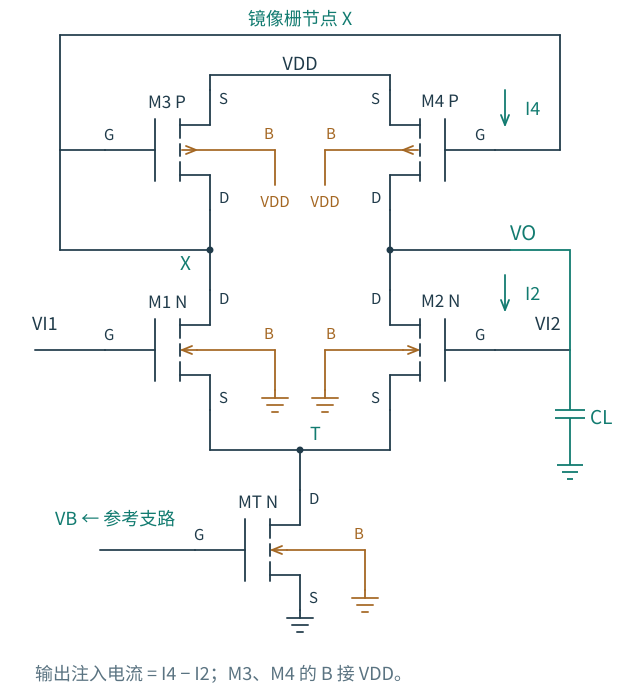
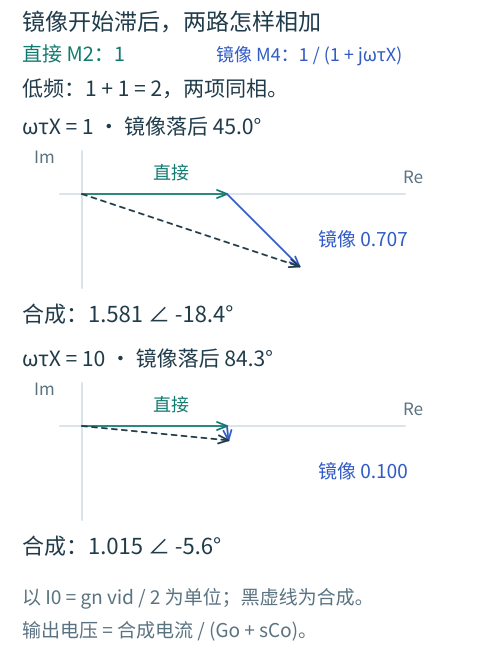
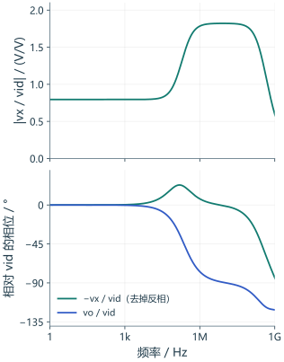

# 6.5 · 镜像的电流，需要多久才能到达

第 4 章中，对称性让差模电路一分为二。进入频域后，只要元件、寄生和终接也对称，这个方法仍然成立。但电流镜负载有一个二极管连接端和一个高阻输出端，从一开始就不是两只独立的对称负载。

## 电阻负载对：对称性保留，端口定义不能省

沿用[第 4 章的电阻负载差分对原理图](../图/diff-pair.svg)，本节只给两侧输出各接一只相等的 CL；两个 CL 分别对地，不跨接两输出。理想尾源的差模响应对应下面的半电路。

对完全匹配的两支路施加 $+v_{id}/2,-v_{id}/2$，两个输出反向运动，公共源点在**线性差模**下为交流虚地。有限尾阻抗不破坏这个结论，因为对称扰动在尾端相消；不对称寄生、负载或输入终接则可能破坏它。

右端单输出取 $v_{o2}$，在源点固定、栅直接理想驱动、简化二端电容模型下有

$$
\frac{v_{o2}}{v_{id}}=
\frac{g_m-sC_{gd}}{2[G_o+s(C_o+C_{gd})]},
\quad G_o=1/R_D+g_{ds}.
$$

右栅为 $-v_{id}/2$，所以右输出低频为正。若差分输出定义成 $v_{o2}-v_{o1}$，则增益恰好是上式两倍。若每只栅前再接 $R_S$，应使用 [6.2](02-米勒与共源.md) 的完整单支路两节点传递函数，右端增益为 $-H_{CS}/2$；不能把发生器端口和实际栅端口混用。

这里单端与差分输出的幅度相差 2，但**匹配差模情况下频率形状相同**，不会因为“差分有两只电容”就让输出节点电容翻倍。对称面上的交流虚地也不是把两支路真的短接。

工艺对照采用两管 10/1 µm、80 µA 理想尾源、两只 40 kΩ 和两只 1 pF，$V_{CM}=1.4$ V。右端低频增益约 6.03 V/V，−3 dB 带宽约 4.07 MHz。它用于检查半电路频域端口，不与低频约 206 倍的有源镜 OTA 直接作“哪个更快”的公平排序。

共模下尾点会动，尾源的输出电导和结电容进入反馈路径；尾管的栅偏置还可能通过 $C_{gdT}$ 被耦合。此时应使用两支路与尾节点方程，不能把差模的虚地条件照搬过来。共模转差模与高频 CMRR 还依赖不对称；本章不把理想匹配结论当作统计失配验收。

## 有源镜负载：一条直接路径，一条先经过 X 的路径

图 6-8 · 沿用第 5 章的 M1～M4、MT、VI1/VI2 与右侧 VO。X 同时是 M1 漏端、二极管连接 M3 的栅漏和 M4 的栅；T 是公共源节点；VB 来自原有 MR 与 RREF，见[偏置图](../图/mirror-bias.svg)。图上显式增加 CL，器件寄生由实际模型给出，不把每一项电荷偏导画成互易电容。

令左输入升、右输入降。M1 增流把 X 拉低，M4 因 $V_{SG}$ 增大而向输出提供更多电流；同时 M2 减少从输出抽走的电流。低频时两项相加。频率升高后，X 必须先给 M3、M4 的栅电荷和相关结电荷充放电，镜像电流来不及完全跟上；M2 的直接路径却仍在。

为了把这两条路径看清，先用理想尾源、忽略 $g_o$ 对尾点的耦合，只在输出保留小电导 $G_o$，将 X 与 O 电容暂时各化为对地的 $C_X,C_O$。输入管跨导为 $g_n$，镜管跨导为 $g_p$：

$$
(g_p+sC_X)v_x=-\frac{g_n}{2}v_{id},\qquad
(G_o+sC_O)v_o=\frac{g_n}{2}v_{id}-g_pv_x.
$$

第二式左侧是输出存储与泄放，右侧的第一项是直接路径，第二项是经过镜像的路径。把直接注入的电流记为 $I_0=g_nv_{id}/2$，以它为相位参考，就能先讨论两路电流，暂时不混入输出节点本身的延迟：

$$
\frac{I_{\mathrm{direct}}}{I_0}=1,\qquad
\frac{I_{\mathrm{mirror}}}{I_0}=\frac1{1+j\omega\tau_X},\qquad
I_{\mathrm{sum}}=I_{\mathrm{direct}}+I_{\mathrm{mirror}}.
$$

先预测：当镜像一项落后 45°，还能把两项幅值直接相加吗？

图 6-8a：只对应上面两节点解析模型，不使用 GF180 参数拟合。绿箭头是 M2 少取电流所形成的直接注入，蓝箭头是经 X 控制 M4 的镜像注入；将蓝箭头接到绿箭头末端，黑虚线才是合成。相位以直接路径为零，尚未乘输出阻抗。

在 $\omega\tau_X=1$ 时，镜像项是 $0.5-j0.5$，而不是一个同相的 0.707；合成是 $1.5-j0.5$，幅值约 1.581，相位约 −18.4°。再升到 $\omega\tau_X=10$，镜像幅值只剩约 0.100，直接路径仍为 1，合成幅值回到约 1.015。于是注入输出的有效跨导，从低频的约 gn 过渡到高频的约 gn/2。**镜像变慢，并没有把直接路径也关掉。**

输出电压还要经过 $1/(G_o+sC_O)$。所以图中合成电流的相位逐渐靠回直接路径，不代表整个 OTA 的输出电压也恢复到零相位。将两部分连起来，消去 X，得到：

$$
\boxed{\frac{v_o}{v_{id}}\approx\frac{g_n}{G_o}
\frac{1+s\tau_X/2}{(1+s\tau_X)(1+s\tau_O)}}
\qquad \tau_X=C_X/g_p,\quad\tau_O=C_O/G_o.
$$

镜像节点带来一极点，同时出现约在 $-2/\tau_X$ 的 LHP 零点。原因不是电容“补回一个极点”，而是高频时镜像路径衰减，直接路径仍留下约一半的跨导；两条路径合起来形成分子。只给增益乘一个镜像低通因子，会把直接路径也错误地滤掉。

这一模型有助于预判幅相形状，但 X 与 O 之间真实存在 M4 的跨端电荷，有限 $r_o$ 会驱动 T，偏置也不是理想固定。实际零点和模态需从完整模型判断，不能把 $2g_p/C_X$ 贴到真实曲线上当作精确提取结果。

## 为什么不能直接给五管 OTA 套差模半电路

左输出是低阻二极管端，右输出是高阻信号端。$v_x$ 与 $v_o$ 并不等幅反向，有限漏源电导把这种不对称反馈到 T。现在回到同一个实际五管 OTA：不改变尺寸、偏置与 1 pF 负载，直接读取已存档的复数节点 AC。

图 6-8b：完全来自 `ota-1p-ac.csv` 的 801 个复数频点，typical、27 °C、VDD=3.3 V、VCM=1.4 V、CL=1 pF；[网表、原始数据与模型版本](../实验/频率响应/README.md)保持不变。图窗为 1 Hz～1 GHz。下图将 X 的反相去掉，画 $-v_x/v_{id}$，使相位零点容易与解析图对照；O 仍画 $v_o/v_{id}$。两条都是相对同一输入的**节点电压传递**，不是已经分离的 M2、M4 完整端口电流。

这里 X 的幅度从低频约 0.795 V/V 增到 1 MHz 的约 1.784 V/V，然后才在更高频率下降，已经不是上一幅解析图里的单调低通。此时去掉反相后的 X 相位约 +7.1°，输出相位约 −77.0°。它说明真实的 X 同时受到尾节点运动和跨节点电荷耦合影响，不能拿一个孤立的 $C_X/g_p$ 精确代表整段响应，更不能把两张图拼成同一个模型的曲线。

在同一个 1 MHz 归档点，每伏差分输入还对应约 0.048 V 的 T 相量；T 并非精确交流零。

这个数值是小信号线性比例，实际 1 mV 差分激励对应约 48 µV 的尾点运动。不要用归一化相量推断真实电压会超出电源，也不要把它混同于大信号电流转向。

谁会成为主导极点？输出电阻通常较大，是首要候选；但必须同时比较电容、耦合和模态可见性。镜像管特别大、输出负载很小或偏置分配很慢时，X 或偏置网络可能进入工作带宽。下一节将对已经存在的 OTA 做实际的节点导纳检查。

下一节：[保留原电路，进入频域](06-OTA进入频域.md)
