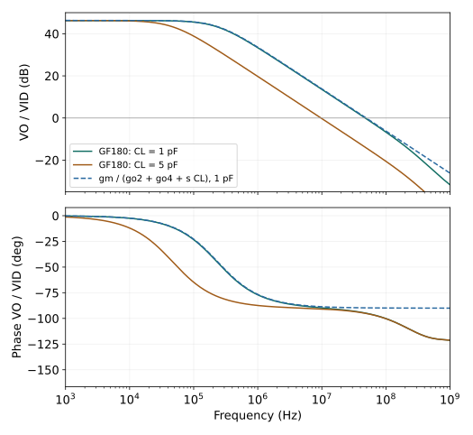

# 6.6 · 206 倍增益，究竟能维持多久

我们不重新调一只“适合画频响”的 OTA。第 5 章已经决定的参考支路、尺寸、输入共模和输出静态点全部保留，只在右输出端增加明确的负载电容。

基准电路仍是五管核心加 MR、RREF：NMOS 输入管 10/1 µm，尾管 20/1 µm，MR 为 10/1 µm，PMOS 为 3.708167/1 µm，RREF 为 59.995746 kΩ。VDD = 3.3 V，VCM = 1.4 V，典型角、27 ℃；体端和结面积约定沿用[第 5 章](../05-电流镜与偏置/05-设计一次电流源.md)。实际尾电流约 78.53 µA，VO = 1.658714 V，功耗约 0.39114 mW，增益 206.0108 V/V。

## 先把要驱动的负载与指标写下来

在开始频域仿真之前，[design.json](../实验/频率响应/design.json) 固定了这次典型条件的教学目标：

- 驱动 1 pF 纯电容负载；低频开环 $|v_o/v_{id}|\ge150$ V/V。
- 同一端口的 −3 dB 带宽至少 100 kHz。
- 全部参考与核心的静态供电功耗不超过 0.45 mW。

这是基于现有低频增益和工作电流作出的可检验目标，并非产品全角规格。$g_m\approx0.309$ mS、$R_{out}$ 为数百 kΩ，先估 $1/(2\pi R_{out}C_L)$ 在数百 kHz，目标具有合理量级。后续候选允许失败，负载和功耗上限不随结果改写。

开环测量不连接输出反馈，也不以理想电压源钳住输出。$v_{i1}$ 和 $v_{i2}$ 围绕 1.4 V 分别激励 $+0.5,-0.5$；输出没有额外直流导通负载。电容在 DC 开路，因而改变 CL 不应改变工作点。这是第一项复核。

## 一张图，分开增益、带宽与单位增益频率

图 6-9 · 原生 ngspice 47、固定版本 GF180MCU、完整 BSIM4 AC 结果。实线只改变 CL；虚线用同一工作点 $g_m/(g_{ds2}+g_{ds4}+sC_L)$，没有为重合而拟合电容。相位直接对应正低频增益的右输出 $v_o/v_{id}$。模型与网表见[实验资源](../实验/频率响应/README.md)。

| CL | 低频增益 | −3 dB 带宽 | 首次向下穿越 0 dB 的频率 |
|---|---:|---:|---:|
| 1 pF | 206.01 V/V | 232.08 kHz | 47.44 MHz |
| 5 pF | 206.01 V/V | 47.11 kHz | 9.70 MHz |

直流增益没变，因为静态电流路径没变；输出电压每秒需要搬运的电荷随 CL 增多，响应更早衰减。−3 dB 是相对低频幅度降低到 $1/\sqrt2$；单位增益频率则是幅度降到 1 V/V。两者相差约两百倍，与较高的直流增益有关。

对于真正单极点模型，$f_u=f_p\sqrt{A_0^2-1}\approx A_0f_p$。此处 $206\times232$ kHz 约为 47.8 MHz，接近实际 47.4 MHz，但高频镜节点与其他路径已经开始贡献相位。不能把乘积公式升级成所有多极点系统的恒等式。

开环输出在 $f_u$ 处的相位也不等于某个已经接好的闭环系统的相位裕度。连接反馈后会改变激励、加载和环路定义；本章不据此宣称闭环稳定或某一闭环带宽。

## 检查主极点：从端口测试重建节点系统

仅因 232 kHz 附近下降 3 dB，还不足以称它为一个精确极点。我们以原 DC 值钳住 X、O、T、B，逐一用 1 V AC 测试源激励各节点，其余节点交流置零，测每个端口流入原电路的电流，得到四节点导纳矩阵 $\mathbf Y(j\omega)$。另外施加差分输入，测强制保持各节点时所需的电流，得到输入项。

这些钳位源**只用于测量导纳**。重建响应时要撤去钳位，求解

$$
[\mathbf G+s(\mathbf C+ C_L\mathbf e_o\mathbf e_o^T)]\mathbf v
=(\mathbf b_0+s\mathbf b_1)v_{id}.
$$

其中 $\mathbf e_o$ 只在 O 所在位置为 1。原生模型在 1、10、100 kHz 的测试确认相应 $G,C$ 一致；复原网络与直接 AC 在 1 Hz～30 MHz 的复数输出也一致，最大相对差异小于 $10^{-9}$。这验证的是同一准静态模型的数值重建，不是硅片精度。

有负载 1 pF 时，这个四节点模型的自然模态频率 $|s_p|/(2\pi)$ 为：

| 模态，按快慢排序 | 计算频率 | 怎样解释 |
|---|---:|---|
| 最慢模态 | 232.10 kHz | 输出负载主导，和 232.08 kHz 截止点接近 |
| 其后 | 336.17 MHz | 主要关联镜像 X，但仍有节点耦合 |
| 其后 | 524.22 MHz | 偏置网络参与的模态 |
| 最快 | 1.689 GHz | 公共源等快速运动，仍是准静态网络结果 |

这次可以将慢模态关联到输出，是因为矩阵、负载敏感性与端口响应共同支持。后三项主要用于检验极点分离，不作为芯片可用射频带宽；当前没有栅布线、电阻和互连的版图提取，也未验证此频段的非准静态与封装行为。

为什么不把 BSIM 的 Cgd、Cgs 拿出来直接拼几只电容

实际模型线性化得到端口电荷偏导。提取的四节点 C 矩阵中，$C_{XO}\approx-0.593$ fF，$C_{OX}\approx-4.655$ fF，并不对称。一只互易二端电容在两个非对角位置应产生相等的负值，因此不能给这两个数随便取平均，再声称得到精确小信号模型。

通过端口导纳提取保留了准静态电荷分配、重叠与结电容，也保留了受控源、真实参考支路和器件内部串联效应在这些端口上的表现。[nodal.json](../实验/频率响应/data/nodal.json) 保存完整单位和节点顺序，AC 钳位网表也全部保留。

由 $G^{-1}$ 得到在其余节点自由响应时的输出电阻约 673.2 kΩ。忽略跨节点项、只用对角电容，会得到不同估计；将所有寄生“并到输出”也可能重复计数。重建模型中 $(G^{-1}C)_{OO}/(G^{-1})_{OO}$ 约为 18.8 fF，可作为这一固定网络的等效输出时间常数贡献，**不是一只物理电容的测量值**。

## 尾节点和偏置节点是否真的可以忽略

原参考支路的小信号阻抗有限，B 还接尾管栅。将 B 用其原 DC 电压的理想源交流固定，再与真实偏置比较，1 pF 下的带宽与单位增益频率变化极小。1 MHz 时 B 的幅度约为每伏差分输入 3.9 µV；同频 T 约为 0.048 V。对这个匹配差模端口、这个偏置和负载，B 不是主要限制。

这项对照支持**在当前问题里**先简化偏置动态；它不说明偏置网络对共模、供电扰动、失配或所有频率都无影响。尤其不能用 B 很安静推断 T 恰好虚地：镜像负载的非对称与有限 $r_o$ 仍会驱动 T。

无外接 CL 时，模型仍有器件电容，得到约 12.7 MHz 的 −3 dB 带宽。它既不是“无电容放大器”，也不是可直接使用的芯片速度指标；真实后级、走线和焊盘很容易超过这里仅十几 fF 的输出电荷量级。保留此实验主要是为了说明：主导负载改变以后，原来隐藏的节点可能浮现出来。

## 作一次选择，而不只读曲线

固定 1 pF 后，保留基准并试三种有明确目的的修改。所有变体重新求 DC、检查工作区，再做 AC，不能只在原曲线上缩放：

| 候选 | 低频增益 | −3 dB 带宽 | 功耗 | 代价与判断 |
|---|---:|---:|---:|---|
| 原尺寸 | 206 | 232 kHz | 0.391 mW | 满足本次三项标称目标，选作基准 |
| 只将输入 W 加倍，L 不变 | 242 | 266 kHz | 0.392 mW | 跨导提高约 35%，但输入面积、电容及驱动负担增加 |
| M1～M4 的 W、L 均加倍，尾与参考不变 | 352 | 134 kHz | 0.391 mW | $r_o$ 增益明显，跨导近似不变；带宽下降、沟道面积增加四倍 |
| 所有 MOS 的 W 加倍，RREF 减半，L 不变 | 208 | 457 kHz | 0.782 mW | 电流与跨导约加倍，带宽提高，但超过功耗预算 |

第二项中电流并非人为锁定完全相等：真实尾管受源节点移动与有限输出电阻影响，供电电流略变，数值已包含它。第三项也没有再调 PMOS 使输出刻意重合，只检查新的工作点仍有足够余量。固定结几何继续采用第 5 章的教学约定，因此尺寸变体不是面积/布线提取后的芯片面积评估。

加长器件的例子把增益与速度的冲突说得很具体。若负载主导，

$$
A_0\approx G_mR_{out},\quad f_{3dB}\approx\frac1{2\pi R_{out}C_L},
\quad A_0f_{3dB}\approx\frac{G_m}{2\pi C_L}.
$$

增加 $R_{out}$ 可以主要换来更高增益与更窄带宽，而非更快的单位增益频率。实际第三项的 $f_u$ 约 44.8 MHz，还略低于基准 47.4 MHz，因为寄生与内部动态也改变了。

若系统后来要求驱动 5 pF，原尺寸只有约 47.1 kHz，不能把 1 pF 的合格结果沿用。应重新分配电流、考虑缓冲或降低增益/速度要求；本阶段没有靠改变目标把它宣布为合格。当前选择是保留原 OTA 满足 1 pF 的标称目标，并把这些代价留给后续噪声、反馈与运放设计继续讨论。

下一节：[怎样用近似作出更快、更可靠的判断](07-近似与设计判断.md)
