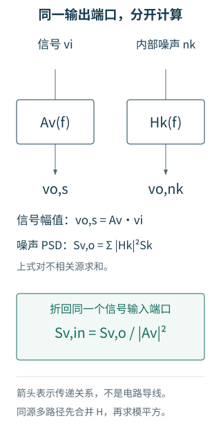

# 7.2 器件会发声，电路决定我们听到多少

一个没有外加电流的电阻仍处于热平衡。载流子的平均定向运动可以为零，微观运动却没有停止；端口电压的平均值为零，不代表均方值也为零。

## 电阻的串联电压与并联电流

经典低频条件 $hf\ll kT$ 下，温度为 $T$ 的理想电阻有单边热噪声 PSD

$$
S_{v,R}=4kTR,\qquad S_{i,R}=\frac{4kT}{R}.
$$

$k=1.380649\times10^{-23}$ J/K，温度必须用开尔文。前者用无噪声电阻串联电压源表示，后者用同一个电阻并联电流源表示。二者是同一端口的戴维南与诺顿表示，**不能作为两个独立来源再相加**。

在 300 K，10 kΩ 的开路 ASD 约为 12.9 nV/√Hz。提高电阻会增大开路电压噪声，却减小短路电流噪声；这不矛盾，因为负载和被比较的量变了。给电阻并联一个电容，端口高频电压被压低，积分结果将在后文变成 $kT/C$。

热噪声没有提供可提取的永动能量。连接到同温度负载后，双方都在涨落，净能量交换保持热平衡。上式也不能无限外推到量子频率或极低温条件。

## MOS：先用沟道电流噪声建立尺度

对长沟道、强反型、饱和 MOS，常用近似为

$$
S_{i_d,\mathrm{th}}\simeq4kT\gamma g_m,\qquad\gamma\simeq\frac23.
$$

它是沟道漏源之间的等效电流源，方向约定任意，但在同一推导中要保持一致。电流流出漏端时，会流入源端，不能把它当成两个不相关的注入源。

若信号通过跨导 $g_m$ 变成漏电流，则等效栅端电压噪声近似为

$$
S_{v,\mathrm{in,th}}\simeq\frac{S_{i_d,\mathrm{th}}}{g_m^2}
=\frac{4kT\gamma}{g_m}.
$$

这个关系回答一个常见疑问：沟道电流噪声随 $g_m$ 增加，为什么低噪声设计还常追求较大的 $g_m$？因为信号电流增长得更快。比较输入参考 PSD 时，分母是 $g_m^2$。

这里的 $\gamma=2/3$ 不是所有工艺、偏置与沟道长度的普遍常数。弱反型的噪声描述、短沟道效应、串联电阻、体区网络和高频感应栅噪声需要相应模型。真实 BSIM 的沟道噪声表达式也可能使用有效导电参数，而不是恰好等于上述 $\gamma g_m$。

## 低频为什么抬起来

界面和氧化层附近的陷阱占据状态会变化，载流子数目与迁移率随之涨落。许多时间尺度叠加，在一段频带内形成近似 $1/f^\alpha$ 的频谱。用于尺寸直觉的栅端表示可以写成

$$
S_{v,\mathrm{in,1/f}}(f)\simeq
\frac{K}{C_{\mathrm{ox}}^2WL f^\alpha},\qquad\alpha\approx1.
$$

此处 $K$ 的单位随这个定义和 $\alpha$ 而定。不同教材、模型卡对 $K_f$ 与 $C_{\mathrm{ox}}$ 次幂的约定不同，不能只抄一个参数数值进来。公式强调的是：在近似成立、偏置可比的条件下，增加栅面积通常能降低输入参考低频噪声。

把简化白噪声写成 $S_0$、闪烁项写成 $S_0f_c/f$，交界频率满足两项相等：

$$
S_v(f)=S_0\left(1+\frac{f_c}{f}\right).
$$

$f_c$ 不是电路极点，也不是频谱突然转折的边界；总 PSD 在这里是每一项的两倍。电路由多个器件构成时，经过不同传递函数后的总闪烁/非闪烁交点，更不能直接叫作某一只 MOS 的工艺常数。

## 输出噪声怎样折回输入

考虑有定义的电压输入端口，信号增益为 $A_v(f)=V_o/V_i$。把电路自身输出噪声用一个放在理想输入端的等效电压源表示：

$$
S_{v,\mathrm{in}}(f)=\frac{S_{v,o}(f)}{|A_v(f)|^2}.
$$

两者在该频率产生相同的输出噪声。它让我们比较放大器自身噪声与微弱输入信号，而不被增益差异迷惑。若增益接近零，折算可能很大甚至失去实用意义；这表示这个端口已很难传递该频率的信号。

一个内部源的贡献是 $S_{v,o,k}=|H_k|^2S_k$。$H_k$ 若将电流变成电压，单位是 Ω；若将电压变成电压，则单位是 V/V。先检查单位，常能发现漏掉平方或误用 ASD 的错误。

图 7-1　等效输入源不等于某个真实的栅电压波动。它把不同内部路径的输出效应统一换算到指定信号端口。图中的独立源按 PSD 合成；同一源的多条路径应先合并传递函数。

## 有源阻抗时，单个电压指标不够

实际信号源有阻抗 $Z_s$。放大器输入电流噪声会在它上面产生电压，输入网络的负载效应也会改变信号增益。通用输入模型需要串联电压噪声 $e_n$ 和并联电流噪声 $i_n$；定义二者对等效输入电压均以正号贡献时，

$$
S_{\mathrm{eq}}=S_e+|Z_s|^2S_i+2\operatorname{Re}\{Z_s^*S_{ei}\}.
$$

$S_{ei}=E[E(f)I^*(f)]$ 的谱定义须与相量约定一致。源电阻自身的热噪声另计。低源阻抗时电压噪声往往更重要，高阻抗传感器则可能受电流噪声限制。因此“输入噪声更低”必须附上源阻抗和频带。

本章 OTA 的 `.noise v(o) Vdiff` 选择理想的差分电压源，正负输入由 $+V_{diff}/2$ 和 $-V_{diff}/2$ 驱动。它报告的是**理想电压驱动端口**的噪声，不包含外部传感器、前级驱动电阻或采样开关。

本章真实 GF180 模型究竟支持什么？

固定版本 GF180MCU 的 3.3 V 模型采用 BSIM 噪声设置 `fnoimod=1`、`tnoimod=0`。ngspice 的实际源向量给出每只 MOS 的总贡献、沟道项 `.id`、闪烁项 `.1overf`，以及其他非闪烁项；电阻 `Rref` 也进入分析。

正文将 `.1overf` 合计称为“模型闪烁项”，其余部分称为“非闪烁项”。后者不强行等同于一个理想 $4kT\gamma g_m$ 源。此模型/设置没有给我们一套可单独读取并验证的感应栅噪声互谱，不能据此制作虚假的相关性曲线。

GF 官方的低频噪声拟合说明涉及 10 Hz–100 kHz、指定尺寸与偏置的测试数据。本章使用不同尺寸，并把频谱计算延伸到更宽范围；那是紧凑模型的预测，不能当成该尺寸、该频率的实测精度保证。[官方说明](https://gf180mcu-pdk.readthedocs.io/en/latest/analog/model_parameters/LV/LV_2_3.html)与[实验记录](../实验/噪声/README.md)给出范围和版本。

继续：[把噪声源放回共源、跟随、共栅和共源共栅](03-单级放大器.md)。
