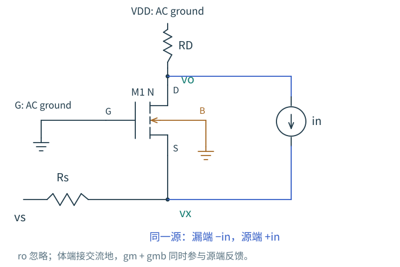
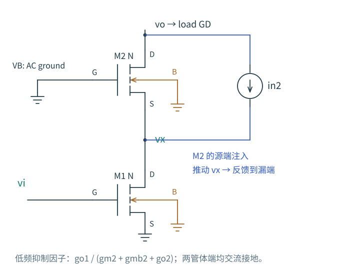

# 7.3 噪声源相同，走的路不同

同一只 MOS 的沟道噪声不会因为我们把电路叫作共源、共栅或跟随器就改变物理来源。改变的是端口约束，以及一个电流扰动能让哪些节点移动。先追踪这条路，再决定能否使用熟悉的输入参考公式。

本节先限制在低频小信号、固定工作点。用 $S_{i,M}$ 表示指定 MOS 的漏源电流噪声 PSD；需要长沟道估算时，再代入 $4kT\gamma g_m$。独立器件的热噪声先按不相关处理；同一器件漏端、源端的注入始终是同一个源。

## 共源级：输出电阻把信号和沟道噪声一起放大

源、体交流接地，漏端接负载 $R_D$，则 $R_o=R_D\parallel r_o$。输入电压和漏源噪声分别产生

$$
A_v=-g_mR_o,\qquad S_{v,o,M}=S_{i,M}R_o^2.
$$

提高 $R_o$，输出噪声会增加；输入参考却为

$$
S_{v,\mathrm{in},M}=\frac{S_{i,M}}{g_m^2}
\simeq\frac{4kT\gamma}{g_m}.
$$

所以较大的输出噪声本身不是坏结论。信号也以同样的 $R_o$ 获得了更大增益。改变负载后应比较输入参考，或直接比较同一测量滤波器后的 SNR。

负载电阻自身的并联电流 PSD 为 $4kT/R_D$。它也经 $R_o$ 到达输出，因此

$$
S_{v,\mathrm{in}}\simeq\frac{4kT\gamma}{g_m}
+\frac{4kT}{g_m^2R_D}.
$$

若信号源串联 $R_s$、栅极在所讨论的低频近似不开电流，源电阻再增加 $4kTR_s$。较大 $g_m$ 同时减小前两项，但不会消除信号源自己的热噪声。用 MOS 电流源替代 $R_D$ 时，应加入负载管的电流噪声；不能把较大的负载电阻当成免费的无噪声增益。

## 源跟随器：接近单位增益，也会增加噪声

漏、体交流接地，源端总负载电导为 $G_L$，暂忽略 $g_o$。输出节点对地的小信号电导是 $g_m+g_{mb}+G_L$。定义

$$
Z_s=\frac{1}{g_m+g_{mb}+G_L},\qquad A_v=g_mZ_s.
$$

沟道噪声流入源节点，得到 $S_{v,o,M}=|Z_s|^2S_{i,M}$，折算到栅端依旧是 $S_{i,M}/g_m^2$。这不是说跟随器完全等同于共源，而是信号与该噪声在这个近似下共享了同一个节点阻抗。

偏置电流源的噪声、负载电阻的噪声也直接流入源节点。若它们的合计为 $S_{i,L}$，其输入参考贡献为 $S_{i,L}/g_m^2$。体效应减小电压增益，却不通过这种“共同的阻抗”关系额外放大沟道输入参考项；它仍影响工作点、驱动和其他传递路径。

到高频，栅端源阻抗、$C_{gs}$、$C_{gd}$ 以及负载改变这些路径，需用完整的 $A_v(f)$ 和 $H_k(f)$。不能看到低频公式不含电容，就说跟随器噪声与带宽无关。

## 共栅级：漏源噪声的两个端点会互相影响

共栅输入接在源端，栅和体交流接地。信号源 $v_s$ 经 $R_s$ 驱动源节点 $v_x$，漏端接 $R_D$。令 $G_s=1/R_s$、$g_\Sigma=g_m+g_{mb}$，暂忽略 $g_o$。

若仅把沟道噪声看成漏端对地电流源，会漏掉一条路径：同一噪声流入源端，推动 $v_x$，继而通过跨导反馈到漏端。

图 7-2　蓝色的两端注入属于同一个噪声源。$v_x$ 能否移动，由信号源阻抗决定。体端明确交流接地，$g_{mb}$ 已计入 $g_\Sigma$。

把沟道噪声方向定为漏到源，KCL 给出

$$
(G_s+g_\Sigma)v_x=G_sv_s+i_n,\qquad
\frac{v_o}{R_D}=g_\Sigma v_x-i_n.
$$

因此信号增益与噪声传递分别是

$$
\frac{v_o}{v_s}=g_\Sigma R_D\frac{G_s}{G_s+g_\Sigma},\qquad
\frac{v_o}{i_n}=-R_D\frac{G_s}{G_s+g_\Sigma}.
$$

当 $R_s$ 很小时，源节点被钳住，沟道噪声几乎完整流入 $R_D$。当 $R_s$ 增大时，源节点移动产生的跨导电流抵消一部分输出噪声。但信号也受到输入分压，按外部源 $v_s$ 折算的沟道项仍为 $S_{i,M}/g_\Sigma^2$。

在相同近似下，漏端电阻的输出 PSD 是 $4kTR_D$，其输入参考为

$$
S_{v,\mathrm{in},R_D}=\frac{4kT}{g_\Sigma^2R_D}(1+g_\Sigma R_s)^2.
$$

这项随源阻抗增加而恶化。共栅低输入阻抗可以解决带宽或匹配问题，却不能只凭较小的某一个输出噪声项就宣布它更安静。有限 $r_o$ 会让漏端反过来影响源端，此时重新列节点方程。

## 共源共栅：上管的噪声为什么常常较小

下管 M1 将输入变成电流，上管 M2 维持较小的中间节点摆幅。这个“较小阻抗节点”也让 M2 的漏源噪声驱动中间节点，形成局部抵消。仅用 M2 的 $g_m$ 较大来解释还不够：我们需要知道抵消受什么限制。

图 7-3　下管源和两管体端交流接地。$g_1=g_{o1}$，$g_2=g_{o2}$，$k_2=g_{m2}+g_{mb2}+g_2$。上管的噪声先引起 $v_x$ 变化，再由受控电流抵消漏端注入。

输出负载电导为 $G_D$，定义行列式

$$
D=(g_1+k_2)(G_D+g_2)-g_2k_2.
$$

M2 的漏源噪声 $i_{n2}$ 方向从输出指向中间节点。两节点方程为

$$
\begin{bmatrix}g_1+k_2&-g_2\\-k_2&G_D+g_2\end{bmatrix}
\begin{bmatrix}v_x\\v_o\end{bmatrix}
=\begin{bmatrix}i_{n2}\\-i_{n2}\end{bmatrix}.
$$

解得 $v_o/i_{n2}=-g_1/D$。信号与下管噪声则分别给出

$$
A_v=-\frac{g_{m1}k_2}{D},\qquad
\frac{v_o}{i_{n1}}=-\frac{k_2}{D}.
$$

于是两个输入参考项为

$$
S_{v,\mathrm{in},1}=\frac{S_{i,1}}{g_{m1}^2},\qquad
S_{v,\mathrm{in},2}=\frac{S_{i,2}}{g_{m1}^2}
\left(\frac{g_{o1}}{g_{m2}+g_{mb2}+g_{o2}}\right)^2.
$$

当 $g_{o1}\ll g_{m2}+g_{mb2}$，上管贡献被显著压低。理想 $g_{o1}=0$ 的低频极限里，它会完全抵消；实际电路有限输出电阻、中间节点电容、栅偏置噪声和失配会破坏这个极限。高频尤其不能把上述常数直接用到整个积分范围。

共源共栅能提高增益、隔离输出摆幅，但不自动降低下管的输入参考噪声。其余量成本、偏置支路噪声和额外极点，仍需与[第 3 章](../03-单级放大器/05-共源共栅.md)和[第 6 章](../06-频率响应/04-共源共栅.md)一起判断。

继续：[参考支路和差分结构里，哪些噪声会相加](04-镜像差分与相关.md)。
