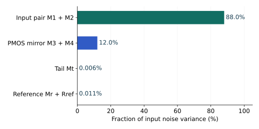

# 7.4 偏置也在抖，差分能消掉多少

前几章把电流源画成恒定箭头，是为了看清偏置与信号。做噪声分析时，这个箭头需要重新展开。参考管的噪声会改变公共栅压，输出管自己的沟道也会涨落；把输入短路并没有让这些电流停止。

## 普通电流镜：参考节点会把噪声复制过去

先看低频 NMOS 镜。参考管二极管连接，公共源端接地，栅漏节点对地电导约为 $g_{m,r}+g_{o,r}+G_B$；$G_B$ 是参考电流发生网络在该节点呈现的电导。参考管噪声会在此产生

$$
S_{v,b}=\frac{S_{i,r}+S_{i,B}}{(g_{m,r}+g_{o,r}+G_B)^2}.
$$

输出端被低阻抗测量时，输出电流噪声近似为

$$
S_{i,o}=S_{i,o,\mathrm{own}}+g_{m,o}^2S_{v,b}.
$$

上式假设两个器件及参考网络的原始源不相关。$G_B\ll g_{m,r}$、$g_o\ll g_m$ 时，参考管噪声以跨导比的平方复制到输出。1:1 镜并不只有一只输出管的噪声；相同管子的热噪声在这个近似下贡献相当。

若参考电流由电阻产生，电阻的 $4kT/R$ 也进入 $S_{i,B}$。若输出端具有有限阻抗，输出管 $g_o$、负载及节点电容都应加入完整传递函数。加大参考节点电容可以滤掉一部分高频偏置噪声，却同时延长建立时间；它不会去除低频闪烁噪声。

共源共栅镜的上管可能因局部反馈而受抑制，但参考栅偏置的噪声会走另一条路。分析时按实际连线展开偏置网络，不能把每一个标作 $V_B$ 的节点都默认为无噪声交流地。

## 差分对：先把每个源分成差模与共模

两只相同输入管，每只跨导为 $g_m$。匹配的电阻负载、理想尾电流源下，差分输入 $v_{id}$ 使两边电流变化分别为 $+g_mv_{id}/2$ 和 $-g_mv_{id}/2$，所以差分电流信号为 $g_mv_{id}$。

每只输入管的独立沟道噪声 PSD 为 $S_{i,n}$。差分输出相减，噪声并不因此相减为零：两个不相关源的方差仍相加。因此

$$
S_{v,\mathrm{in},n}=\frac{2S_{i,n}}{g_m^2}
\simeq\frac{8kT\gamma_n}{g_m}.
$$

这里的 $g_m$ 是**每一只管子**的跨导，不是两只相加。同样要说明输出是差分还是单端：单端信号增益少一半，同时各源到这一端的传递也改变；不能只改信号增益、沿用原来的噪声电压。

尾管噪声是另一回事。理想对称的电阻负载差分输出中，它同相推动两边，差分相减后抵消。两只输入管的独立噪声包含差模分量，尾源噪声则在这个极限下只激发共模。**抑制来自路径对称，不是因为“差分会消除噪声”。**

## 五管 OTA：镜像负载把单端输出变得有用，也带来噪声

PMOS 镜把左支路信号电流复制到右边，与右支路的反向变化相加，低频输出信号跨导约为 $g_{m,n}$。在理想镜像、忽略 $g_o$ 的近似下，两只 PMOS 的自身噪声也都会到达输出。用长沟道热噪声估算，

$$
S_{v,\mathrm{in,th}}\simeq
\frac{8kT\gamma_n}{g_{m,n}}
+\frac{8kT\gamma_p g_{m,p}}{g_{m,n}^2}.
$$

输入对希望较大 $g_{m,n}$，镜像负载却希望自身电流噪声不要太大。这解释了为什么“把所有管的跨导一起提高”不一定是最节省功耗的降噪方法。降低 PMOS 的跨导可以减轻它的热噪声，但会改变余量、参考节点阻抗及极点；长沟道和面积也会影响低频噪声及电容。

真实 OTA 的尾管贡献通常很小，但不会严格为零。有限 $r_o$、两边不同的漏压、镜像传递误差与内部极点，都让共模扰动有机会转成单端输出。参考管和电阻也通过尾栅偏置进入电路。

图 7-4　基准 OTA，typical、27 °C、$V_{DD}=3.3$ V、$V_{CM}=1.4$ V、$C_L=1$ pF、100 Hz–100 kHz。份额按**积分方差**计算；输入对约占 88.0%，PMOS 镜约占 12.0%，尾管及参考网络合计约 0.017%。这些小贡献仍保存在原始数据中，图中没有把它们宣称为零。

## 一条源走两条路：先相量相加，再求功率

设同一个噪声 $n$ 沿 $H_1$、$H_2$ 两路到达输出。正确结果为

$$
S_y=|H_1+H_2|^2S_n.
$$

若写成 $(|H_1|^2+|H_2|^2)S_n$，就把同一个源误当成两个独立源，丢掉了抵消或增强。上一节共栅、共源共栅的漏源双端注入，正是这个问题在节点方程中的形式。

更一般地，令零均值源向量为 $\mathbf n$，输出为 $Y=\mathbf h\mathbf N$，$\mathbf h$ 是行向量。单边互谱矩阵 $\mathbf S_n$ 的元素定义为 $S_{ij}=E[N_iN_j^*]$ 的谱密度，则

$$
S_y=\mathbf h\mathbf S_n\mathbf h^\dagger
=\sum_i|H_i|^2S_{ii}
+2\operatorname{Re}\sum_{i<j}H_iH_j^*S_{ij}.
$$

互谱一般是复数，包含相位；$|S_{ij}|^2\le S_{ii}S_{jj}$。频率相关的复相干度不能无条件用一个实常数 $\rho$ 替代。

协方差形式怎样连接到总噪声？

对同一时刻的实随机源向量，$\mathbf C=E[\mathbf n\mathbf n^T]$。实线性组合 $y=\mathbf a^T\mathbf n$ 的方差为 $\sigma_y^2=\mathbf a^T\mathbf C\mathbf a$。$\mathbf C$ 半正定，保证方差不会为负。

对于带记忆的电路，不能只在时域用一个常数权重 $\mathbf a$。每个源先经频率相关传递函数，按上面的互谱矩阵求输出 PSD，再积分：

$$
\sigma_y^2=\int_{f_L}^{f_H}\mathbf h(f)\mathbf S_n(f)\mathbf h^\dagger(f)df.
$$

例如两个 RMS 都为 $\sigma$ 的源，相关系数为 $\rho$，其和、差的方差分别为 $2\sigma^2(1+\rho)$ 和 $2\sigma^2(1-\rho)$。当 $\rho=1$，差为零；当 $\rho=0$，和与差同样吵。差分电路通过共同的噪声源形成相关的支路电压，正是前一个极限的电路来源。

实际 MOS 高频噪声模型可能在器件内部包含相关机制。仿真器已合成的“器件总贡献”应作为模型结果使用，不能拆成自己猜测的独立源。本章仅对当前模型真正输出的源分组，并验证分组总和等于总输出 PSD；不从分组相加反推所有物理机制都独立。

继续：[选中一段频带，究竟积了什么](05-带宽与积分.md)。
