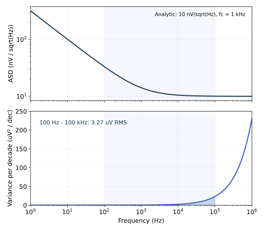

# 7.5 频谱不是噪声预算，积分以后才是

在 1 kHz 读到一个很低的 ASD，并不能证明电路满足噪声指标。低频闪烁噪声可能在更低处抬升，高频白噪声又可能铺得很宽。预算要求的是指定测量方式下的总均方值。

## 预测：把上限扩大十倍，会增加多少

先看输入参考 PSD 的简化模型

$$
S_v(f)=S_0\left(1+\frac{f_c}{f}\right),\qquad
\sigma_v^2=S_0\left[(f_H-f_L)+f_c\ln\frac{f_H}{f_L}\right].
$$

白噪声在每一赫兹分到同样多的方差，因此高频十倍频程比低频十倍频程包含更多白噪声。$1/f$ 项则在每个十倍频程分到同样的方差 $S_0f_c\ln10$。两者的积分规律完全不同。

拖动下面的上限之前，先判断：在当前频带里，扩一段高频和加一段低频，哪一个更值得担心？

<!-- interactive: noise-band -->

图 7-5　静态回退采用解析模型：$\sqrt{S_0}=10$ nV/√Hz，$f_c=1$ kHz，积分 100 Hz–100 kHz，得到约 3.27 µV RMS。上图 ASD 的视觉面积不等于方差；下图纵轴为 $d\sigma^2/d\log_{10}f=\ln(10)fS_v(f)$，因此在对数横轴下，着色面积才直接对应方差。交互中的 GF180 曲线来自固定电路 `.noise`，不是在线 SPICE。

移动低频下限时，闪烁噪声积分按 $\ln(f_H/f_L)$ 变化。把 $1/f$ 模型一直积到零会发散，不能写成有限 RMS。实际观测时间、交流耦合或数字处理决定低端测量响应；简单用 $1/T_{obs}$ 当下限只是近似，精确估计应带上实际窗口或滤波器的权重。

## 3 dB 带宽不等于噪声带宽

若输出噪声来自一个白噪声源 $S_0$，经传递函数 $H(f)$，则

$$
\sigma_o^2=S_0\int_0^\infty|H(f)|^2df
=S_0|H(0)|^2B_n,
\quad B_n=\int_0^\infty\left|\frac{H(f)}{H(0)}\right|^2df.
$$

$B_n$ 是等效噪声带宽：找到一个高度相同的理想矩形频响，使平方幅度的面积相同。单极点低通 $H/H(0)=1/(1+jf/f_p)$ 给出

$$
B_n=\int_0^\infty\frac{df}{1+(f/f_p)^2}
=\frac\pi2f_p.
$$

直接用 $S_0f_{3\mathrm{dB}}$ 会低估方差约 36.3%，或低估 RMS 约 20.2%。这个系数只属于单极点白噪声条件；多极点、峰化、零点和不同源的路径不能共用一个未经证明的 $B_n$。

## 一个可以亲手验算的结果：kT/C

无噪声电容 $C$ 并联在电阻 $R$ 的输出端，串联电阻噪声经 RC 低通到达电容。于是

$$
\sigma_C^2=4kTR\cdot\frac\pi2\cdot\frac{1}{2\pi RC}
=\frac{kT}{C}.
$$

增大 $R$ 提高低频 PSD，却以相同比例缩小噪声带宽，总均方电压不变。这个平衡结果也与电容储能的热平衡相符。它不意味着任意噪声源接在任意电容上都等于 $kT/C$，也不直接覆盖开关瞬态、相关双采样或有源滤波器。

本章先用 10 kΩ、1 nF、27 °C 的真实 `.noise` 网表校准单边系数和单位。`set sqrnoise` 后频谱输出为 V²/Hz，积分输出为 V²，独立积分再开平方；RC 的解析积分和仿真一致，记录见[实验资源](../实验/噪声/README.md)。

## 输入参考积分：除以增益以后，输出极点去哪了

最容易误用的一步是先积分输出，再除以直流增益。真正按频率定义的输入参考方差是

$$
\sigma_{\mathrm{in}}^2=\int_{f_L}^{f_H}
\frac{S_o(f)}{|A_v(f)|^2}df.
$$

而下面这个量是另一种约定：

$$
\sigma_{o\to\mathrm{DC}}^2=\frac{1}{|A_v(0)|^2}
\int_{f_L}^{f_H}S_o(f)df.
$$

只有在所讨论频带内 $|A_v(f)|\approx|A_v(0)|$ 时，二者才近似相同。第二个量也可以有用：它把实际输出噪声与按直流增益放大的低频信号比较。但必须说明比较的信号和滤波方式，不能把它冒充第一个定义。

一个理想输入噪声源与信号共同经过 $A_v(f)$，输出 PSD 为 $S_{in}|A_v|^2$。逐点折回输入时，这个极点就被除掉了。因此增加输出电容可以降低输出 RMS，却未必改变输入参考谱。把白色输入参考噪声从零积到无穷会发散，也不代表真实输出噪声无限；它们描述的观察方式不同。

| 同一基准 OTA，100 Hz–1 MHz | 数值 |
|---|---:|
| 逐点折回输入再积分 | 34.64 µV RMS |
| 输出 RMS 除以直流增益 | 30.46 µV RMS |

这段频带已经跨越约 232 kHz 的主带宽，两个值的差异具有实际意义。对真实信号检测，最稳妥的是明确测量滤波器 $W(f)$，计算 $\int |W|^2S_o df$，并用同一滤波器处理信号。对于宽带信号，单个“输入 RMS”还不能代替完整的 SNR 分析。

> 先规定带宽，再谈噪声。缩小频带可以降低总噪声，但如果同时删掉了需要的信号或延长了测量时间，这个代价也属于设计的一部分。

继续：[用这些判断修改真实的五管 OTA](06-噪声预算与设计.md)。
