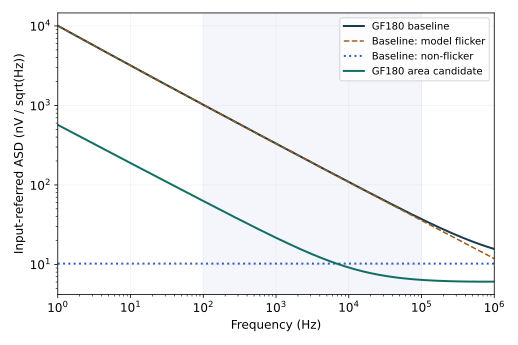

# 7.6 花电流，还是花面积？设计一次安静的 OTA

第 5 章的 OTA 已经建立工作点，第 6 章给出了它约 206 V/V 的低频增益和 1 pF 负载下约 232 kHz 的开环带宽。现在加入一个新要求：在输入为 100 µV RMS 的小信号测量中，放大器自身不能掩盖信号。

## 在运行噪声仿真前，把要求写下来

本次采用标称教学规格，见先于噪声实验写下的 [design.json](../实验/噪声/design.json)：

| 条件或指标 | 定义 |
|---|---|
| 电源、共模与温度 | 3.3 V、1.4 V、27 °C，typical |
| 负载 | 1 pF；理想差分电压驱动 |
| 信号频带与幅度 | 100 Hz–100 kHz；100 µV RMS |
| 放大器输入参考噪声 | 该频带内不超过 4 µV RMS |
| 低频增益、3 dB 带宽 | 至少 150 V/V、至少 100 kHz |
| 总静态电源功耗 | 不超过 0.45 mW，包含参考支路 |

这不是完整产品规格：没有给失真、闭环建立、输入电容上限和 PVT 良率。因此后文“满足”仅指表中的标称条件。输入参考噪声目标对应至少约 28 dB 的上述信号/噪声比，尚未计入传感器与前级噪声。

图 7-6　沿用第 5 章电路及端口。M1/M2 为输入对，M3/M4 为 PMOS 有源镜，Mt 为尾管；Mr 与 Rref 构成参考支路。所有 NMOS 体接地，PMOS 体接 VDD。基准尺寸和工作点不因加入噪声分析而重新调节。

## 先看主导机制，再决定改什么

基准结果为 **28.25 µV RMS**，明显未满足 4 µV。100 Hz–100 kHz 内，模型闪烁项约占总方差的 **98.7%**；器件位置上，输入对约占 88.0%，PMOS 镜约占 12.0%。

这两种分类回答不同问题：一个按物理机制分，一个按器件位置分。不能把“输入对 88%”与“闪烁项 98.7%”当成互斥份额相加。

图 7-7　实线为完整模型输入参考 ASD；基准的虚线分别为模型闪烁项与非闪烁项，虚线不能按幅度直接相加。输入端口为理想差分电压，typical、27 °C、3.3 V、1.4 V 共模、1 pF。面积方案改变器件尺寸并重新求工作点，不是把基准曲线手动缩小。

基准的总输出闪烁/非闪烁交点约为 1.35 MHz，面积方案约为 13.8 kHz。它们由各源传递后的频谱计算得到，不是输入管单独的测量 $f_c$，也不是 OTA 极点。

也可以用上一节的长沟道热噪声式核对量级。把实际工作点的 $g_{m,n}=0.309$ mS、$g_{m,p}=0.0836$ mS 代入，并暂取两种管子的 $\gamma=2/3$，得到约 **9.54 nV/√Hz**。真实模型在 1 kHz 的非闪烁输入 ASD 约为 **10.23 nV/√Hz**。这个接近程度支持了跨导与负载的量级判断，却不能证明长沟道式等于 BSIM；后者还保留实际传递路径和其他非闪烁机制。更不能用这个约 10 nV/√Hz 的数值，代替低频闪烁主导的完整积分。

## 三个直觉，逐个接受检验

**只把输入管加宽一倍。** 固定尾偏置，输入跨导会增加，输入管面积也增加。但 PMOS 镜的噪声仍然存在；工作点和节点电容同样会改变。

**把所有管的宽度和偏置电流一起加倍。** 长沟道固定反型程度下，$g_m$ 大致随电流增加，白噪声输入 PSD 下降。但功耗约翻倍；闪烁噪声仍由面积和模型偏置共同决定。

**只把输出电容增到 5 pF。** 它更像一个输出低通滤波动作。信号带宽也缩小，而逐点输入参考的共同输出滤波会被除掉。它不能无代价解决输入噪声指标。

| 方案 | 输入 RMS / µV | 增益 / V/V | 3 dB / kHz | 功耗 / mW | 判定 |
|---|---:|---:|---:|---:|---|
| 原始基准 | 28.25 | 206.0 | 232.1 | 0.391 | 噪声失败 |
| 仅输入宽度 ×2 | 18.25 | 242.1 | 265.5 | 0.392 | 噪声失败 |
| 全部宽度、电流 ×2 | 19.98 | 208.0 | 457.2 | 0.782 | 噪声、功耗失败 |
| 基准、仅负载 5 pF | 28.25 | 206.0 | 47.1 | 0.391 | 噪声、带宽失败 |
| 追加面积方案 | **2.59** | **335.4** | **276.2** | **0.394** | 四项标称指标满足 |

全部噪声数值采用同一 100 Hz–100 kHz 积分定义。5 pF 行是一个控制实验，负载条件有意不同，不能拿它当作 1 pF 规格的候选合格者。

## 看到失败以后，再花面积

先声明的三种尺寸/电流候选都未解决问题，所以保持原指标不动，在 [adjustment.json](../实验/噪声/adjustment.json) 中记录追加方案：每个输入支路由十只 100/1 µm 的 MOS 并联；每只 PMOS 的宽和长同时增加十倍，成为约 37.08/10 µm。尾管、参考管和 Rref 不变。

与基准每只输入管 10/1 µm 相比，每支路输入栅面积增加到 100 倍；PMOS 栅面积也增加到 100 倍，保持其 W/L。较大的输入宽度在近似相同电流下提升 $g_m/I_D$，较大的面积压低模型中的低频噪声。它花的是显著的面积和输入驱动负担。

工作点确实变了：输出从约 1.659 V 变为 1.597 V，尾节点从 0.373 V 变为 0.604 V，输入支路总跨导从 0.309 mS 增到 0.947 mS。每个候选都重新执行 `.op`、AC 和 `.noise`，并检查核心器件的模型饱和余量为正。

这组结果还提醒我们：更低噪声并不代表所有速度指标都更好。面积方案的单位增益频率约 40.3 MHz，基准约 47.4 MHz；即使 3 dB 带宽提高，内部极点、零点和增益分布仍发生变化。这里没有以单个交越频率宣称闭环稳定。

为什么不用一个 W=1000 µm 或 m=10？

固定版本模型的有效宽度分箱没有覆盖单只 1000 µm，直接写该宽度或其 `nf=10` 变体都未被正确接受。更容易漏掉的问题是：模型子电路虽声明 `m` 参数，却未将它传给内部 MOS 实例；实际探针中 `m=1` 与 `m=10` 的工作点相同。

因此这里显式实例化十个合法的 100 µm 单元，并把各单元 PSD 按当前模型的独立实例假设相加。没有修改模型文件，也没有悄悄把失败网表当成完成的面积扫描。

每个单元仍采用教学网表的 AD=AS=5 µm²、PD=PS=21 µm，所以并联后总结面积与周长也增加。这不是一种寄生几何完全等价的版图实现。输入驱动、真实共享扩散区、失配、版图相关性、工艺角与测量精度均需后续验证。

## 把经验整理成可以复用的设计判断

热噪声主导时，长沟道估算 $S_{v,in}\propto1/g_m$，所以 RMS 对跨导只按平方根改善。强反型饱和平方律给出 $g_m\propto\sqrt{I_DW/L}$：固定 W/L 增电流时，热噪声 RMS 大约按 $I_D^{-1/4}$ 改善，并不划算。固定反型程度、宽度与电流一起扩展时，$g_m\propto I_D$，代价是功耗和电容一起增长。

闪烁主导时，更大的有效面积通常比仅加电流更直接，但小面积管的贡献可能逐渐被其他管取代。应该对**方差**分预算：例如输入对分 8 µV²、负载分 6 µV²、其余分 2 µV²，合计是 16 µV²，也就是 4 µV RMS；不能给各组分别分 4 µV 再直接相加。

面积方案在当前目标带内的闪烁份额已降到约 47.3%。继续只扩大面积，非闪烁项、驱动能力和电容成本会越来越突出。下一轮若有输入电容或面积上限，必须重新提出完整规格，而不是把这一方案当成普遍最优解。

## 自检：能否在仿真前说出方向

1. 若信号本来就从 10 Hz 开始，把积分下限从 10 Hz 改成 100 Hz，为什么不能算免费降噪？
2. 两个候选输出 RMS 一样，增益相差十倍，它们对同一个输入传感器是否一样好？还缺哪些条件？
3. 共源共栅上管低频噪声被抑制，为什么它的栅偏置噪声仍需单独分析？
4. 输入对已经只占总方差 10% 时，即使把它完全消除，总 RMS 最多改善多少？

核对思路

第一题改变了测量任务，可能损失所需信号。第二题至少还要比较输入参考、信号源阻抗、频响和观察滤波器。第三题中栅偏置激励与漏源双端注入不是同一传递路径。第四题总方差最多变为原来的 0.9，总 RMS 变为 $\sqrt{0.9}\approx0.949$，只改善约 5.1%。

本章到这里，统计量已经与电路设计连上：噪声由器件产生，由拓扑传递，由测量频带汇总，再由规格决定是否值得付出面积、电流或速度。完整的[实验与 Windows 复现记录](../实验/噪声/README.md)保留所有失败候选与原始数据。
